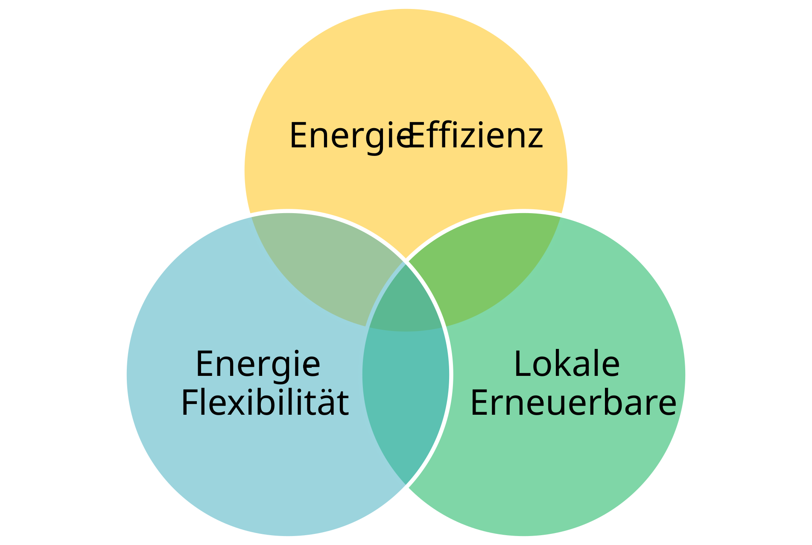

# Noch ein Standard? {#sec-einfuehrung}

::: {.lead}
Von klimaneutralem Bauen zu quantitativen Anforderungen an Gebäude und Quartiere
:::

## Herausforderungen des klimaneutralen Bauens

Klimaneutrales Bauen erfordert mehr als die Reduktion des Heizwärmebedarfs. Gebäude müssen mit erneuerbarer Energie versorgt werden, fossile Energieträger ersetzen und die Treibhausgasemissionen aus Errichtung, Instandhaltung und Betrieb begrenzen. Hinzu kommen die Auswirkungen der Alltagsmobilität, die wesentlich von Standort und Quartiersgestaltung beeinflusst werden.

Gleichzeitig verändert die Umstellung auf erneuerbare Energieträger die Rolle der Gebäude im Energiesystem. Bei Photovoltaik und anderen zeitlich schwankenden erneuerbaren Quellen kommt es auch darauf an, wann Energie benötigt, gespeichert, bezogen oder abgegeben wird. Gebäudebetrieb, Energieversorgung und Mobilität sind deshalb zunehmend gemeinsam zu betrachten.

Ein künftig erneuerbares Energiesystem macht Energieeffizienz und Flexibilität auf Gebäudeebene nicht überflüssig – im Gegenteil: Nationale Energie- und Klimaszenarien setzen erhebliche Energieeinsparungen voraus. Damit die angestrebten Ausbau- und Klimaziele erreicht werden können, müssen Gebäude ihren Energiebedarf entsprechend reduzieren und zunehmend flexibel gestalten.

**Energieeffizienz, lokale erneuerbare Energieerzeugung und Energieflexibilität** bilden daher drei sich ergänzende Handlungsfelder. Ihr Zusammenspiel ist sowohl auf Gebäude- als auch auf Quartiersebene relevant.

{#fig-peq-saeulen width="65%"}

## Vom Nachhaltigkeitskriterium zum quantitativen Klimaziel

Bestehende Instrumente zur Gebäude- und Quartiersbewertung berücksichtigen wichtige Qualitäten wie Energieeffizienz, Ressourcenschonung, Komfort und Standort. Eine gute Gesamtbewertung beantwortet jedoch nicht automatisch die Frage, **welchen messbaren Beitrag ein konkretes Vorhaben zur Erreichung übergeordneter Energie- und Klimaziele leisten muss**.

Dafür sind zwei Festlegungen erforderlich: Einerseits müssen Energie- und Treibhausgaswirkungen innerhalb nachvollziehbarer räumlicher, zeitlicher und funktionaler Grenzen bilanziert werden. Andererseits ist zu begründen, **welches Ergebnis als ausreichend gilt** und wie Anforderungen auf Projekte mit unterschiedlichen Voraussetzungen verteilt werden.

Eine reine Jahresbetrachtung kann sommerliche Überschüsse und winterlichen Netzbezug verdecken. Eine positive Betriebsenergiebilanz wiederum sagt für sich genommen noch nichts darüber aus, ob die Emissionen aus Baustoffen und Errichtung mit einem langfristigen Klimaziel vereinbar sind. Für eine quantitative Bewertung müssen solche Unterschiede ausdrücklich berücksichtigt werden.

Hier setzt der klimaaktiv Standard für Plus-Energie-Quartiere an. Er verbindet einen aus nationalen Energie- und Klimazielen abgeleiteten Bewertungsmaßstab mit der Bilanzierung konkreter Projekte. **Was** der Standard fordert, beschreibt @sec-standard. **Wie** die Zielwerte hergeleitet werden, erläutert @sec-allokation und @sec-zielwert-thg; die Systemgrenzen und Bilanzierungsregeln sind in @sec-bilanzregeln dokumentiert.

::: {.callout-note title="Gebäude oder Quartier?"}
Obwohl der Standard aus dem Konzept der Plus-Energie-Quartiere hervorgegangen ist, lässt sich seine Bewertungsmethodik sowohl auf einzelne Gebäude als auch auf Gebäudegruppen und ganze Quartiere anwenden. Unterschiedliche Standort- und Bebauungsbedingungen werden durch entsprechende Kontextfaktoren berücksichtigt.
:::