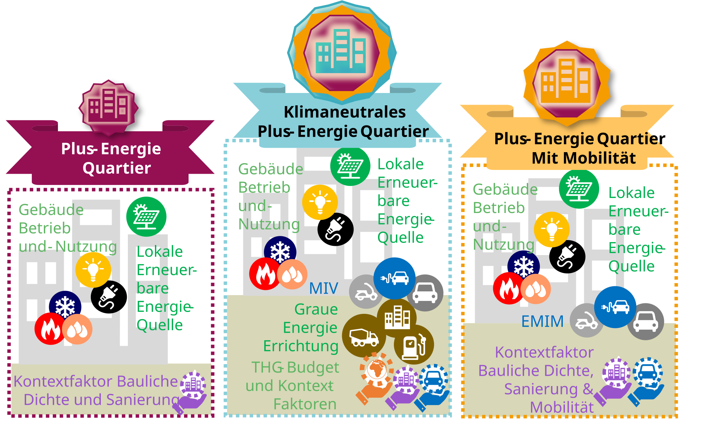

::: {.lead}
Der klimaaktiv Standard für Plus-Energie-Quartiere 
:::
::: {.callout-note appearance="simple" icon=true}
 vom 
:::

# Der Standard {#sec-standard}

Der klimaaktiv Standard für Plus-Energie-Quartiere definiert quantitative Anforderungen an die Energie- und Treibhausgasbilanz von Quartieren. Er ermöglicht es, Neubau- und Sanierungsvorhaben anhand eines gemeinsamen, aus übergeordneten Energie- und Klimazielen abgeleiteten Bewertungsmaßstabs zu beurteilen.

## Ziel und Bewertungsanspruch

Ein Quartier soll nicht nur möglichst wenig Energie benötigen, sondern einen angemessenen Beitrag zu einem erneuerbaren und klimaneutralen Energiesystem leisten. Der Standard betrachtet dafür das Zusammenspiel von Energiebedarf, erneuerbarer Energieaufbringung, Mobilität und Lebenszyklusemissionen.

Die Anforderungen sind **quantitativ, kontextabhängig und überprüfbar**. Sie berücksichtigen unterschiedliche bauliche und räumliche Ausgangsbedingungen, ohne die Ausrichtung an den übergeordneten Zielen aufzugeben.

## Die drei Qualitätsstufen

Der Standard unterscheidet drei aufeinander aufbauende Qualitätsstufen:

| Qualitätsstufe | Bewertungsumfang | Zentrales Kriterium |
|---|---|---|
| **Plus-Energie-Quartier** | Gebäudebetrieb einschließlich gebäudebezogener Stromanwendungen | Positive bewertete Primärenergiebilanz |
| **Plus-Energie-Quartier mit Mobilität** | Gebäudebetrieb und zugeordnete motorisierte Individualmobilität | Positive bewertete Primärenergiebilanz einschließlich Mobilität |
| **Klimaneutrales Plus-Energie-Quartier** | Zusätzlich Lebenszyklusemissionen aus baulichen Prozessen, Betrieb und Mobilität | Positive bewertete Primärenergiebilanz und Einhaltung des kumulierten THG-Budgets |

Die dritte Qualitätsstufe verwendet im dokumentierten Referenzverfahren ein Treibhausgasbudget von **320 kg CO₂e/m² BGF**. Dieses gilt unter den festgelegten Systemgrenzen und Szenarioannahmen. Seine Herleitung wird in @sec-zielwert-thg erläutert; die berücksichtigten Lebenszyklusprozesse beschreibt @sec-bilanzregeln.

{#fig-standard-systemgrenzen width="100%"}

## Bewertungsgrößen und Erfüllungskriterien

Die Bewertung beruht auf zwei komplementären Größen:

**Primärenergiebilanz:** Energiebedarf, erneuerbare Aufbringung und Energieaustausch mit den umgebenden Netzen werden nach den festgelegten Bilanzierungsregeln bewertet. Die stündlich berechneten Energieflüsse werden mit zeitabhängigen Faktoren gewichtet. Eine positive Bewertungsbilanz ist Voraussetzung für alle drei Qualitätsstufen.

**Treibhausgasbilanz:** Für die Klimaneutralitätsstufe werden die Emissionen aus den definierten baulichen Prozessen, dem Gebäudebetrieb und der Mobilität über den Bewertungszeitraum kumuliert und mit dem zugeteilten THG-Budget verglichen.

Die Bewertung unterscheidet damit zwischen **dem berechneten Energie- und Emissionsergebnis eines Quartiers** und **dem Maßstab, an dem dieses Ergebnis beurteilt wird**.

Die entsprechenden Bilanzierungsverfahren und Systemgrenzen erläutert @sec-bilanzregeln.

## Kontextabhängige Anforderungen

Nicht jedes Quartier verfügt über dieselben Voraussetzungen. Insbesondere bauliche Dichte, Standort und Gebäudebestand beeinflussen, welche Beiträge zur Energiewende lokal erbracht werden können.

Der Standard berücksichtigt dies über drei Kontextfaktoren:

- **Dichte:** Bei geringer baulicher Dichte wird ein höherer energetischer Beitrag verlangt; dichte Quartiere können eine Gutschrift erhalten.
- **Mobilität:** Ein aus der nationalen Energieallokation abgeleitetes Budget wird den Nutzungen zugeordnet und dem tatsächlich bilanzierten Mobilitätsbedarf gegenübergestellt.
- **Sanierung:** Bestandsvorhaben erhalten eine festgelegte Entlastung, die besonderen Einschränkungen bei der energetischen Verbesserung Rechnung trägt.

Die Kontextfaktoren verändern die **energetische Bewertungsanforderung**, nicht die tatsächlich benötigte oder erzeugte Energie. Eine positive Bewertungsbilanz kann daher auch dann erreicht werden, wenn das Quartier physisch keinen Nettoenergieüberschuss aufweist.

Die Herleitung der Zielwerte beschreiben @sec-allokation und @sec-zielwert-thg, die Berechnung und Anwendung der Kontextfaktoren @sec-kontext.

## Bedeutung und Grenzen der Bewertung

Eine erfüllte Qualitätsstufe zeigt, dass ein Quartier die definierten Anforderungen **unter den festgelegten Systemgrenzen, Faktoren und Projektannahmen** erreicht.

Die Bewertung soll  eine konsistente Grundlage bieten, um Quartierskonzepte zu beurteilen, Varianten zu vergleichen und die Zielerreichung im Planungsprozess nachzuweisen.

Für die quantitative Bewertung steht das klima**aktiv** PEQ-Nachweistool zur Verfügung. Die [Wissensplattform](https://simonschaluppe.github.io/peexcel/) bietet weiterführende Informationen zum Bewertungsmodell und zur Anwendung des Tools.

Die Gültigkeit des Bewertungsmaßstabs hängt von den verwendeten Szenarien, Parametern und methodischen Festlegungen ab. Grenzen und Weiterentwicklung werden in @sec-fortschreibung dokumentiert.