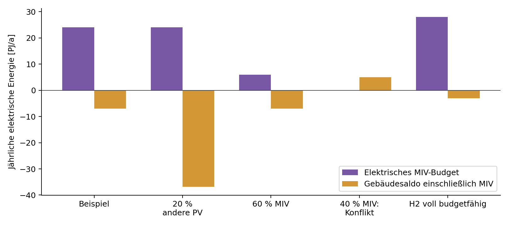

# Sektorale Energieallokation {#sec-allokation}

::: {.lead}
Vom nationalen Stromsystem nach UBA Transition 2040 zum Energiebeitrag des Gebäudesektors und zum MIV-Budget
:::

Das nationale Zielbild in @sec-zielszenario beschreibt Erzeugung und Bedarf im Zieljahr 2040. Die **sektorale Allokation** legt fest, welche Anteile zentral erzeugter erneuerbarer Energie und welche Strombedarfe den einzelnen Sektoren zugeordnet werden. Zwei Ergebnisse sind für die PEQ-Kalibrierung erforderlich: (1) der dem Gebäudesektor zugeordnete Stromsaldo als nationaler Kalibrierungsmaßstab und (2) das **erneuerbare Mobilitätsbudget**, das später nutzungsbezogen auf Quartiere verteilt wird. Beide Ergebnisse stammen aus demselben Zuordnungsmodell; das Mobilitätsbudget darf nicht erst nachträglich unabhängig von der Sektorbilanz festgelegt werden.

## Zuordnungsprinzip und Bilanzgrenzen

Im Ausgangsmodell werden zentrale erneuerbare Energiequellen vorrangig für Industrie und öffentlichen Verkehr verwendet. Der verbleibende Anteil bildet die Grundlage für eine virtuelle Deckung des motorisierten Individualverkehrs (MIV). Gebäude übernehmen gleichzeitig die Verantwortung für ihren betrieblichen Bedarf, den ihnen zugerechneten MIV-Bedarf und den zugewiesenen lokalen erneuerbaren Erzeugungsbeitrag [@schneider2020lokal, Abschn. 3.1.4 und 5.1; @schneider2023context, Abschn. 6.1–6.2].

Diese Zuordnung ist eine **Bilanz- und Lastenverteilungsregel** und keine Aussage über physisch getrennte Stromnetze. Die hier beschriebene Neukalibrierung nutzt UBA Transition 2040 statt des historischen Referenzszenarios. Sämtliche Zuordnungen müssen deshalb anhand der neuen Strombilanz erneut vorgenommen und abgestimmt werden.

## Zentrale und dezentrale erneuerbare Erzeugung

Für die Allokationslogik wird zunächst ein zentral verfügbarer, **nicht aus PV stammender** erneuerbarer Strompool abgegrenzt. Darunter fallen entsprechend den bilanzierten Positionen insbesondere Wasserkraft, Windkraft sowie verfügbare Stromerzeugung aus Rückverstromung und Speichern. Die konkrete technische Zuordnung folgt den UBA-Kategorien und ihren Systemgrenzen; die Bezeichnung „zentral“ ist hier eine **Modellkategorie**, keine Aussage über Eigentum oder Anlagengröße.

**PV-Strom wird getrennt geführt**, insbesondere Gebäude-PV und PV außerhalb von Gebäuden. Welche Energiemenge an Gebäude-PV dem Gebäudesektor zugerechnet wird und wie sonstige PV-Erzeugung verwendet wird, ist ausdrücklich festzulegen. PV außerhalb von Gebäuden wird nicht stillschweigend dem nicht-PV-Mobilitätsbudget zugeschlagen.

Die Verfügbarkeit des zentralen Pools ist konsistent mit Energiesektor-Eigenverbrauch, Speichern, Umwandlungsbedarfen, Transportverlusten und Stromimporten zu berechnen. Insbesondere sind Elektrolyse-/Methanisierungs-Strombedarfe und die daraus folgende Rückverstromung **nicht als zwei unabhängige zusätzliche Energiequellen** zu bilanzieren. Ein- und Ausspeicherungen sowie Verluste werden nur an einer festgelegten Stelle der Bilanz berücksichtigt.

| Modellgröße | Abgrenzung | Kalibrierungsstand |
|---|---|---|
| Erneuerbare Stromerzeugung ohne PV | Quellen und Stromerzeugung aus Rückverstromung/Speichern gemäß UBA-Bilanz | Technologieliste und Nettoabgrenzung festzulegen |
| Gebäude-PV | PV-Erzeugung auf beziehungsweise an Gebäuden | Anteil am nationalen PV-Ausbau festzulegen |
| Andere PV | Freiflächen-PV und weitere nicht dem Gebäude zugeordnete PV | Allokationsregel festzulegen |
| Netz-/Umwandlungspositionen | Verluste und energiewirtschaftliche Bedarfe, sofern nicht bereits im Nettowert enthalten | Abgleich mit Quelltabellen nötig |
| Importe, nicht erneuerbare Anteile | Gesonderte Bilanzpositionen, keine automatische erneuerbare MIV-Gutschrift | Behandlung zu dokumentieren |

: Für die sektorale Allokation benötigte Strombilanzpositionen. Fehlende Zuordnungen sind **keine Nullwerte**. {#tbl-allokation-datenbedarf}

## Vorrangige Bedarfe: Industrie und öffentlicher Verkehr

Die Industrie wird auf Basis der entsprechenden nationalen Strombedarfsposition erfasst. Der Verkehrsbedarf von UBA Transition 2040 ist für die PEQ-Definition gesondert nach **öffentlichem Verkehr, motorisiertem Individualverkehr und übrigen Verkehrsbedarfen** aufzuschlüsseln. Soweit das UBA-Szenario die benötigte Unterteilung nicht unmittelbar liefert, ist eine belegte ergänzende Zuordnung erforderlich; historische MIV/ÖPNV-Anteile werden nicht ungeprüft übernommen.

Die Zuordnung weiterer Bedarfe, insbesondere des Energiesektors und anderer Endverbraucher, erfolgt ausdrücklich und ohne doppelte Belastung. Es ist zu dokumentieren, welche Positionen bereits von einer verfügbaren Nettoerzeugung abgezogen sind und welche als vorrangige externe Bedarfe zu berücksichtigen sind.

## Ermittlung des erneuerbaren MIV-Budgets {#sec-allokation-miv}

Das **nationale MIV-Budget entsteht innerhalb der sektoralen Allokation** als Differenz zwischen dem hierfür verfügbaren zentralen erneuerbaren Strompool und den vorrangig zugeordneten Strombedarfen. Schematisch gilt in **elektrischer Energie**:

$$
E_{\mathrm{MIV,Budget}}^{\mathrm{el}}
=E_{\mathrm{zentral,verf}}^{\mathrm{el}}
-E_{\mathrm{Industrie,zugeordnet}}^{\mathrm{el}}
-E_{\mathrm{ÖPNV,zugeordnet}}^{\mathrm{el}}
-E_{\mathrm{sonstige,zugeordnet}}^{\mathrm{el}}.
$$ {#eq-miv-restbudget}

Die letzte Position enthält nur solche zusätzlichen Verwendungen, die nicht bereits bei der Nettoabgrenzung des zentralen Pools berücksichtigt wurden. Ergibt die Rechnung keinen positiven Rest, ist dies als **Allokationskonflikt beziehungsweise Fehlbetrag** sichtbar zu machen und nicht durch eine erfundene Gutschrift zu verdecken. Die Verwendung des Restes als MIV-Budget ist selbst eine dokumentierte Zuordnungsregel.

**Erst nach der Stromallokation** wird der ermittelte budgetfähige Stromanteil mit den einschlägigen Primärenergiefaktoren in eine PE-Größe überführt. Strommengen (PJ Strom/a) und Gutschriften (PJ PE/a) werden dabei nicht gleichgesetzt. Die weitere Verteilung auf Wohn-, Büro-, Bildungs- und andere Nutzflächen sowie die Gegenüberstellung mit dem standortabhängigen MIV-Bedarf erfolgt in @sec-kontext-mobilitaet.

## Gebäude-PV, zugeordneter Bedarf und Gebäudesektorsaldo

Die zweite Ausgangsgröße für die Neukalibrierung ist die Bilanz des Gebäudesektors. Ihr liegen die dem Gebäude zugewiesene PV-Erzeugung und die Gebäude- und Mobilitätsbedarfe zugrunde. Bei einer im Gebäudesektor geführten MIV-Bilanz wird die aus dem zentralen Pool finanzierte Stromdeckung **einmalig** berücksichtigt; dieselbe erneuerbare Energiemenge darf nicht zusätzlich in einem anderen sektoralen Saldo als verfügbarer Überschuss erscheinen.

Für die Dokumentation sind mindestens die folgenden Positionen nötig:

| Position | Beschreibung |
|---|---|
| \(E_{\mathrm{PV,Geb}}\) | Dem Gebäudesektor zugeordnete PV-Stromerzeugung |
| \(E_{\mathrm{Geb,Betrieb}}\) | Strombedarf für Betrieb und Nutzung der Gebäude |
| \(E_{\mathrm{MIV}}\) | Zu bilanzierender Strombedarf des individuellen motorisierten Verkehrs |
| \(E_{\mathrm{MIV,Budget}}\) | Einmalig zugeteilter zentraler Erneuerbaren-Anteil für MIV |
| \(B_{\mathrm{Geb,Ziel}}\) | Resultierender, konsistent abgegrenzter nationaler Gebäudesektorsaldo |

Das Vorzeichen eines Saldos wird als *Erzeugung beziehungsweise Deckung minus zugeordneter Bedarf* ausgewiesen. Eine schematische Darstellung – **nur bei gleicher Bilanzgrenze und ausschließlich elektrischen Größen** – lautet:

$$
B_{\mathrm{Geb,Ziel}}^{\mathrm{el}}
=E_{\mathrm{PV,Geb}}^{\mathrm{el}}
+E_{\mathrm{MIV,Budget}}^{\mathrm{el}}
-E_{\mathrm{Geb,Betrieb}}^{\mathrm{el}}
-E_{\mathrm{MIV}}^{\mathrm{el}}.
$$ {#eq-gebaeudesektor-zielsaldo}

Ob weitere Strombedarfe oder Zuordnungen hinzukommen, ist am UBA-Sektormodell zu prüfen. Diese Gleichung wird im folgenden Rechenanhang für ausdrücklich gesetzte Annahmen ausgewertet. Der nationale Abgleich erfolgt zunächst auf elektrischer Endenergiebasis. Die spätere Bewertung mit heutigen Primärenergiefaktoren bleibt ein eigener Schritt; elektrische und primärenergetische Größen dürfen nicht unmittelbar gleichgesetzt werden.

## Vorläufige quantitative Allokation {#sec-allokation-ergebnisse}

Der ausführbare Anhang @sec-allokation-notebook enthält die vollständigen Berechnungen, Parameter und Bilanzkontrollen. Grundlage sind REP-0880 Tabelle 15 (S. 60) und Tabelle 16 (S. 63). Das Modell arbeitet mit 457 PJ Stromerzeugung, 7 PJ Nettoexport und 452 PJ Bedarfskomponenten. Die publizierte Bedarfssumme beträgt 450 PJ; der Komponentenrest von −2 PJ wird erhalten [@uba2023transition].

### Rechenannahmen und gemeinsamer nationaler Saldo

Das **vorläufige Rechenbeispiel** ordnet die gesamte PV-Erzeugung den Gebäuden zu und teilt den elektrischen Verkehrsbedarf in 80 % MIV und 20 % ÖPNV. Diese Anteile sind keine UBA-Ergebnisse oder bereits beschlossenen Vorgaben. Andere Verkehrsbedarfe bleiben als eigene parametrierbare Kategorie vorgesehen; ihr Nullanteil gilt nur im Beispiel.

Dem zentralen Pool werden Wasser (173 PJ), Wind (105 PJ), Biomasse (21 PJ) und vorläufig die gesamte normierte Position Geothermie/sonstige (4 PJ) zugeordnet. Die 4 PJ Wasserstoff-Rückverstromung bleiben mangels dokumentierter Herkunft zunächst außerhalb des budgetfähigen Pools; ihre volle Anrechnung wird als eigene Variante gezeigt. Die fossile Erzeugung von 1 PJ bleibt separat. Diese Zuordnung ist eine Rechenannahme, kein Herkunftsnachweis einzelner Strommengen.

| Rechenschritt im Beispiel | Elektrische Jahresenergie [PJ/a] |
|---|---:|
| Zentral budgetfähige Erzeugung | 303 |
| Industrie | −140 |
| Landwirtschaft | −4 |
| Verbrauch des Energiesektors | −34 |
| Umwandlungseinsatz | −57 |
| Transportverluste | −19 |
| Nettoexport | −7 |
| ÖPNV, hier 20 % von 90 PJ Verkehr | −18 |
| **Verbleibendes MIV-Budget** | **24** |

Die Systembedarfe und der Nettoexport werden in diesem Modell einmalig vorrangig aus dem zentralen Pool finanziert. Eine alternative Priorität wäre eine zusätzliche normative Entscheidung. Bei Anrechnung der Rückverstromung bleibt der Umwandlungseinsatz bestehen; er wird nicht zusätzlich als Erzeugung behandelt.

Bei 149 PJ Gebäude-PV und 108 PJ Betriebsstrombedarf beträgt der betriebliche Gebäudesaldo +41 PJ/a. Mit 72 PJ MIV-Bedarf und 24 PJ einmalig zugeordnetem MIV-Budget ergibt sich für die **erweiterte Bilanzgrenze Gebäude einschließlich MIV ein Zielsaldo von −7 PJ/a**. Das elektrische MIV-Budget entspricht **6,667 TWh/a**. Es ist noch keine Primärenergie- oder flächenbezogene Gutschrift.

### Stellschrauben und Grenzen



{#fig-allokation-varianten width="100%"}

Mit \(f\) als Anteil der PV außerhalb von Gebäuden, \(m\) als elektrischem MIV-Anteil und \(h\) als angerechnetem Anteil der 4 PJ Rückverstromung gilt für die oben gewählten übrigen Zuordnungen:

$$
E_{MIV,Budget}^{el}=90m-48+4h,\qquad B_{Geb,Ziel}^{el}=-7+4h-149f.
$$

Diese vereinfachten Beziehungen gelten nur, solange der zentrale Rest nicht negativ ist und das Budget den MIV-Bedarf nicht überschreitet. Der ausführbare Algorithmus weist bei einem negativen Rest einen Fehlbetrag aus und vergibt keine negative Gutschrift. Ein überschüssiger Rest oberhalb des MIV-Bedarfs bliebe unverteilt. Bei gedeckter Priorität heben sich Änderungen des MIV-Bedarfs und seiner zugeordneten Deckung im Gebäudesaldo auf; sie verändern dennoch das MIV-Budget.

PV außerhalb von Gebäuden bleibt in diesen Varianten ein **noch nicht zugeordneter Pool**. Ihr Betrag wird weder dem nicht-PV-Mobilitätsbudget zugeschlagen noch aus der nationalen Prüfung entfernt. Der Gebäudesaldo plus verbleibender zentraler Rest plus andere PV plus nicht budgetfähige Erzeugung entspricht in allen Fällen dem Quellenrest von −2 PJ. Die Abhängigkeit von \(f\) bedeutet somit nicht, dass andere PV national verloren geht, sondern dass ihre Zuteilung noch aussteht.

### Endenergiezuordnung und spätere Primärenergiebewertung

Die sektorale Zuordnung für 2040 erfolgt hier auf elektrischer Endenergiebasis. Eine nachgelagerte PE-Bewertung soll mit einem dokumentierten heutigen Konversionsfaktorensatz die Vergleichbarkeit mit heutigen Nachweisverfahren herstellen. Sie ist keine Prognose der Primärenergieintensität 2040. Ohne belegte Faktoren, Zeitgewichtung, Nutzungsanteile und Flächen wird aus dem elektrischen MIV-Budget keine neue spezifische PE-Gutschrift berechnet. Die historische Operationalisierung wird nicht durch dieses Rechenbeispiel ersetzt.

Die Bottom-up-Gebäudesektorrechnung liegt inzwischen auf Basis der aktualisierten Typologie-Excel vor (@sec-gebaeudebestand; @sec-gebaeudesektormodell). Der gelieferte Pool erreicht einen betrieblichen Stromsaldo von −59,25 PJ/a; unter derselben MIV-Zuordnung ergibt sich −107,25 PJ/a und damit ein Abstand von −100,25 PJ/a zum hier dargestellten Top-down-Beispiel. Die Festlegung der PEQ-Anteile, der PV-Ausstattung und der Dichtekalibrierung bleibt offen. Die Differenz ist kein Rundungsrest und wird nicht durch eine zusätzliche Gutschrift geschlossen.

## Bilanzschluss, Konsistenz und Freigabe der Kalibriergrundlage

Vor der Übernahme in @sec-kalibrierung sind sowohl die nationalen Stromsummen als auch die Zuordnungen zu schließen: Erzeugung und Bedarf laut Quelle, zugeordnete Mengen je Pool und Sektor, separat ausgewiesene Rest- und Verlustpositionen sowie Umrechnung in die für die Quartiersbewertung relevanten Größen. Die Summe der sektoralen Ansprüche darf verfügbare erneuerbare Ressourcen nicht mehrfach beanspruchen.

::: {.callout-important title="Noch abzustimmende Allokationsparameter"}
**Offen:** genaue Zuordnung der UBA-Technologien zur zentralen Nettoerzeugung; Anteil Gebäude-PV versus übrige PV; nachgewiesene Zerlegung des Verkehrs in MIV/ÖPNV/übrigen Verkehr; Behandlung von Umwandlungs- und Speicherpositionen; primärenergetische Umrechnung; schließlich der abgestimmte nationale Gebäudesektorsaldo und das MIV-Budget. Die vorläufigen Zahlen in @sec-allokation-ergebnisse sind ausdrücklich bedingte Rechenergebnisse; sie werden nicht als gültige PEQ-Gutschriften oder freigegebene Zielwerte ausgegeben.
:::

::: {.callout-note title="Historische Referenz – keine aktuelle Kalibrierung"}
Die Streicher-basierte Operationalisierung 2023 wies dem Gebäudesektor 114,8 PJ/a PV-Erzeugung und 137,6 PJ/a Strombedarf nach sektoraler Zuordnung zu; daraus ergab sich ein Saldo von rund −22,7 PJ/a [@schneider2023context, Tab. 6]. Diese Größen dienen ausschließlich der Nachvollziehbarkeit der ursprünglichen Methode und werden **nicht** auf UBA Transition 2040 übertragen.
:::
