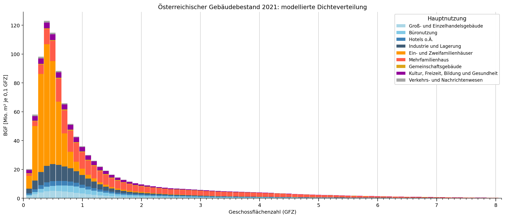
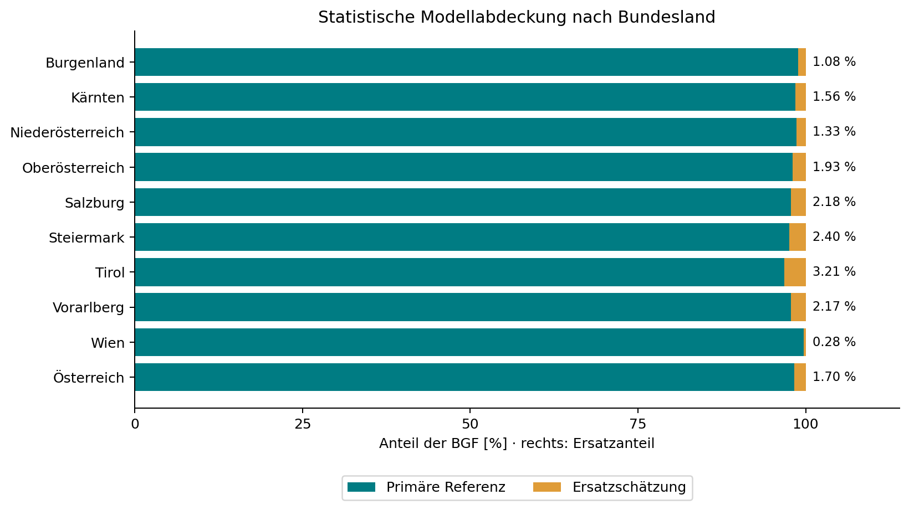
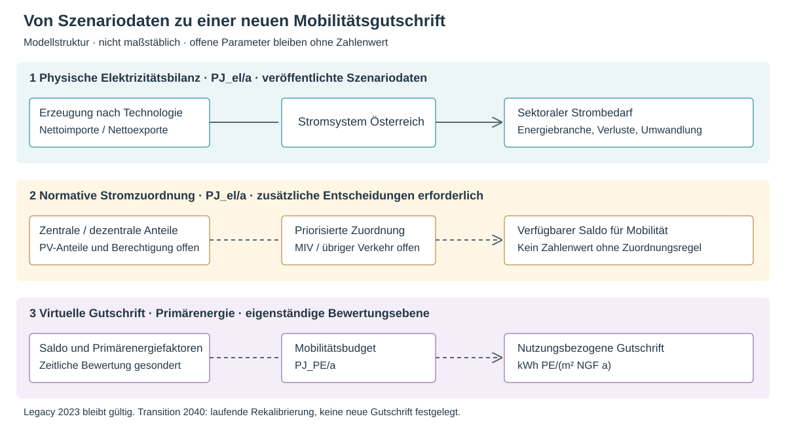

# Zielwert PE {#sec-allokation}
::: {.lead}
Vom nationalen Energieszenario zur jährlichen Primärenergieanforderung
:::
Ein Quartier kann seinen Energiebedarf senken, erneuerbare Energie erzeugen und Emissionen vermeiden. Ob dieser Beitrag ausreicht, hängt auch davon ab, welche Aufgaben die übrigen Gebäude, die Mobilität und die Energieversorgung übernehmen. Das nationale Allokationsmodell stellt diesen Zusammenhang her. Dieses Kapitel erläutert die Verteilung verfügbarer erneuerbarer Energie auf Sektoren und anschließend auf Nutzungen und Flächen konkreter Quartiere. Das davon getrennte kumulierte Emissionsbudget behandelt @sec-zielwert-thg.

Die Quartierssimulation ermittelt, welche Bilanz ein Projekt unter bestimmten Annahmen erreicht. Das Allokationsmodell bestimmt den Maßstab, an dem dieses Ergebnis beurteilt wird. Das Bewertungsverfahren verbindet beide Ebenen: Systemgrenzen, Gewichtung und Anforderungen müssen gemeinsam festgelegt werden [@schneider2026thesis, Kap. 3.1–3.2, S. 43–60].

## Welche Entscheidungen stecken in einem Zielwert?

Ein nationales Ziel lässt sich nicht ohne weitere Festlegungen auf ein Bauvorhaben herunterbrechen. Zunächst braucht es ein Szenario für Energiebedarf und Energieversorgung. Anschließend ist festzulegen, welche Anteile der verfügbaren Ressourcen und Emissionsbudgets den Sektoren zugerechnet werden. Erst danach können Anforderungen für Quartiere unterschiedlicher Dichte und Nutzung bestimmt werden.

```{mermaid}
%%| label: fig-allokationskette
%%| fig-cap: "Vom nationalen Szenario zur Quartiersbewertung. Methodik nach Schneider (2026), Kap. 3.1–3.3."
%%| fig-alt: "Nationale Szenarien führen über sektorale Zuordnung und Bezugsgrößen zu Quartiersanforderungen. Projektdaten und Simulation liefern die Quartiersbilanz. Anforderungen und Bilanz treffen in der Bewertung zusammen."
flowchart TB
  A["Nationale Energie- und Klimaszenarien"] --> B["Sektorale Zuordnung"]
  B --> C["Verteilung nach Dichte, Nutzung und Fläche"]
  C --> D["Anforderungen und Budgets"]
  E["Projektdaten und Maßnahmen"] --> F["Quartierssimulation und Bilanzierung"]
  D --> G["Bewertung des Quartiers"]
  F --> G
```

| Bestandteil | Funktion | Beispiel |
|---|---|---|
| Physikalischer Zusammenhang | Beschreibt Beziehungen zwischen Größen. | Mehr Geschossfläche auf gleicher Grundstücksfläche verändert das Verhältnis von Bedarf und lokalem Erzeugungspotenzial. |
| Szenarioannahme | Beschreibt eine mögliche zukünftige Entwicklung. | Dekarbonisierung der Energieversorgung und der Herstellungsprozesse. |
| Normative Festlegung | Verteilt Anforderungen und Budgets. | Anteil des nationalen Emissionsbudgets für Gebäude und MIV. |
| Operationalisierung | Übersetzt den Ansatz in berechenbare Regeln. | Mobilitätsgutschrift je Nutzung und Quadratmeter Nettogrundfläche. |

: Grundlagen eines Zielwerts [@schneider2026thesis, Kap. 3.1–3.2]. {#tbl-arten-festlegungen}

Die wissenschaftliche Herleitung macht diese Entscheidungen prüfbar. Sie hebt ihren normativen Charakter nicht auf. Für die Verwaltung ist gerade diese Trennung hilfreich: Ein geändertes Szenario, eine andere Verteilungsregel und eine Korrektur der Software sind unterschiedliche Eingriffe.

## Energieallokation: Welchen Beitrag muss der Gebäudesektor leisten?

### Prinzip der sektoralen Zuordnung

Die initiale Operationalisierung 2023 beruht auf der Streicher-basierten Herleitung: Das Szenario „Energieautarkie für Österreich 2050“ wurde von Schneider, Zelger und Klauda (2020) angepasst und im PEQ-Modell 2023 für den Zielhorizont 2040 weiterentwickelt [@schneider2020lokal, Abschn. 3.1, S. 3–6; @schneider2023context, Abschn. 6.1–6.2]. Dieses historische Referenzmodell betrachtet ein vollständig erneuerbares österreichisches Energiesystem. Erneuerbare Erzeugung und verbleibende Energiebedarfe werden sektoral zugeordnet. Daraus ergeben sich der erforderliche Beitrag dezentraler Erzeugung im Gebäudesektor und ein Anteil zentral bereitgestellter erneuerbarer Energie für den motorisierten Individualverkehr [@schneider2023context, Abschn. 6.1–6.2, S. 12–16].

Die Primärstudie *Energieautarkie für Österreich 2050* erschien im Dezember 2010. Sie versteht Energieautarkie als ausgeglichene jährliche Nettoenergiebilanz; zeitweiser Austausch bleibt möglich. Importierte graue Energie wird nicht als vollständig neu bilanzierte Größe einbezogen. Das Wachstumsszenario unterstellt jährlich 0,8 % Wachstum der Energiedienstleistungen beziehungsweise industriellen Bruttowertschöpfung; dies ist keine reine Bevölkerungsannahme [@streicher2010energieautarkie, Zusammenfassung, S. iii–v]. Die Übertragung in eine lokale Erzeugungsanforderung erfolgt durch Schneider et al. (2020); die späteren PEQ-Gutschriften stammen aus der Weiterentwicklung 2023 [@schneider2020lokal, Abschn. 3.1, S. 3–6; @schneider2023context, Abschn. 6.1–6.2]. Energieautarkie, jährliche erneuerbare Deckung und Klimaneutralität sind deshalb nicht gleichzusetzen.

Eine dem Quartier zugerechnete Energiemenge ist deshalb weder automatisch lokal erzeugte Energie noch ein vertraglich gesicherter Strombezug. Im Bewertungsverfahren kann sie als virtuelle Gutschrift erscheinen. Der physische Energiefluss muss davon getrennt bilanziert werden.

Die Anforderungen an Quartiere werden aus einem nationalen Bilanzmodell abgeleitet. Dieses verknüpft die verfügbare erneuerbare Energie mit den Bedarfen der einzelnen Sektoren.

{#fig-nationales-bilanzmodell width="100%"}

Im Referenzszenario sind dem Gebäudesektor 114,8 PJ/a Photovoltaikerzeugung und 137,6 PJ/a Strombedarf nach sektoraler Allokation zugeordnet. Der Zielsaldo beträgt −22,7 PJ/a [@schneider2023context, Tab. 6, S. 13]. Diese jährlichen Größen beschreiben die sektorale Strombilanz. Für die primärenergetische Quartiersbewertung werden sie mit den zugehörigen Gewichtungen und Flächenbezügen verknüpft.

Ein Quartier muss damit nicht die gesamte nationale Versorgung lokal nachbilden. Seine Anforderungen müssen aber zu einer Verteilung passen, die auch für den übrigen Gebäudebestand und die anderen Sektoren aufgeht.

### Dichte: physikalisches Prinzip und kalibrierte Anforderung

Der Grundgedanke lässt sich mit einer vereinfachten Beziehung zeigen. Sei \(A_G\) die Grundstücksfläche und \(A_B\) die Bruttogrundfläche. Die Geschoßflächenzahl ist \(d=A_B/A_G\). Werden eine jährliche lokale Erzeugung \(p\) je Grundstücksfläche und ein jährlicher Bedarf \(e\) je Bruttogrundfläche angesetzt, folgt:

$$
b(d)=\frac{p A_G-e A_B}{A_B}=\frac{p}{d}-e.
$$ {#eq-dichte-prinzip}

Erzeugung und Bedarf sind in derselben Energiegröße auszudrücken; \(b\) ist dann eine jährliche Bilanz je m² BGF. Die Beziehung zeigt, weshalb das Erzeugungspotenzial je Geschossfläche bei steigender Dichte abnimmt, wenn das Potenzial je Grundstücksfläche gleich bleibt. In realen Projekten hängen Erzeugung und Bedarf zusätzlich von Gebäudeform, Nutzung, Verschattung und Technik ab [@schneider2023context, S. 11–12].

Aus diesem Zusammenhang wird noch kein verbindlicher Zielwert. Die Anforderungsfunktion ergänzt die Beziehung um eine Verschiebung auf der Dichteachse und eine Begrenzung. Ihre Parameter bestimmen die Lastenverteilung zwischen Quartierstypen. Die so festgelegte Kurve beschreibt eine Anforderung und kein technisches Potenzialmaximum [@schneider2023context, Gl. 7–8, S. 12–13].

Bei niedriger Dichte kann die Regel einen zusätzlichen Überschuss verlangen; bei hoher Dichte kann sie einen negativen Saldo ohne Kontextkorrektur zulassen. Dies lässt sich entweder als unterschiedlicher Zielwert oder als Gut-/Lastschrift gegenüber einem gemeinsamen Nullmaßstab ausdrücken. Die Gutschrift verändert die Anforderung, nicht den realen Energiebedarf.

### Operationalisierung über den Gebäudebestand

Die nationale Kalibrierung braucht zusätzlich die Flächenverteilung des Bestands nach Dichte und Gebäudequalität. Ein Zielwert für einen häufigen Quartierstyp trägt zum nationalen Ergebnis stärker bei als derselbe Zielwert für einen seltenen Typ.

Der nationale Sektorsaldo ergibt sich aus der flächengewichteten Summe der spezifischen Zielsalden:

$$
B_{\mathrm{Sektor}}
=\sum_k\sum_j A_{k,j}\,t_k(d_j).
$$ {#eq-sektor-aggregation}

\(A_{k,j}\) bezeichnet die Fläche des Gebäudetyps \(k\) in der Dichteklasse \(j\), \(t_k(d_j)\) dessen jährlichen spezifischen Zielsaldo. Fläche und Zielsaldo müssen dieselbe Flächendefinition verwenden. Bei einem Zielsaldo in kWh/(m² a) ergibt sich der Sektorsaldo in kWh/a.

Die Kalibrierung unterscheidet thermische Sanierung, Sanierung mit geringer PV-Ausstattung, PEQ-Sanierung und PEQ-Neubau mit Anteilen von 40 %, 20 %, 20 % und 20 %. Unsanierter Bestand hat im zugrunde gelegten Zielzustand einen Anteil von 0 %. Zusammen mit der Dichteverteilung bestimmen diese Annahmen den nationalen Sektorsaldo [@schneider2023context, Tab. 5 und Abb. 8, S. 12–14].

Die Anforderungen an PEQ hängen somit auch davon ab, wie viel der übrige Gebäudebestand beiträgt. Eine andere Sanierungsentwicklung oder Dichteverteilung kann eine neue Kalibrierung erfordern. Dafür müssen sowohl die Bestandsdaten als auch die Verteilungsentscheidungen dokumentiert werden.

**[Abbildungsplatzhalter: Dichteabhängige Anforderungen und Flächenverteilung des Gebäudebestands, übernommen aus Schneider et al. (2023), Abb. 8.]**

### Österreichische Dichteverteilung als aktualisierte Datengrundlage {#sec-gfz-bestand}

Für die Weiterentwicklung der Kalibrierung liegt eine bundeslandweise Hochrechnung des Gebäudebestands mit Statistikbezug 2021 vor. Sie beschreibt, wie sich die Bruttogrundfläche (BGF) über die Geschossflächenzahl (GFZ) verteilt. Dazu werden gebäudescharfe Referenzdaten aus Wien und Salzburg mit statistischen Nutzflächen nach Bundesland, Hauptnutzung und sieben Geschossklassen verbunden: ein bis fünf Geschosse, sechs bis zehn sowie elf und mehr Geschosse. Die Statistik umfasst neun Nutzungsgruppen.

```{mermaid}
%%| label: fig-gfz-methodik
%%| fig-cap: "Bundeslandweise Hochrechnung der GFZ-Verteilung. Ersatzreferenzen werden je Zielkombination ausdrücklich ausgewiesen."
flowchart TB
  W["Einzelgebäude Wien"] --> KW["BGF-gewichtete KDE je Nutzung und Geschossklasse"]
  S["Einzelgebäude Salzburg"] --> KS["BGF-gewichtete KDE je Nutzung und Geschossklasse"]
  KW --> V["Wien"]
  KS --> L["Acht andere Bundesländer, jeweils separat"]
  T["Statistische NGF 2021 je Bundesland, Nutzung und Geschossklasse"] --> U["BGF = NGF / 0,8"]
  U --> V
  U --> L
  E["Bei weniger als fünf Referenzgebäuden: gekennzeichnete Ersatzregel"] -.-> V
  E -.-> L
  V --> AT["Österreich: Summe der neun BGF-Verteilungen"]
  L --> AT
```

Innerhalb jeder Referenzgruppe wird eine mit der BGF der Einzelgebäude gewichtete Kernel-Dichteschätzung (KDE) berechnet. Dadurch repräsentiert die Verteilung Gebäudefläche und nicht Gebäudeanzahl. Die normierten Wahrscheinlichkeitsmassen werden mit der statistischen BGF der jeweiligen Zielgruppe multipliziert. Die Umrechnung von statistischer Nettogrundfläche (NGF) in BGF erfolgt mit dem aus der früheren Analyse übernommenen Verhältnis NGF/BGF = 0,8. Dieser einheitliche Faktor ist eine Modellannahme.

Die KDE verwendet die Scott-Bandbreite und ein GFZ-Raster von 0 bis 20 mit einer Breite von 0,1. Sie wird auf diesem Raster normiert. Damit bleibt die zugeordnete Fläche erhalten; die Behandlung am Rand ist jedoch keine eigenständige physikalische Modellierung sehr geringer oder sehr hoher Dichten.

Für Wien gilt grundsätzlich die Wiener Referenz, für die übrigen Bundesländer die Salzburger. Liegen weniger als fünf geeignete Gebäude vor, wird zuerst dieselbe Nutzung und Geschossklasse aus Wien verwendet. Reicht auch diese Stichprobe nicht aus, folgt die nächstgelegene Geschossklasse derselben Nutzung, zuerst in der vorgesehenen Referenzregion und danach in Wien. Diese Ersatzregel ist für den vorliegenden Arbeitsstand freigegeben. Die Ziel-Flächen der Statistik werden dabei nicht verändert.

{#fig-gfz-wien-salzburg}

Die modellierte österreichische BGF beträgt rund **1.058,9 Mio. m²**, entsprechend **847,1 Mio. m² NGF**. Die Hochrechnung umfasst 516 positive Kombinationen aus Bundesland, Nutzung und Geschossklasse. Davon werden 425 unmittelbar durch die vorgesehene Referenz und 91 durch Ersatzzuordnungen abgebildet. Flächengewichtet entfallen **98,304 %** auf primäre Referenzen und **1,696 %** auf Ersatzschätzungen. Die Zahl betroffener Kategorien ist deshalb nicht mit ihrem Flächenanteil gleichzusetzen.

{#fig-gfz-oesterreich}

{#fig-gfz-abdeckung}

| Bundesland | BGF [Mio. m²] |
|---|---:|
| Burgenland | 38,043 |
| Kärnten | 68,058 |
| Niederösterreich | 214,888 |
| Oberösterreich | 197,149 |
| Salzburg | 69,494 |
| Steiermark | 150,038 |
| Tirol | 99,794 |
| Vorarlberg | 46,683 |
| Wien | 174,787 |
| **Österreich** | **1.058,935** |

: Flächensummen des GFZ-Bestandsmodells 2021. Datenbasis: übergebene Arbeitsdateien der ursprünglichen GFZ-Analyse, Tabellenblatt `python` der Statistikaufbereitung und gebäudescharfes Blatt `Rohdaten`. Rundungsdifferenzen in der Darstellung sind möglich. {#tbl-gfz-bundeslaender}

Das Rechenmodul `Berechnungen/gfz_at/` stellt zusätzlich die vollständige Tabelle für Bundesland × Nutzung × Geschossklasse mit Ziel-BGF, zugeteilter BGF, Bilanzdifferenz, Referenzregion, Referenzklasse und Stichprobenumfang bereit. Die Neuberechnung aus den ursprünglichen Excel-Eingaben reproduziert die übergebenen Ergebnisse bis auf numerische Rundungsreste. Die Summe der neun Bundesländer stimmt mit den österreichischen Kontrollsummen überein; die BGF bleibt in jeder positiven Zielkombination erhalten. Die flächengewichtete mittlere GFZ des Modells beträgt rund 1,231. Sie ist ein Mittel über die BGF-Verteilung und nicht das Verhältnis der gesamten BGF zur gesamten Grundstücksfläche Österreichs.

Die Übertragbarkeit der Salzburger Stichprobe auf andere Bundesländer, der einheitliche NGF/BGF-Faktor, auffällige Geschossklassenzuordnungen und die Empfindlichkeit gegenüber KDE-Parametern bleiben dokumentierte methodische Einschränkungen. Eine zusätzliche Sensitivitätsrunde wurde für diesen Arbeitsstand nicht durchgeführt. Der Bestand 2021 ist außerdem noch kein Zielbestand 2040: Neubau, Abriss, Verdichtung, Sanierung und energetische Typologien müssen in einem anschließenden Modellschritt ergänzt werden. Die hier dargestellte Aktualisierung ersetzt daher noch nicht die zuvor beschriebenen Energie- und THG-Zielwerte oder deren Flächenbezüge.

## Mobilitätsbudget: vom nationalen Anteil zur Nutzung

### Initiale Operationalisierung 2023

Die folgenden Streicher-basierten Mobilitätsgutschriften bleiben der geltende Bewertungsstand dieser Berichtsfassung. Die veröffentlichte klimaaktiv-Broschüre 2026 beschreibt den Kontextfaktor Mobilität; das bereitgestellte Tool-Handbuch Version 1.08 dokumentiert die nutzungsabhängige virtuelle Deckung und beispielhaft den Wohnwert von 14,11 kWh PE/(m² NGF a) [@klimaaktiv2026peq, S. 10; @peq2026handbuch, S. 66]. Die vollständigen vier Referenzwerte stammen aus der Kalibrierung 2023. Damit wird keine vollständige Prüfung der aktuell produktiven Softwareversion behauptet.

Zentral beziehungsweise regional erzeugte erneuerbare Energie wird in der historischen Zuordnung zunächst für übergeordnete Bedarfe, insbesondere Industrie und öffentlichen Verkehr, reserviert. Der verbleibende Saldo begründet das Mobilitätsbudget. Gebäude übernehmen zugleich dezentrale Erzeugungsaufgaben und die Bilanzierung des ihnen zugeordneten MIV. Diese Priorität ist eine Allokationsentscheidung und keine physische Trennung des Stromnetzes [@schneider2020lokal, Abschn. 3.1.4 und 5.1; @schneider2023context, Abschn. 6.2].

Der motorisierte Individualverkehr erweitert den Energiebedarf, für den das Quartier bilanziell Verantwortung übernimmt. Gleichzeitig erhält er einen Anteil der zentral bereitgestellten erneuerbaren Energie. Dieser Anteil wird über die Nutzungen auf Quartiere verteilt.

Für den MIV sind 6,30 TWh/a Strom und 0,36 TWh/a Biomasse zugeordnet. Mit der primärenergetischen Gewichtung ergibt sich ein Budget von 10,68 TWh PE/a [@schneider2023context, Tab. 8, S. 16].

Die Verteilung folgt den Anteilen der Nutzungen am österreichischen Zielverkehr und ihren nationalen Nutzflächen. Für eine Nutzung \(u\) gilt:

$$
c_{\mathrm{M},u}
=\frac{E_{\mathrm{M},u}}{A_{\mathrm{NGF},u}}.
$$ {#eq-mobilitaetsbudget}

Die nationale Energiemenge \(E_{\mathrm{M},u}\) in kWh PE/a wird durch die zugehörige Nettogrundfläche geteilt. Das Ergebnis ist die jährliche Mobilitätsgutschrift je m² NGF. Bei gemischter Nutzung werden die Gutschriften mit den jeweiligen Quartiersnutzflächen gewichtet.

| Nutzung | Budget [TWh PE/a] | Fläche [Mio. m² NGF] | Gutschrift [kWh PE/(m² NGF a)] |
|---|---:|---:|---:|
| Wohnen | 5,30 | 375,6 | 14,11 |
| Büro und Gewerbe | 2,20 | 53,1 | 41,47 |
| Bildung | 0,29 | 22,5 | 12,93 |
| Handel und sonstige Nutzungen | 2,89 | 96,5 | 29,97 |

: Nutzungsbezogene Mobilitätsallokation, übernommen aus Tabelle 9 [@schneider2023context, S. 16]. {#tbl-mobilitaetsallokation}

Die Gutschrift richtet sich nach der Nutzung; der Mobilitätsbedarf hängt zusätzlich von Standort, Verkehrsverhalten und Fahrzeugflotte ab. Ein hoher Bedarf erzeugt keinen entsprechend hohen Budgetanspruch. Bei gleicher Nutzung bleibt ein Quartier mit geringerem MIV-Bedarf bilanziell im Vorteil [@schneider2026thesis, Abschn. 3.2.7, S. 56–57].

Für die Bewertung wird der Zielverkehr dem Quartier zugeordnet. Die Simulation der Lade- und Speicherflüsse muss dagegen die tatsächliche Anwesenheit und Ladung der Fahrzeuge berücksichtigen. Ein zugeteiltes Mobilitätsbudget ist weder ein physisches Ladeangebot noch eine Aussage über die nutzbare Batteriekapazität.

Die Mobilitätsallokation beruht auf den Mobilitätsdaten von 2013/2014 und dem nationalen Energieszenario. Neue Erhebungen zu Verkehrsverhalten, Fahrzeugflotte und Flächennutzung ermöglichen eine Aktualisierung der Gutschriften. Das Zuordnungsprinzip bleibt dabei bestehen; Ausgangsbudget und Verteilung werden gemeinsam überprüft.

### Aktuelle Operationalisierung (2026) auf Basis UBA Transition 2040 (2024)

::: {.callout-note title="Modellstand 2026 und geltende Gutschriften"}
Die aktuelle Operationalisierung 2026 umfasst die normierten UBA-Daten, den Szenarienvergleich und eine parametrische Berechnung. Die Rekalibrierung der sektoralen Zuordnung bleibt offen; bis zu deren Festlegung gelten die initialen Mobilitätsgutschriften 2023 unverändert. Die folgenden UBA-Werte sind eine veröffentlichte Szenariogrundlage und noch keine neue Allokation oder Deklarationsanforderung. WEM/WAM 2025 dienen als neuere Vergleichsszenarien, WEM/WAM 2023 als Vergleich derselben Modellgeneration wie Transition. WAM 2025 entspricht im Energieteil WAM NEKP 2024 [@uba2025szenarien, S. 62].
:::

Die Jahresangabe **2024** bezeichnet hier die Ausgabe mit Copyright 2024. Auf Titelblatt und Seitenfuß von REP-0880 steht „Wien 2023“; die Modellgeneration bleibt entsprechend 2023. Diese Datierung ändert weder Zieljahr noch Zahlenbasis [@uba2023transition, Impressum].

Die Fortschreibung konzentriert sich auf die **Elektrizitätsbilanz**. Stromerzeugung, Strombedarf und Nettoimporte werden in PJ elektrischer Energie pro Jahr verglichen. Der energetische Endverbrauch aller Energieträger bleibt ein separater Sektorausweis im Datenmodell und geht nicht als Strombedarf in das Allokationsmodell ein. Verbrauch des Energiesektors, Transportverluste und elektrischer Umwandlungseinsatz sind gesonderte Bedarfspositionen. Der Umwandlungseinsatz ist bereits ein Strombedarf; der später erzeugte Wasserstoff darf nicht nochmals als Endstrom addiert werden.



Die publizierten Gesamtsummen bleiben neben den Komponentensummen erhalten. Die Bilanzreste werden weder auf Bedarfe verteilt noch durch erfundene Erzeugung oder Verlustflüsse ausgeglichen. Für WEM/WAM 2025 folgt die gelieferte Normierung **Tabelle E auf S. 12** von REP-0995. Tabelle 19 auf S. 64 desselben Berichts enthält abweichende Erzeugungswerte, etwa 403 statt 406 PJ für WAM 2040. Dieser Quellenwiderspruch ist zusätzlich zu den Rundungsresten offen; die beiden Fassungen werden nicht vermischt [@uba2025szenarien, Tab. E und 19]. Für Transition bleibt REP-0880 Tabelle 16 maßgeblich, nicht die abweichend zusammengefasste Erzeugung in REP-0882.

Die Legacy-Kalibrierung wird über ihre belegten sektoralen Zuordnungen und Mobilitätsbudgets verglichen. Eine vollständige nationale Streicher-Stromtabelle in derselben Abgrenzung wie die UBA-Tabellen liegt im normierten Datenpaket nicht vor. Fehlende Werte werden deshalb nicht mit null oder einer UBA-Zahl ersetzt; auch die historischen Horizonte 2050 und 2040 werden nicht gleichgesetzt.

### Ausbau und Bedarf: Ausgangsbilanz 2020 bis Zieljahr 2040

Als „heute“ dient ausdrücklich das **Ausgangsjahr 2020** der Transition-Bilanz, nicht das Kalenderjahr 2026. Gegenüber 2020 steigt die publizierte jährliche Stromerzeugung von 249 auf 457 PJ und der Strombedarf von 257 auf 450 PJ. Gleichzeitig sinkt der gesamte energetische Endverbrauch von 1.053 auf 722 PJ. Die Elektrifizierung erhöht den Strombedarf, obwohl der Bedarf über alle Energieträger abnimmt [@uba2023transition, Tab. A, 15 und 16].

Die folgende Grafik greift die Leserichtung des schematischen Sektorbilds auf: links Ausgangsertrag und zusätzlicher Ertrag, in der Mitte Erzeugung und Stromsystem, rechts Sektorbedarf und daneben der Vergleich mit 2020. Der untere, **getrennte** Sankey zeigt die notwendige Endenergieminderung. Die Linien beschreiben Jahresenergiemengen, keine installierten Leistungen und keine virtuellen PE-Gutschriften. Zentral/dezentral und MIV/ÖV werden erst durch ausdrücklich dokumentierte Parameter im Notebook unterschieden.

::: {.content-visible when-format="html"}
```{=html}
<iframe src="../Abbildungen/transition_sankey.html" title="Sankey: Stromausbau und Energiebedarf 2020 bis 2040" style="width:100%;height:1250px;border:0" loading="lazy"></iframe>
```

[Interaktive Grafik in voller Breite öffnen](../Abbildungen/transition_sankey.html)
:::

::: {.content-hidden when-format="html"}
{#fig-transition-sankey}
:::

„Ausbau“ bezeichnet den zusätzlichen Jahresertrag je Technologie. Der Ersatz ausscheidender Anlagen, Volllaststunden, Witterung und Speicherleistungen müssten für eine Investitions- oder Leistungsplanung zusätzlich modelliert werden. Die Minderung des Endenergieverbrauchs beträgt nach publizierten Gesamtsummen 331 PJ, nach den gerundeten Sektorkomponenten 330 PJ. Beim Ziel-Strombedarf stehen 450 PJ Gesamtsumme einer Komponentensumme von 452 PJ gegenüber. Diese Differenzen werden ausgewiesen und nicht auf Sektoren umgelegt. Die optional auswählbare Ausgangsbilanz 2023 enthält zusätzliche Quellenwidersprüche und ist kein gleichwertiger Ersatz für den konsistenten Transition-Bezug 2020.

Das ausführbare Notebook `Redaktion/transitionsszenarien/Berechnungen/Transition_2040.ipynb` verbindet Eingabetabellen, Rechnungen und Ausgaben. Es erlaubt Varianten des dezentralen PV-Anteils, der Anteile MIV/ÖV/übriger Verkehr und zusätzlicher Strombedarfsminderung. Diese Eingriffe verändern ausschließlich gekennzeichnete Varianten; die UBA-Eingaben und geltenden Gutschriften bleiben erhalten. Die Stromminderung wird nicht zugleich als neue Endenergieprojektion ausgegeben: Dafür fehlen die technologiebezogenen Substitutionsannahmen.

### Parametrische Struktur der weiteren Allokation

{#fig-transition-allokation-schema}

Die gemeinsame Knoten- und Verbindungsstruktur unterstützt Legacy, Transition sowie WEM/WAM. Quellenbelegte Stromflüsse können als eigene Sankey-Ebene dargestellt werden. Normative Zuordnungen und virtuelle Primärenergie-Gutschriften bleiben separate Ebenen. Offene Werte sind als fehlend markiert und erhalten keine erfundene Linienbreite. Insbesondere darf ein Budget in PJ Primärenergie nicht mit einem Fluss in PJ elektrischer Energie verbunden werden.

Für eine neue Mobilitätsgutschrift sind folgende Entscheidungen erforderlich:

- **Zentral/dezentral:** Anteile je Erzeugungstechnologie, insbesondere Gebäude-PV gegenüber Freiflächen und größeren PV-Anlagen. Ein Fall mit 100 % dezentraler PV ist als ausdrücklich gekennzeichnete Parameterstudie möglich, aber kein Standardwert.
- **Verkehr:** belegte Trennung von MIV, öffentlichem Verkehr und weiteren Verkehrsbedarfen. Eine proportionale Übertragung historischer Anteile wäre eine zusätzliche Annahme und ist derzeit nicht gesetzt.
- **Priorität und Berechtigung:** Reihenfolge und Deckungsanteile der Sektoren, Umgang mit fossiler Erzeugung, Importen und Herkunft der Rückverstromung. Der gesamte Strompool ist nicht automatisch ein zentraler erneuerbarer Pool.
- **Primärenergie und Zeitbezug:** gesicherte Konversionsfaktoren und zeitliche Bewertung sowie konsistente Behandlung von Umwandlung, Speicherung und Verlusten. Erst danach kann ein verfügbares Budget auf Nutzflächen verteilt werden.

Die nationalen Jahresstrombilanzen allein bestimmen keine dieser normativen Regeln. Eine pauschale Skalierung der bisherigen Gutschrift mit dem Verhältnis neuer zu alter Stromerzeugung ist deshalb nicht vorgesehen.

## Sanierung und kommunale Perspektive

Die Sanierungsgutschrift von 15 kWh PE/(m² NGF a) entlastet Bestandsprojekte gegenüber Neubauten [@klimaaktiv2026peq, S. 14]. Ihre Höhe ist normativ gesetzt und bislang nicht quantitativ kalibriert. Sie berücksichtigt, dass schwer sanierbare Gebäude andere Handlungsmöglichkeiten haben als Neubauten.

Eine mögliche Differenzierung nach Gebäudealter, Denkmalschutz oder weiteren Sanierungserschwernissen erfordert eine eigene Begründung und eine Prüfung der Verteilungswirkung.

Eine kommunale Zwischenebene, beispielsweise für Wien, könnte nationale Vorgaben zunächst auf kommunale Beiträge und dann auf Quartiere beziehen. Diese Erweiterung ist eine Entwicklungsperspektive; sie ist noch kein implementierter Kontextfaktor [@schneider2026thesis, Abschn. 3.5.1, S. 89–90]. Dieselben Energie- oder Emissionsbudgets dürfen dabei nicht mehrfach zugeteilt werden.

## Folgerungen für die Anwendung

Die jährliche PE-Anforderung hängt von Szenario, sektoraler Zuordnung, Dichte und Nutzung ab. Ein Nachweis muss deren Methodenstand und Flächenbezüge nennen. Die UBA-Aktualisierung ist eine neue Datengrundlage; eine geänderte Gutschrift folgt erst nach begründeter Allokation. Für die kumulierten Emissionen gilt zusätzlich @sec-zielwert-thg.
