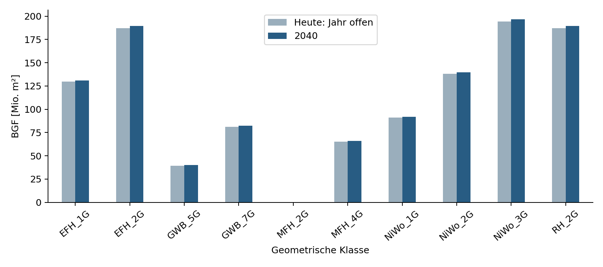
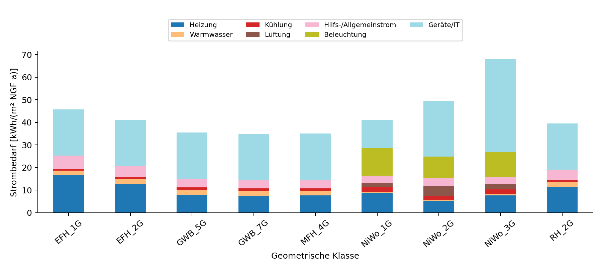
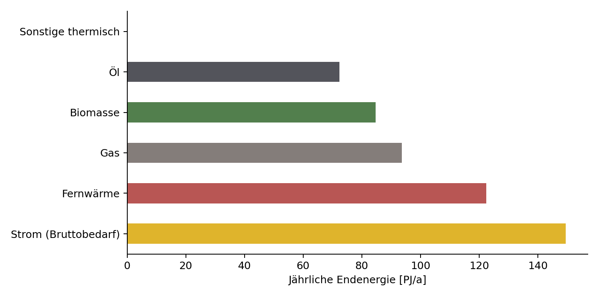
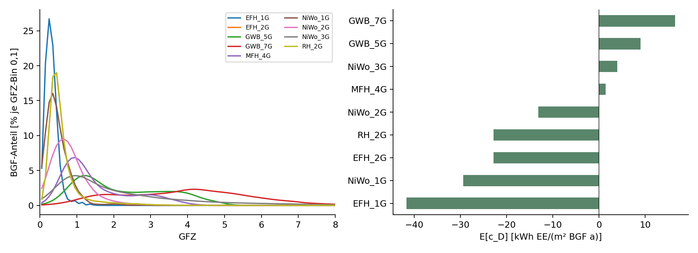

# Gebäudebestand und Entwicklungsszenario 2040 {#sec-gebaeudebestand}

::: {.callout-warning title="Bisherige Ergebnisse – neue Auswertung steht aus"}
**Aktualisierungsbedarf · 09.11.2026**

Dieses Kapitel zeigt noch den vorläufigen Rechenstand vom 05.11.2026. Die lokale Typologie umfasst inzwischen 43.200 Simulationen. Für die neue Analyse fehlt die vollständige Flächenzuordnung des Kollegen. Die folgenden Tabellen, Diagramme und Aussagen sind deshalb noch keine Ergebnisse des neuen Analysewegs.
:::

::: {.lead}
32.400 simulierte Varianten, regelbasierte nationale Flächen und ein separater virtueller Bewertungsvergleich
:::

Das Gebäudesektormodell verbindet PEExcel-Kennwerte mit nationalen Basisflächen. Der hier ausgewertete **vorläufige Szenariostand** ersetzt die frühere Beschränkung auf PV30/noFlex. Alle Annahmen und Rechenschritte sind im ausführbaren Anhang @sec-gebaeudesektormodell dokumentiert. Die Flächenverteilung ist eine Testannahme bis zur aktualisierten Lieferung der Bestandsflächen.

## Datenbasis und Typologie {#sec-gebaeudetypologien}

::: {.callout-warning title="Datenbasis aktualisieren"}
**Aktualisierungsbedarf · 09.11.2026**

Typenanzahl, Variantenabdeckung und Quellenbeschreibung auf das lokale Szenariopaket und die neue vollständige Flächentabelle umstellen. Die bisherige Excel-Reinschrift und die automatische Variantenaufteilung gehören zum archivierten Rechenweg.
:::

Der Parquet-Export `building_sector_v2` enthält 32.400 Simulationen: zehn Geometrien, neun Hüllcodes, zehn Versorgungsvarianten, drei PV-Dachanteile (30/70/90 %), zwei Flexibilitätszustände, zwei Wetterstandorte und drei Gebäudemassen. Weitere Presets sind teilweise an diese Merkmale gekoppelt. Quelle ist PEExcel 1.13.1_dev. Die ungewichtete Anzahl der Simulationen beschreibt keine nationale Bestandsverteilung.

Die bestehenden Basisflächen werden aus `daten_gebauedesektor.xlsx` übernommen. Die 900 Basisgruppen aus Geometrie/Hülle/Versorgung sind vollständig im neuen Pool enthalten. Nationale BGF und Statusanteile bleiben Eingaben; die detaillierten Variantenflächen werden im Notebook erzeugt. Kennwerte werden nicht manuell in 32.400 Excel-Zeilen gepflegt.



Energiekennwerte beziehen sich auf NGF. Für den aktuellen Pool gilt NFA_total/GFA_total = 0,8; damit wird NGF = 0,8 × BGF verwendet. „Heute“ hat kein bestätigtes Statistikjahr und wird nicht mit 2020 gleichgesetzt. Seine Auswertung verwendet dieselben Simulationskennwerte und ist keine validierte historische Energiebilanz.

## Flächenzuordnung und Entwicklung

::: {.callout-warning title="Flächenlieferung und PEQ-Auswahl ersetzen"}
**Aktualisierungsbedarf · 09.11.2026**

Die unten gezeigten PV-/Flex-Anteile, Wetter-/Massegewichte und die feste 20-%-PEQ-Auswahl sind historische Testannahmen. Künftig liefert die Modellierung fertige Typenflächen für heute und 2040. Die PEQ-Bewertungsflächen werden erst im Dashboard ausgewählt.
:::

Die bestehenden nationalen Basisflächen bleiben erhalten: rund 1.112,341 Mio. m² BGF heute und 1.126,579 Mio. m² BGF 2040. Die Zuweisung erfolgt über disjunkte PEQ- und Restflächen, gemeinsame PV-/Flex-Anteile sowie Wetter- und Massegewichte.

**PEQ-Szenario:** 20 % der gesamten BGF 2040 werden proportional aus den geeigneten Gruppen ausgewählt: Hüllcodes Neu_20cm/Neu_30cm mit Wärmepumpe, erneuerbarer Fernwärme oder Biomasse. Diese Teilfläche erhält PV70/Flex. Die Ausstattung allein ist kein Nachweis der PEQ-Konformität. Im Dashboard bleibt die virtuelle Bewertung interaktiv veränderbar.

Die folgende Restverteilung gilt **innerhalb der nicht als PEQ ausgewählten Fläche** und ist ausdrücklich vorläufig:

| Stand / Status | PV0/noFlex | PV30/noFlex | PV30/Flex | PV70/Flex |
|---|---:|---:|---:|---:|
| Heute | 80 % | 20 % | 0 % | 0 % |
| 2040 Bestand | 40 % | 40 % | 20 % | 0 % |
| 2040 Neubau | 0 % | 40 % | 40 % | 20 % |
| 2040 Sanierung | 20 % | 40 % | 40 % | 0 % |

Wien und Innsbruck erhalten jeweils 50 %, leichte/mittlere/schwere Gebäudemasse jeweils ein Drittel. Dies sind Testgewichte, keine statistisch belegten Österreich-Anteile. PV90 bleibt verfügbar, erhält in diesem Startfall aber keine Fläche. Die heutige Statusstruktur wird nicht aus den 2040-Anteilen abgeleitet.



{#fig-gebaeude-flaechen width="100%"}

Bestand/Neubau/Sanierung sind Anteile innerhalb der 2040-Basisgruppen. Neubaufläche ist nicht gleich Nettoflächenzuwachs; eine zeitliche Übergangsbilanz mit Abbruch und Ersatzneubau liegt nicht vor.

## Strom und Endenergie

::: {.callout-warning title="Energieergebnisse neu berechnen"}
**Aktualisierungsbedarf · 09.11.2026**

Nach Eingang der Flächenlieferung Strom- und Endenergietabellen sowie Anwendungsdiagramme neu erzeugen. Die bisherige synthetische PV0-Ergänzung entfällt im neuen Analyseweg; verwendet werden die gelieferten Simulationen.
:::

Zusätzlich entstehen 5.400 gekennzeichnete synthetische PV0/noFlex-Varianten. Ohne Speicher und Mobilitätsladung wird deren elektrischer Nutzbedarf aus der entsprechenden PV30/noFlex-Simulation übernommen, PV-Flüsse werden null und der Bedarf durch Netzstrom gedeckt. Dies ist eine Näherung; echte PV0-Simulationen ersetzen sie künftig.

Der Bruttostrombedarf wird aus EUI_el_total ohne Mobilität übernommen. PV_total umfasst direkten und flexiblen Verbrauch sowie Einspeisung. Flexible Flüsse werden in der Bilanzprüfung berücksichtigt und nicht unterschlagen.



{#fig-gebaeude-strom-anwendungen width="100%"}



{#fig-gebaeude-endenergie width="100%"}

Fossile Versorgung bleibt gemäß Basisflächen enthalten. Der Startfall wird nicht durch nachträgliche Skalierung an das nationale Ziel angepasst.

## Primärenergie und virtuelle Bewertung

::: {.callout-warning title="PE-Abdeckung neu bewerten"}
**Aktualisierungsbedarf · 09.11.2026**

Die Aussagen zu fehlenden PE-Kennwerten beziehen sich auf das frühere synthetische PV0. Mit dem neuen Bestand Import, Export, Projektsaldo und Datenabdeckung erneut berechnen. Virtuelle Kontextwerte weiterhin getrennt ausweisen.
:::

Die PE-Bewertung tatsächlicher Flüsse verwendet PEI_import, PEI_export und PEI_saldo_project = Export − Import. Netzbezug und flexible Bezüge sind Komponenten; thermische Energieträger werden eigenständig berücksichtigt. Virtuelle Kontextwerte werden hier nicht hinzuaddiert.

Für synthetische PV0-Varianten fehlen zeitlich konsistent neu berechnete PE-Kennwerte. Deshalb bleibt die vollständige nationale PE-Bilanz offen; die physische Strombilanz ist davon unabhängig berechenbar. PE-Werte werden nicht aus PV30 kopiert.



Virtual Demand/Supply und die virtuelle PE-Bilanz gehören zur ergänzenden Bewertung. Sie ersetzen weder die physische Strombilanz noch die PE-Import-/Exportbetrachtung.

## GFZ und sektoraler Abgleich {#sec-gfz-verteilung}

::: {.callout-warning title="GFZ-Gewichtung und Szenarioabgleich erneuern"}
**Aktualisierungsbedarf · 09.11.2026**

Die bestehende geometrische Zuordnung kann weiterverwendet werden, muss aber alle positiv belegten Typen abdecken. Gewichtete Ergebnisse und sektoralen Abstand neu berechnen. Den Bestand heute nicht als zeitgleichen Vergleich zum nationalen Ziel 2040 darstellen.
:::

Die bestehende GFZ-Zuordnung aus Nutzung und Geschoßklasse bleibt erhalten. Varianten derselben Geometrie übernehmen dieselbe bedingte Dichteverteilung. MFH_2G hat weiterhin keine positive Basisfläche und keine ergänzte GFZ-Zuordnung. Für eine künftig positive Fläche wäre diese zuerst zu liefern.

{#fig-gebaeude-gfz width="100%"}

Die historische elektrische Dichtefunktion wird separat als virtueller Vergleich gezeigt. Positive und negative Beiträge sind Bewertungsgrößen und keine Stromerzeugung oder reale Last. Die nationale GFZ-Auswertung wird nicht zusätzlich in die PEExcel-Import-/Exportwerte eingerechnet.

::: {.content-visible when-format="html"}
```{=html}
<iframe src="../Abbildungen/methodik/typen_deckung.html" title="Typenvergleich mit virtueller Dichtebewertung" style="width:100%;height:850px;border:0" loading="lazy"></iframe>
```
:::



::: {.content-visible when-format="html"}
```{=html}
<iframe src="../Abbildungen/methodik/sektorvergleich.html" title="Physischer sektoraler Abgleich und separate Dichtebewertung" style="width:100%;height:690px;border:0" loading="lazy"></iframe>
```
:::

Auf beiden Seiten werden dieselben MIV-Mengen und dieselbe zentrale Restdeckung angesetzt. Der physische Szenarioabstand bleibt dadurch unverändert. Die dritte Vergleichsgruppe ergänzt ausdrücklich einen virtuellen Dichtebeitrag; sie ist keine neue physische Bilanz.

## Fortschreibung

::: {.callout-warning title="Neuen Notebook-Ablauf übernehmen"}
**Aktualisierungsbedarf · 09.11.2026**

Diese Beschreibung auf Modellierung → fertige Flächen-Excel → Analyse → bestand.parquet → Kalibrierungsdashboard umstellen. In der Analyse werden keine Flächenallokationsregeln mehr gepflegt.
:::

Für neue Typologien wird der Parquet-Pfad im Notebook geändert. Vorhandene Basisflächen und Regeln bleiben verwendbar, solange die Merkmale passen. Fehlende gewichtete Varianten werden gemeldet; zusätzliche ungewichtete Varianten ändern keine nationale Fläche. Neue Flächenlieferungen ersetzen die bisherige Quelle. Nach vollständiger Notebook-Ausführung werden Bericht und Kalibrierungsdashboard aus demselben Ergebnisstand neu erzeugt.
