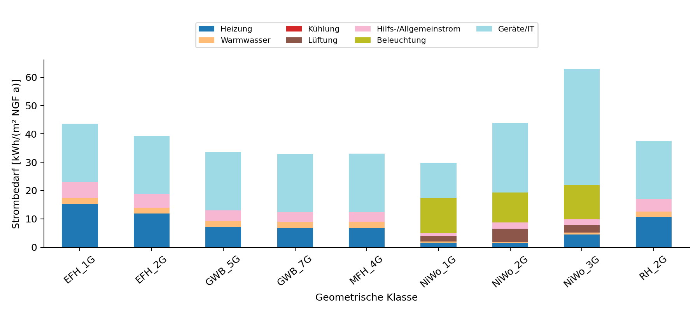
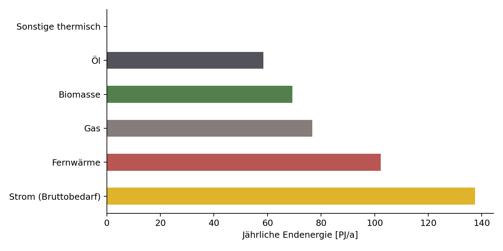
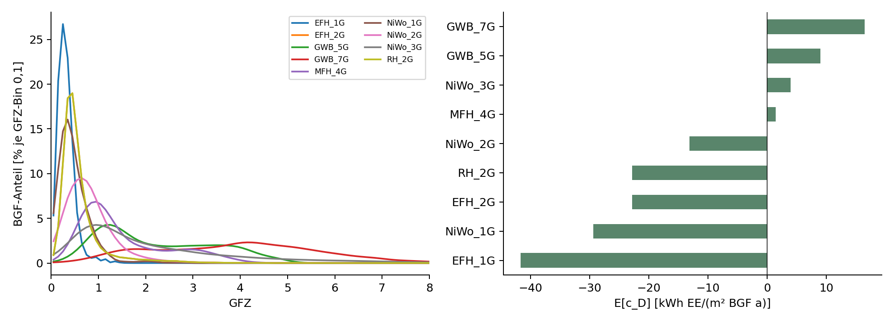

# Gebäudebestand und Entwicklungsszenario 2040 {#sec-gebaeudebestand}

::: {.lead}
Gebäudetypologien, nationale Flächen und GFZ-Verteilungen als Bottom-up-Grundlage der PEQ-Kalibrierung
:::

Das Gebäudesektormodell verknüpft die Flächenstruktur des Zieljahres 2040 mit den energetischen Kennwerten der Gebäudetypen und ihren Dichteverteilungen. Es bildet die Bottom-up-Seite zur sektoralen Allokation in @sec-allokation. Die erste Auswertung des gelieferten Pools ergibt **137,49 PJ/a Strombedarf**, **78,25 PJ/a PV-Erzeugung** und einen **betrieblichen Stromsaldo von −59,25 PJ/a**. Diese Zahlen beschreiben den gelieferten Szenariostand. Sie sind noch keine mit UBA Transition abgestimmten PEQ-Zielwerte.

Die vollständige Herleitung, Eingabetabellen, Formeln und Bilanzprüfungen stehen im ausführbaren Anhang @sec-gebaeudesektormodell. Die Berechnungen sind unmittelbar in dessen Notebook-Zellen enthalten.

## Datenbasis, Flächenbegriffe und Bezugsjahre

Grundlage ist `Building-Sector_Pool 1.xlsx`, einschließlich der am 23.10.2026 ergänzten GFZ-Anteile. Das Blatt `Strombed_estim` enthält die maßgeblichen Flächen- und Energiekennwerte, `zuordnung_gfz` die Zuordnung nach Nutzung und Geschoßklasse. Das Simulationsblatt `Tabelle2` liefert Einheiten und ergänzende Anwendungen. Alle 900 Archetypenschlüssel sind eindeutig und lassen sich vollständig mit den Simulationsergebnissen verbinden. Die gespeicherten Kennwerte stimmen mit den im Kennwertblatt referenzierten Simulationswerten überein; eine erneute PEExcel-Simulation ist damit nicht verbunden.

Die nationale Flächensumme beträgt **1.126,579 Mio. m² BGF für 2040**, gegenüber **1.112,341 Mio. m² BGF** in der Quellspalte „heute“. Deren konkretes Bezugsjahr ist noch zu bestätigen. Sie wird deshalb nicht mit 2020 gleichgesetzt. Die Energiekennwerte beziehen sich laut Simulationsblatt auf **NGF**. Für diese erste Aggregation gilt die aus der bestehenden GFZ-Analyse übernommene einheitliche Modellannahme:

$$
A_{NGF,k,y}=0{,}8\,A_{BGF,k,y}.
$$

Für 2040 folgen daraus 901,263 Mio. m² NGF. Eine typologiespezifische Umrechnung ist später möglich. Es erfolgt keine Skalierung auf die GFZ-Bestandsfläche von 1.058,935 Mio. m² BGF oder auf die separate Flächenannahme der THG-Allokation. Diese Größen haben unterschiedliche Grundlagen.

Das ältere Blatt `reduced` enthält 696,615 Mio. m² NGF, 486 positiv gewichtete Varianten, 264 echte Nullwerte und 6.450 leere Flächenfelder. Im neuen Kennwertblatt sind 603 Typen für 2040 positiv gewichtet und 297 explizit null; Flächenwerte fehlen dort nicht. Die unterschiedlichen Flächenbezüge, Variantenabdeckungen und Summen werden in @sec-gebaeude-flaechen verglichen. Der ältere Datensatz wird nicht als additive Fläche oder Ersatzgewichtung verwendet. `save` ist ein zusätzlicher Projekt-/Presetstand und keine nationale Flächenbilanz.

## Energetische Gebäudetypologien 2040 {#sec-gebaeudetypologien}

Der vollständige Typenschlüssel kombiniert **Geometrie, Baualter beziehungsweise Hüllstandard, Wärmeversorgung, PV-Ausstattung und Flexibilität**. Die zehn Geometrieklassen sind daher nicht mit zehn energetischen Klassen gleichzusetzen. Der ausgewertete Bestand umfasst neun Baualters-/Hüllcodes und zehn Wärmeversorgungsvarianten. Alle 900 simulierten Typen tragen die Variante `PV30|noFlex`; die übrigen PV-/Flexibilitätsvarianten des 7.200 Szenarien umfassenden Gesamtpools erhalten keine ungeprüft übertragenen Kennwerte.

`Neu_10cm`, `Neu_20cm` und `Neu_30cm` bezeichnen Hüllcodes. Die Zugehörigkeit zu Bestand, Neubau oder Sanierung folgt den separat gelieferten Anteilen, nicht allein dem Wort „Neu“. Das Feld „Energetischer Standard“ ist noch leer. Auch eine PEQ-Presetbezeichnung oder ein positiver Stromsaldo belegt für sich keine PEQ-Konformität.



Die Geometrie MFH_2G besitzt derzeit keine positive nationale Fläche. Ihre fehlende GFZ-Zuordnung bleibt sichtbar; für sie wird kein Dichte-Erwartungswert erfunden. Für alle positiv gewichteten Typen liegt eine Zuordnung vor.

## Flächenentwicklung vom Bestand zum Zieljahr

Die gelieferte Gesamtfläche steigt zwischen „heute“ und 2040 um rund 14,238 Mio. m² BGF beziehungsweise 1,28 %. Die Spalten Bestand, Neubau und Sanierung enthalten innerhalb der Archetypen Anteile, die auf jeder positiv gewichteten 2040-Fläche zusammen eins ergeben. Flächengewichtet resultiert:



{#fig-gebaeude-flaechen width="100%"}

Die Neubaufläche ist nicht mit dem Nettoflächenzuwachs gleichzusetzen. Für einen nachvollziehbaren Entwicklungspfad fehlen noch die zeitliche Definition dieser Kategorien und eine Übergangsbilanz mit Abbruch, Ersatzneubau und Sanierung. Die Reinschrift enthält ein separates, zunächst leeres Feld für BGF 2020. Es wird nicht automatisch aus „heute“ gefüllt.

## Energetische Performance, Strombedarf und PV

Netzbezug und Bruttostrombedarf werden konsequent getrennt. Für die vorliegenden Varianten ohne Speicher, Flexibilität oder simulierte Mobilität gilt:

$$
E_{el}=E_{Netzbezug}+E_{PV,direkt},\qquad E_{PV}=E_{PV,direkt}+E_{PV,Export}.
$$

Der physische Stromsaldo ist sowohl als PV-Erzeugung minus Strombedarf als auch als PV-Netzeinspeisung minus Netzbezug bestimmbar. Beide Wege stimmen in der Typenprüfung überein. PV-Direktverbrauch wird nicht doppelt als Deckung angesetzt.



{#fig-gebaeude-strom-anwendungen width="100%"}

Die Kennwerte unterscheiden Heizung, Warmwasser, Kühlung, Lüftung, Hilfs-/Allgemeinstrom, Beleuchtung und Geräte/IT. Kühlung ist im gelieferten Simulationsstand null. Das ist eine Eigenschaft dieser Simulationen und keine Bestätigung, dass im nationalen Gebäudesektor 2040 kein Kühlbedarf besteht. Die detaillierte Herleitung steht in @sec-gebaeude-strom.

## Endenergie und Primärenergie

Fernwärme-, Gas-, Biomasse- und Ölbedarfe werden eigenständig bilanziert. Geringer elektrischer Heizbedarf dieser Typen bedeutet nicht, dass ihre Wärmeversorgung energiefrei wäre. Die Sammelgröße `EUI_other` wird bei den als `Oel` gekennzeichneten Typen Öl zugeordnet; weitere Beträge blieben separat unter sonstiger thermischer Endenergie erhalten.



{#fig-gebaeude-endenergie width="100%"}

Insbesondere die verbleibenden **76,67 PJ/a Gas** und **58,51 PJ/a Öl** zeigen, dass die gelieferte Flächen-/Versorgungsstruktur noch kein vollständig dekarbonisiertes Szenario darstellt. Diese Mengen werden weder als Strom behandelt noch aus der Bilanz entfernt. Die Anwendungsaufteilung der thermischen Energie steht in @sec-gebaeude-endenergie.

Die Primärenergiebilanz aggregiert die gelieferten Import- und Exportkennwerte. Sie enthält keine virtuellen Dichte-, Mobilitäts- oder Sanierungsgutschriften:



Der PE-Saldo von **−409,36 PJ PE/a** ist ein Ergebnis des gelieferten Bewertungsstands. Die konkreten Konversionsfaktoren und ihr Bezugsjahr sind noch zu bestätigen. Effektive Faktoren unterscheiden sich zwischen Typen und zwischen Import und Export; eine einfache Multiplikation sämtlicher Stromflüsse mit einem Jahresmittel würde die gelieferten PEI nicht reproduzieren. Die sektorale Aufgabe 2040 bleibt auf Endenergiebasis definiert. Eine Bewertung mit heutigen Faktoren stellt die Vergleichbarkeit mit heutigen Nachweisverfahren her und ist keine Prognose der PE-Intensitäten 2040 (@sec-gebaeude-pe).

## GFZ-Verteilung des österreichischen Gebäudebestands {#sec-gfz-verteilung}

Die vorhandene GFZ-Hochrechnung verwendet die statistische Gebäudestruktur 2021 und BGF-gewichtete Referenzverteilungen aus Wien und Salzburg. Ihre freigegebene Ersatzregel bleibt unverändert. Die neue Zuordnung aus der Excel übersetzt Nutzung und Geschoßklasse in geometrische Poolklassen. **Eine einzelne Zielklasse erhält 100 %; nur bei einer Aufteilung wird die zweite Zielspalte benutzt.** Diese Regel ist vom Auftraggeber bestätigt und in der aktualisierten Datei vollständig eingetragen. Für Wohngebäude mit zwei oder drei Geschoßen werden beispielsweise EFH_2G und RH_2G mit jeweils 50 % angesetzt.

Die im GFZ-Modell zusammengefasste Kategorie „Ein- und Zweifamilienhäuser“ erhält die identischen Regeln der beiden entsprechenden Excel-Nutzungen nur einmal. Dadurch wird keine Referenzfläche doppelt gezählt. Aus den zugeordneten BGF-Mengen entstehen je Geometrie bedingte GFZ-Verteilungen. Unterschiedliche energetische Varianten derselben Geometrie übernehmen im ersten Modellstand dieselbe Verteilung.

{#fig-gebaeude-gfz width="100%"}

Die Erwartungswerte in @tbl-gebaeude-typologien werden über sämtliche GFZ-Bins berechnet. Der Funktionswert am mittleren GFZ wäre wegen der Nichtlinearität nicht gleichwertig. Als vorläufige elektrische Referenz dient die historische Tabellenparametrisierung aus @schneider2023context, Gl. 7 und Tab. 5, mit 30,4, 26,4, Achsenverschiebung 0,15 und Begrenzung 62. Die gemischte EE-/PE-Beschriftung der Quellentabelle ist im Notebook dokumentiert; der Referenzansatz ist noch keine neu freigegebene Dichtefunktion.

Die virtuellen Erwartungswerte reichen hier von rund **−41,63 kWh EE/(m² BGF·a)** für EFH_1G bis **+16,44 kWh EE/(m² BGF·a)** für GWB_7G. Sie zeigen die Verteilung zusätzlicher Anforderungen und Gutschriften. Sie werden nicht als reale Stromerzeugung oder als pauschal zustehende Gutschrift aller Typen bilanziert.

## Gemeinsame Typologie-Dichte-Matrix und sektoraler Abgleich

Für Typologie \(k\) und GFZ-Bin \(j\) gilt:

$$
A_{k,j}^{2040}=A_k^{2040}s_{j|k},\qquad\sum_j s_{j|k}=1.
$$ {#eq-typologie-gfz-flaeche}

Die erzeugte Typologie-Dichte-Matrix erhält die Fläche jedes positiv gewichteten Typs. Sie steht im Modellordner unter `outputs/typologie_gfz_2040.csv.gz` zur Verfügung. Die Referenzverteilung von 2021 wird dafür als räumliches Verteilungsmuster verwendet, nicht als zusätzliche Flächensumme.



Der Abstand zum vorläufigen Top-down-Saldo beträgt **−100,25 PJ/a**. Er ergibt sich aus geringerer PV-Erzeugung und höherem Gebäudestrombedarf des gelieferten Pools. Werden auf beiden Seiten dieselben 24 PJ/a MIV-Budget und 72 PJ/a MIV-Bedarf angesetzt, bleibt diese Differenz unverändert. Sie ist ein Szenariounterschied und wird nicht durch nachträgliche Flächenskalierung oder eine neue Gutschrift geschlossen.

Für die Kalibrierung in @sec-kalibrierung fehlen noch die definierten PEQ-Flächenanteile, die abgestimmte Versorgung der übrigen Typen sowie alternative PV-/Flexibilitätsvarianten. Die gelieferte Typologiematrix und ihre Ergebnisse bilden nun eine prüfbare Grundlage für diese Entscheidungen. Die THG-Allokation erhält dadurch nicht automatisch eine neue Flächenbasis.
