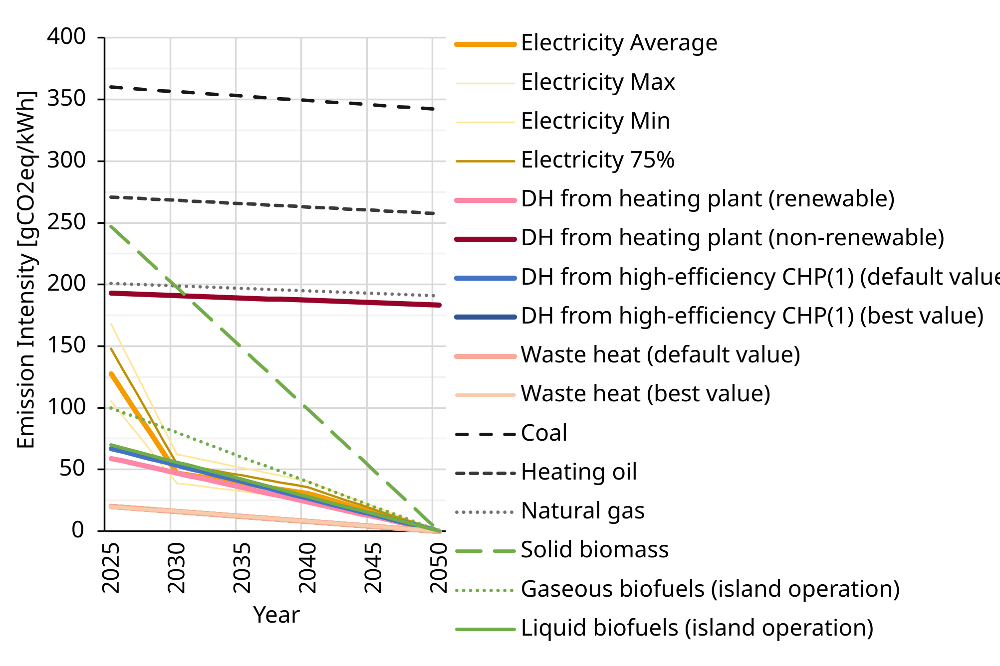

# Zielwert THG {#sec-zielwert-thg}
::: {.lead}
Vom nationalen Klimabudget zum kumulierten Emissionsbudget eines Quartiers
:::

Der Energiezielwert beschreibt die jährliche Leistung im Zielsystem. Der THG-Zielwert begrenzt dagegen die kumulierten Emissionen aus Errichtung, Betrieb, Instandhaltung und MIV über 50 Jahre.

## Wie entstehen 320 kg CO₂e je Quadratmeter?

### Nationale Grundlage und sektorale Verteilung

Das Verfahren unterscheidet drei Budgetvarianten. Ausgangspunkte sind das verbleibende nationale CO₂-Budget, Annahmen über natürliche Senken, ein Anteil von 50 % für Gebäude und MIV sowie eine nationale Bezugsfläche von 906,7 Mio. m² BGF. Der Klimabudgetansatz bezieht sich auf 1,5 °C mit 66 % Wahrscheinlichkeit; dokumentiert werden Varianten mit und ohne temporäre Überschreitung des Temperaturziels [@schneider2025declaration, Abschn. 2.3, Tab. 2 und A1, S. 6–7, 30].

Die Budgetvarianten L1, L2 und L3 beruhen auf einem Klimabudget **ohne temporäre Überschreitung** des Temperaturziels: Von 280 Mt CO₂ ab 2022 verbleiben nach Abzug der bis Ende 2024 angesetzten Emissionen 130 Mt ab 2025. Dieses Ausgangsbudget bildet die Referenz der Bewertung [@schneider2025declaration, Tab. A1].

Mit nationalem Restbudget $B_{\mathrm{AT}}$, Bevölkerung $P$, jährlicher Senkenleistung je Person $s$, Zeitraum $T$, Sektoranteil $\alpha$ und Bezugsfläche $A_B$ gilt:

$$
b_{\mathrm{THG}}
=\frac{\alpha\left(B_{\mathrm{AT}}+P\,s\,T\right)}{A_B}.
$$ {#eq-thg-allokation}

Budget und Senkenleistung werden in einer gemeinsamen Masseneinheit angesetzt. Das nationale CO₂-Budget dient als Grundlage für die Zuteilung; auf Quartiersebene werden die Treibhausgase mit GWP100 in CO₂-Äquivalenten bewertet.

| Größe | Referenzwert | Funktion |
|---|---:|---|
| Verbleibendes Budget ab 2025 | 130 Mt CO₂ | Ausgangsbudget ohne zusätzliche Senken |
| Bevölkerung | 9,0 Mio. Personen | Bezug für die Senkenannahme |
| Betrachtungsdauer | 50 Jahre | Kumulation der Senkenannahme |
| Anteil Gebäude und MIV | 50 % | Sektorale Zuteilung |
| Nationale Bruttogrundfläche im Zieljahr 2040 | 906,7 Mio. m² | Flächenbezogene Verteilung |

: Eingangsgrößen der THG-Allokation [@schneider2025declaration, Tab. A1, S. 30]. {#tbl-thg-eingaben}

Für L3 werden 1 t CO₂e pro Person und Jahr an natürlichen Senken angesetzt. Über 50 Jahre und 9 Mio. Personen entsprechen sie 450 Mt. Zusammen mit dem Ausgangsbudget ergeben sich 580 Mt, davon 290 Mt für Gebäude und MIV. Geteilt durch 906,7 Mio. m² ergibt dies gerundet **320 kg CO₂e/m² BGF**.

| Variante | Senkenannahme [t CO₂e/(Person a)] | THG-Budget [kg CO₂e/m² BGF] |
|---|---:|---:|
| L1 | 0 | 72 |
| L2 | 0,5 | 196 |
| L3 | 1,0 | 320 |

: Budgetvarianten nach Schneider et al. [@schneider2025declaration, Tab. 2, S. 7]. {#tbl-thg-budgetvarianten}

Die L-Werte sind **Budgetvarianten innerhalb der THG-Bewertung**, nicht die drei PEQ-Qualitätsstufen. Der für diesen Bericht zugrunde gelegte Zertifizierungswert beträgt 320 kg CO₂e/m² BGF. Seine Einhaltung ist zusammen mit der L3-Senkenannahme und den Bilanzregeln zu lesen. Die unterstellte nationale Senkenleistung ist kein vom einzelnen Quartier nachgewiesener Emissionsausgleich.

## Gebäudesektor: Bezugsflächen und Entwicklung {#sec-thg-flaechen}

Die Fläche bestimmt, wie ein nationales Budget auf Quadratmeter verteilt wird. Die folgenden Datenstände haben unterschiedliche Abgrenzungen; sie bilden **keine durchgängige Zeitreihe**. Insbesondere darf aus ihrer Differenz kein Rückgang des Gebäudebestands abgeleitet werden.

| Datenstand / Horizont | BGF [Mio. m²] | NGF [Mio. m²] | Rolle und Quelle |
|---|---:|---:|---|
| Statistikbezug 2021, GFZ-Hochrechnung | 1.058,935 | 847,1 | Bestandsverteilung nach Nutzung, Bundesland und Geschossklasse; @sec-gfz-verteilung; BGF = NGF / 0,8 |
| Building-Sector Pool, „heute“ (Jahr offen) | 1.112,341 | 889,873 | Gelieferte Typenflächen; NGF/BGF = 0,8 als Modellannahme; @sec-gebaeudebestand |
| Building-Sector Pool, Entwicklung 2040 | 1.126,579 | 901,263 | Neue Bottom-up-Energieauswertung; keine automatische Änderung der THG-Budgetfläche |
| Zielbestand 2040 der THG-Kalibrierung | 906,7 | nicht separat angesetzt | Bezugsfläche der Budgetzuteilung; @schneider2025declaration, Tab. A1 |
| Bestand 2025 und Zwischenjahre bis 2040 | nicht im Datensatz enthalten | nicht im Datensatz enthalten | Keine interpolierten Werte ohne harmonisierte Abgrenzung |

: Flächenbezüge des Energie- und THG-Modells. {#tbl-thg-flaechenentwicklung}

| Baustein der Fortschreibung | Benötigte Angaben | Aktueller Status |
|---|---|---|
| Ausgangsbestand | Stützjahr, Nutzung, konditionierte Fläche, NGF/BGF-Abgrenzung | Statistikmodell 2021 vorhanden; Abgleich mit THG-Systemgrenze offen |
| Neubau und Erweiterung | Zusätzliche m² je Nutzung und Jahr | Typengewichteter Neubauanteil 2040 vorhanden; zeitliche Übergangsbilanz nicht festgelegt (@sec-gebaeude-flaechen) |
| Abbruch und Umnutzung | Abgänge und Nutzungsverschiebungen je Jahr | Nicht im Datensatz enthalten |
| Sanierung | Sanierte m² und energetischer Zustand je Jahr | Keine zusätzliche Geschossfläche allein durch Sanierung unterstellen |
| Zielbestand | Konsistente Summe aus Bestand, Zu- und Abgängen | 906,7 Mio. m² als bestehende Kalibrierungsannahme erhalten |

: Datenumfang der Gebäudeflächenentwicklung. {#tbl-thg-fortschreibung}

## Drei Zeitbegriffe

Der Bewertungszeitraum beträgt **50 Jahre, von 2025 bis 2075**. Innerhalb dieses Horizonts werden die treibhauswirksamen Effekte bilanziert.

Die Ableitung orientiert sich am österreichischen Klimaneutralitätsziel **2040**; auf dieses Jahr beziehen sich auch die zugrunde gelegten Flächenprognosen. **2050** wird als vorsorglich späterer Dekarbonisierungszeitpunkt angesetzt, um eine mögliche Verzögerung gegenüber dem ursprünglichen Ziel abzubilden. Damit wird das Prognosejahr der Bezugsfläche nicht automatisch auf 2050 verschoben. Eine spätere Umstellung erfordert eine dokumentierte Fortschreibung.

Die vereinfachende Annahme einer vollständigen Dekarbonisierung der betrachteten Prozesse **ab 2050** führt dazu, dass danach im Modell keine zusätzlichen Emissionen mehr entstehen. Das emissionswirksame Zeitfenster liegt damit faktisch vor 2050, obwohl die Betrachtung bis 2075 reicht. Dies ist eine Szenarioannahme, keine Verkürzung des Bewertungszeitraums und keine Garantie der tatsächlichen Entwicklung [@schneider2025declaration, Abschn. 2.4, S. 7–8; @schneider2026thesis, Abschn. 3.2.8, S. 58–60].

**GWP100** bezeichnet den 100-jährigen Charakterisierungshorizont des Treibhauspotenzials für die Bewertung unterschiedlicher Treibhausgase in CO₂-Äquivalenten. Diese 100 Jahre bestimmen nicht die Projektlaufzeit.

Errichtungsemissionen beanspruchen das Budget unmittelbar. Eine rechnerische Verteilung auf 50 Jahresraten würde ihren Emissionszeitpunkt nicht ändern. Für Etappen eines Renovierungsfahrplans muss deshalb betrachtet werden, wann bauliche Emissionen entstehen und welche Betriebsemissionen bis zur jeweiligen Maßnahme anfallen.

## Absenkpfade und kumuliertes THG-Budget {#sec-thg-pfade}

Für die Lebenszyklusbewertung werden zeitabhängige Emissionsfaktoren verwendet. Ihre Entwicklung bildet einen angenommenen Dekarbonisierungspfad ab und beeinflusst insbesondere die Bewertung der Betriebsemissionen im Szenariozeitraum.

{#fig-absenkpfade width="100%"}

Die bestehende Abbildung unterscheidet Netzstromvarianten, Fernwärmesysteme, Abwärme sowie fossile und biogene Brennstoffe. Die numerischen Zeitreihen sind im Datensatz nicht enthalten; die Abbildung dokumentiert die Szenariopfade qualitativ. Die methodische Grundlage bilden @schneider2025declaration, Abschn. 2.4 und 2.6, sowie @schneider2026thesis, Abschn. 3.2.8.

| Größe | Anwendung im kumulierten Budget | Dokumentierter Stand |
|---|---|---|
| Netzstrom und weitere Energieträger | Jahresverbrauch × zeitabhängiger THG-Faktor, über die Jahre summiert | Trägerspezifische Pfade in @fig-absenkpfade; numerische Stützwerte und Interpolation nicht im Datensatz enthalten |
| Herstellung, Ersatz und Lebensende | Emissionen zum jeweiligen Ereigniszeitpunkt | Prozessbezogene Dekarbonisierungsannahmen des Referenzverfahrens |
| Vollständige Dekarbonisierung ab 2050 | Im Modell keine zusätzlichen Emissionen der so erfassten Versorgung und Prozesse | Szenarioannahme, keine physische Zusicherung; Betrachtung läuft bis 2075 weiter |
| Natürliche Senken | Bestandteil der nationalen Budgetzuteilung | Eigene Annahme; kein Abzug durch einen fallenden Stromfaktor |

## Rekalibrierung: Welche Stellgrößen ändern sich?

Eine Fortschreibung muss klären, ob Datenbasis, Szenario oder Verteilungsentscheidung verändert werden. Beim THG-Budget sind Restbudget, Senkenannahme, Sektoranteil und Bezugsfläche maßgeblich. Diese Größen sind bei einer Rekalibrierung gemeinsam zu überprüfen [@schneider2025declaration, Abschn. 4.2–4.3, S. 27–28].

Zusätzlicher Baubedarf kann eine Entscheidung über die sektorale Verteilung auslösen. Ein höheres Budget je Quadratmeter entsteht daraus nicht von selbst: Bei unverändertem Sektorbudget verteilt sich dieselbe Menge auf mehr Fläche. Soll der Gebäudesektor mehr Budget erhalten, muss die entsprechende Entlastung anderer Sektoren oder eine begründete Änderung der Budgetgrundlage ausgewiesen werden. Eine Erhöhung ohne solche Deckung verändert den Gesamtanspruch.

### PV-Errichtung und sektorale Konsistenz

Die grauen Emissionen der PV-Anlagen bleiben außerhalb der Quartiersbilanz, weil die Erzeugungsanlagen im nationalen Sektormodell der Energieversorgung zugeordnet sind. Diese Abgrenzung setzt voraus, dass ihre Emissionen dort konsistent erfasst werden [@schneider2025declaration, Abschn. 2.4.1 und 4.2, S. 8–9, 27–28].

Eine Alternative nimmt die PV-Errichtung in die Quartiersbilanz auf. Dann müssen Emissionen und Budgetzuordnung gemeinsam neu abgegrenzt werden. Eine zusätzliche Belastung bei unverändertem, anders abgegrenztem Budget würde zwei Bilanzmodelle vermischen. Wie sich die konsistente Alternative auf Grenzwert und Vorteil zusätzlicher PV auswirkt, ist zu berechnen. @sec-bilanzregeln erläutert die Abgrenzung der PV-Errichtung und die Voraussetzungen eines Vergleichs mit einer gebäudebezogenen Normbilanz.

## Folgerungen für Planung und Verwaltung

Die Allokation zeigt, welche Beiträge ein Quartier selbst erbringen soll und welche Voraussetzungen es aus dem übergeordneten System übernimmt. Ein Nachweis sollte deshalb neben dem Ergebnis den Methodenstand, die Systemgrenzen, Flächenbezüge und Kontextgutschriften ausweisen. Erst damit lässt sich unterscheiden, ob eine Verbesserung aus einer Planungsmaßnahme, einer geänderten Annahme oder einem anderen Bewertungsmaßstab stammt.
