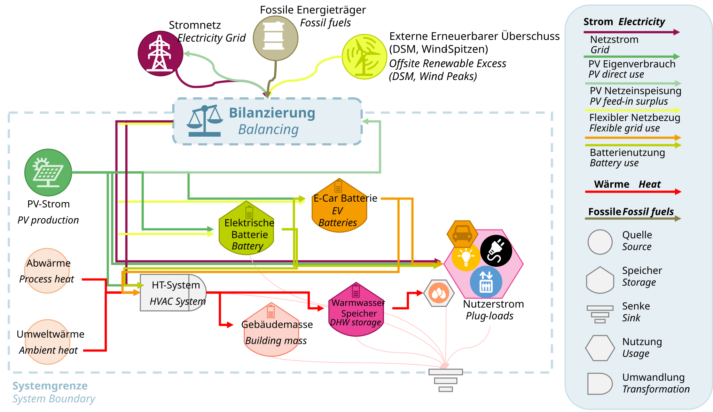
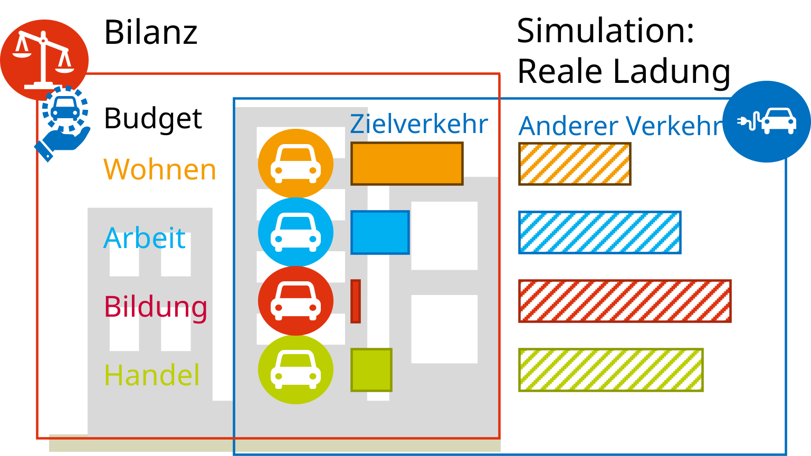
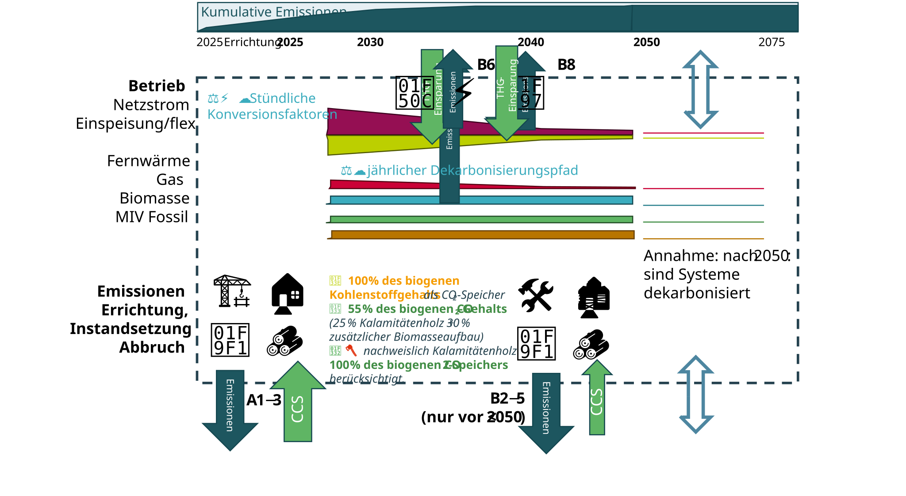
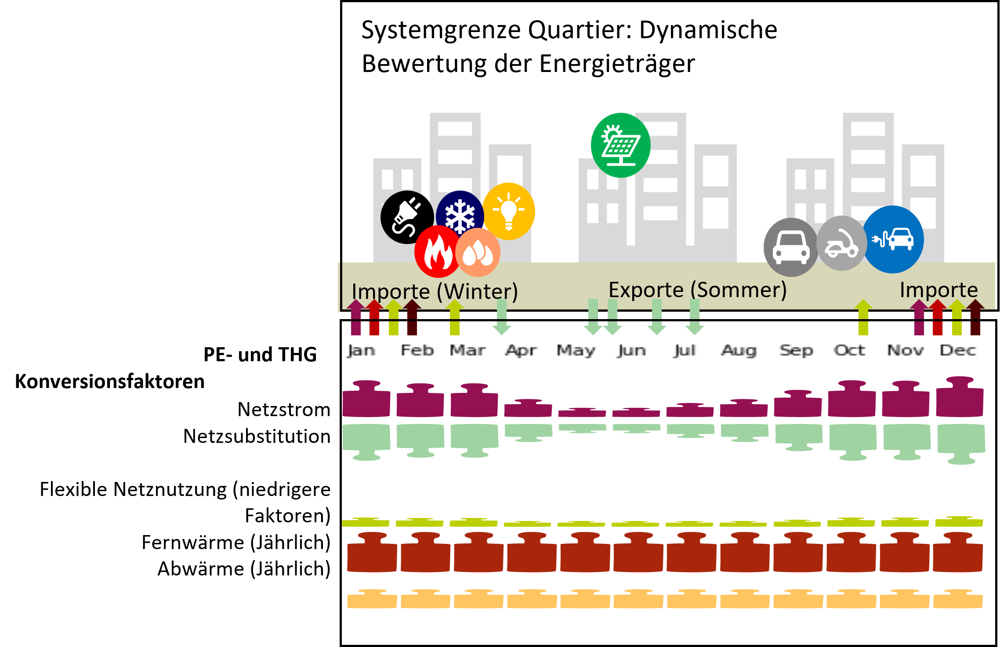

# Systemgrenze des Quartiers {#sec-bilanzregeln}

::: {.lead}
Was gehört zur Quartiersbilanz – und wie werden Energieflüsse und Emissionen bewertet?
:::

Die Aussage einer Energie- oder Treibhausgasbilanz hängt wesentlich davon ab, **was einbezogen, wie zugeordnet und über welchen Zeitraum bewertet wird**. Der klimaaktiv Standard legt deshalb räumliche, funktionale und zeitliche Systemgrenzen fest. Diese gelten für Energiebedarf, erneuerbare Erzeugung, Mobilität und Lebenszyklusemissionen ebenso wie für die zugehörigen Zielwerte und Kontextfaktoren.

Die drei Qualitätsstufen und ihre Erfüllungskriterien werden im Kapitel @sec-standard eingeführt. Dieses Kapitel erläutert die **konkreten Bilanzierungsregeln**. Die nationale Herleitung der Anforderungen steht in @sec-allokation und @sec-zielwert-thg; ihre kontextabhängige Anwendung in @sec-kontext.

## Räumliche Systemgrenze: Was gehört zum Quartier?

Das bewertete Quartier wird als räumlich und funktional zusammenhängende Einheit abgegrenzt. Zum Projektumfang gehören die einbezogenen Gebäude, ihre zugehörigen Flächen sowie gemeinschaftliche Versorgungs- und Erzeugungsanlagen. Auch unbeheizte Gebäudeteile, Keller und zugehörige Außenanlagen können für die bauliche Treibhausgasbilanz relevant sein, selbst wenn sie nicht zur konditionierten Nutzfläche zählen [@schneider2026thesis, Abschn. 3.2.2, S. 51–53].

::: {.callout-important icon="true"}
Die Grenze darf nicht allein mit dem Ziel gewählt werden, günstige Erzeugungsflächen einzuschließen oder besonders energieintensive Nutzungen auszuklammern. Bei Anlagen, die mehrere Gebäude oder auch Bereiche außerhalb des Quartiers versorgen, muss die **Zuordnung der Energieflüsse und baulichen Aufwendungen** nachvollziehbar sein.
:::

Für die Bewertung sind insbesondere folgende Bezugsgrößen zu dokumentieren:

- **Grundstücks- beziehungsweise Quartiersfläche:** maßgeblich für die räumliche Abgrenzung und die Geschoßflächenzahl (GFZ).
- **Bruttogrundfläche (BGF):** Bezugsgröße des kumulierten THG-Budgets und Bestandteil der GFZ.
- **Konditionierte Nettogrundfläche (NGF):** Bezugsgröße der spezifischen betrieblichen Primärenergiebilanz.
- **Nutzungsanteile:** Grundlage für Bedarfsprofile und die flächengewichtete Zuordnung von Mobilitätsbudgets.

Die Flächenbezüge sind **nicht austauschbar**: Ein spezifischer Wert in kWh PE/(m² NGF a) ist ohne Flächenumrechnung nicht mit einem Wert in kg CO₂e/m² BGF vergleichbar. Änderungen der Quartiersgrenze können gleichzeitig Bedarf, lokale Erzeugung, GFZ und verfügbare Budgets verändern. Varianten sind daher nur bei dokumentierter Abgrenzung sinnvoll vergleichbar.

::: {.callout-note title="Abbildung – Räumliche und funktionale Quartiersgrenze (Platzhalter)" appearance="minimal" icon=false}
Schematische Quartierszeichnung mit Umrandung des bewerteten Gebiets, konditionierten Gebäudeflächen, unbeheizten Bauteilen, gemeinschaftlicher Wärmeversorgung, lokaler PV und Netzschnittstellen. Beschriftung der verschiedenen Flächenbezüge (Grundstück, BGF, NGF). Außerhalb liegende Infrastruktur und Erzeugung getrennt kennzeichnen. **Ziel:** zeigen, dass die physische Quartiersgrenze nicht mit jeder sektoralen Bilanzgrenze identisch ist.

*Vorgesehene Grundlage:* Schneider (2026), Abschn. 3.2.2; grafisch neu aufbereiten.
:::

## Funktionale Bilanzgrenze: Welche Nutzungen und Prozesse zählen?

Der Umfang der Bewertung steigt mit der angestrebten Qualitätsstufe. Der Gebäudebetrieb ist Bestandteil aller Stufen; bei den beiden erweiterten Stufen kommt der zugeordnete motorisierte Individualverkehr (MIV) hinzu. Erst die Klimaneutralitätsstufe verlangt darüber hinaus die Einhaltung eines kumulierten THG-Budgets einschließlich der definierten baulichen Lebenszyklusprozesse [@schneider2025declaration, Tab. 1; @klimaaktiv2026peq, S. 8–11].

Für die Abgrenzung der **einzelnen Bilanzbestandteile** gilt:

| Bilanzbestandteil | Einbezogene Größen und Zuordnung |
|---|---|
| Gebäudebetrieb | Raumheizung, Kühlung, Warmwasser, Lüftung, Beleuchtung, Hilfsenergie und weitere im Verfahren erfasste gebäudebezogene Stromanwendungen |
| Erneuerbare Energieaufbringung | Dem Quartier zugeordnete Erzeugung sowie Nutzung, Speicherung, Bezug und Abgabe nach den festgelegten Bilanzregeln |
| Motorisierter Individualverkehr | Dem Quartier nach dem Zielverkehrsprinzip zugeordnete Fahrenergie; bei der THG-Bilanz zusätzlich die im Verfahren erfasste Fahrzeugherstellung |
| Bauliche Lebenszyklusprozesse | Herstellung, Errichtung, Instandhaltung, Ersatz und Lebensende nach dem unten beschriebenen Modulumfang |
| Kontextfaktoren | Virtuelle Gut- und Lastschriften für Dichte, Mobilität und Sanierung; **keine physischen Energiemengen** |

: Funktionale Abgrenzung der PEQ-Bewertung. Die erforderlichen Bilanzbestandteile richten sich nach der Qualitätsstufe; eine Übersicht dazu bietet das Kapitel *Der Standard*. {#tbl-bilanzumfang}

Ein Energieausweis, der vor allem Heizung und Warmwasser beschreibt, bildet damit nicht automatisch den vollständigen betrieblichen Quartiersbedarf ab. Bei gemeinsam versorgten Nutzungen muss erkennbar bleiben, welchem Teil des Quartiers die berechneten Mengen zugeordnet werden.

## Primärenergiebilanz: Physische Flüsse und Bewertung trennen

Das Quartiersmodell bestimmt zunächst die **physischen Energieflüsse** über ein Jahr: Bedarf der Anwendungen, lokale Erzeugung, direkten Eigenverbrauch, Lade- und Entladevorgänge, Speicherverluste sowie Bezug und Abgabe über die Quartiersgrenze. Ein Speicher stellt dabei keine zusätzliche Energiequelle dar; er verschiebt verfügbare Energie und verursacht Verluste.

Anschließend werden die bilanzierten Energiemengen mit den festgelegten Primärenergiefaktoren bewertet. Der **bewertete Primärenergiesaldo** ist positiv bei einem Überschuss und negativ bei einem Bedarfssaldo. Auf diesen Wert wirken die Kontextgutschriften und -lastschriften. Für die Erfüllung der jeweiligen Qualitätsstufe ist die Bilanz *einschließlich* der relevanten Kontextfaktoren maßgeblich [@schneider2025declaration, Abschn. 2.2].

Eine Kontextgutschrift ist daher weder zusätzlich erzeugte Energie noch eine tatsächliche Verringerung des Netzbezugs. Auch ein positiver **Bewertungssaldo** ist nicht mit elektrischer Autarkie gleichzusetzen. Die formale Kombination von Saldo und Kontextkomponenten wird in @sec-kontext angegeben.

Die Quartiersbilanz verknüpft Energiequellen, Umwandlungsanlagen, Speicher und Nutzungen. Energiebezug und Energieabgabe werden an der Systemgrenze erfasst.

{#fig-energiemodell-betrieb width="100%"}

::: {.callout-note title="Abbildung – Vom Energiefluss zur Bewertungsbilanz (Platzhalter)" appearance="minimal" icon=false}
Dreistufige Grafik: **(1)** physische Energieflüsse (PV, Anwendungen, Speicher, Netzbezug/-export), **(2)** zeitlich gewichteter Primärenergiesaldo, **(3)** Addition virtueller Kontextfaktoren zum bewerteten Endsaldo. Physische und virtuelle Größen grafisch deutlich unterscheiden. Optional eine interaktive HTML-Version mit Tooltip zu jeder Komponente und einem feststehenden, druckbaren Zustand für PDF/DOCX.

*Vorgesehene Grundlage:* Bilanzlogik nach Schneider et al. (2025) sowie @eq-kontextbilanz.
:::
## Mobilität: Zugeordnete Fahrten sind nicht gleich lokale Ladevorgänge

Der MIV wird nach dem **Zielverkehrsprinzip** zugeordnet: Relevant sind Fahrten, deren Ziel im betrachteten Quartier liegt, beispielsweise Heim-, Arbeits- oder Einkaufswege. Fahrten zu anderen Zielen werden den jeweiligen Zielorten zugeordnet. Der öffentliche Verkehr wird im beschriebenen Verfahren nicht unmittelbar als Quartiersmobilität bilanziert; ein geringerer MIV-Anteil vermindert jedoch den zugeordneten Fahrenergiebedarf [@schneider2025declaration, Abschn. 2.4.2].

Bei Elektrofahrzeugen können **Fahrenergie und Ladevorgang räumlich auseinanderfallen**. Das Modell berücksichtigt deshalb das Laden innerhalb und außerhalb des Quartiers und die Zuordnung von Fahrten zu verschiedenen Zielen. Wenn Fahrzeugbatterien zusätzlich zur Versorgung des Gebäudes beitragen, handelt es sich um einen Speicherfluss, nicht um eine zweite erneuerbare Energiequelle. Die für die Fahrt erforderliche Energie muss weiterhin berücksichtigt werden.

In der THG-Bilanz wird außerdem die Fahrzeugherstellung in dem im Referenzverfahren vorgesehenen Umfang angesetzt. Daraus folgt keine vollständige Flotten-LCA aller künftigen Fahrzeugwechsel. Das nutzungsbezogene Mobilitätsbudget ist ebenfalls von realen Ladeleistungen, Anschlusskapazitäten und der tatsächlichen Anwesenheit von Fahrzeugen zu unterscheiden. Budgetzuordnung und Anwendung des Mobilitätskontextfaktors beschreibt @sec-kontext-mobilitaet; die stündliche Fahrzeugmodellierung ist in @schneider_annual_2025 beschrieben.

::: {.callout-note title="Abbildung – Zielverkehr und Ladeort (Platzhalter)" appearance="minimal" icon=false}
Vereinfachte Karte mit Wohn-, Arbeits- und Einkaufsquartier. Pfeile zeigen nach dem Zielverkehrsprinzip zugeordnete Fahrten; Ladepunkte zeigen davon getrennt die physischen Orte der Stromaufnahme. Ergänzend schematische Zuordnung zu Mobilitätsbedarf, Nutzungsgutschrift und Fahrzeugherstellung. **Ziel:** Doppelzählung von Fahrtenergie, Ladevorgang und Budgetgutschrift anschaulich vermeiden.

*Vorgesehene Grundlage:* Schneider et al. (2025), Abschn. 2.4.2.
:::

Die energetische Zuordnung von Mobilität und die tatsächlichen Ladevorgänge folgen unterschiedlichen Systemgrenzen. Fahrenergie wird dem Zielverkehr zugerechnet; geladen werden kann auch außerhalb des betrachteten Quartiers.

{#fig-mobilitaetsbilanzgrenze width="90%"}

## Lebenszyklus-Treibhausgasbilanz: Welche Module werden berücksichtigt?

Die Klimaneutralitätsstufe berücksichtigt neben Betrieb und MIV die definierten Emissionen der baulichen Infrastruktur. Diese umfasst insbesondere Gebäude und zugehörige Anlagen auf dem Grundstück, einschließlich technisch relevanter Anlagen und nicht konditionierter Bauteile. Die folgende Tabelle dokumentiert den in den wissenschaftlichen Arbeiten beschriebenen PEQ-Umfang; sie ist **nicht** als pauschale Übereinstimmung mit einem anderen Gebäudebilanzierungsstandard zu lesen [@schneider2025declaration, Abschn. 2.4 und Tab. 3].

| Lebenszyklusmodul oder Prozess | Behandlung im beschriebenen PEQ-Verfahren |
|---|---|
| A1–A3: Herstellung | Rohstoffe, Transport zur Herstellung und Produktionsprozesse werden erfasst. |
| A4–A5: Transport und Errichtung | Erfassung abhängig von praktischer Erhebbarkeit und Datenverfügbarkeit; tatsächlich berücksichtigten Umfang dokumentieren. |
| B1 und B7: Nutzung und Wasser | Nicht Teil der Kernbilanz. |
| B2–B5: Wartung, Reparatur, Ersatz und Erneuerung | Berücksichtigt; Ersatzzeitpunkt und Dekarbonisierungsannahmen beeinflussen das kumulierte Ergebnis. |
| B6: Betriebsenergie | Bewertung der Energieflüsse mit den zeitlich zugeordneten Emissionsfaktoren. |
| B8: Zugeordnete Mobilität | MIV einschließlich des im Verfahren berücksichtigten Anteils der Fahrzeugherstellung. |
| C1–C4: Lebensende | Berücksichtigt; für Ereignisse ab 2050 gilt der angenommene Dekarbonisierungspfad. |
| D: Wirkungen außerhalb der Gebäudegrenze | Wiederverwendung und Verwertung nach der gewählten LCA-Konvention; exportierte Energie als Substitutionswirkung. |
| Öffentliche Infrastruktur außerhalb des Grundstücks | Nicht Teil der baulichen Kernbilanz; gegebenenfalls separat auszuweisen. |

: Lebenszyklusumfang nach Schneider et al. (2025), Tab. 3, und dem im Bericht dokumentierten Referenzverfahren. {#tbl-lca-umfang}

Die Lebenszyklusbilanz verbindet zeitlich auftretende Betriebsemissionen mit den Emissionen aus Errichtung, Instandhaltung und Lebensende. Hinzu kommen die im Verfahren berücksichtigten Gutschriften und Speicherwirkungen.

{#fig-lebenszyklus-thg width="100%"}

Die zeitliche Abbildung der Emissionen ist relevant: **Emissionen einer heute ausgeführten Maßnahme entstehen heute**; sie werden nicht durch die Verteilung auf 50 rechnerische Jahresraten zeitlich verschoben. Spätere Ersatz- und Instandhaltungsmaßnahmen bleiben technisch erforderlich, auch wenn die angenommene Dekarbonisierung ihre modellierte Emissionswirkung reduziert.

### Photovoltaik, Eigenverbrauch und Netzeinspeisung

Lokal erzeugter PV-Strom kann direkt verwendet, gespeichert oder – soweit technisch möglich – in das öffentliche Netz abgegeben werden. Ein direkter PV-Verbrauch vermeidet Netzbezug; exportierter Strom wird im beschriebenen Referenzverfahren als Substitution von Netzstrom bewertet. Für Bezug und Export gelten zum jeweiligen Zeitpunkt dieselben operativen Bewertungsfaktoren. Der konkrete Effekt hängt daher auch von zeitlicher Verfügbarkeit, Verlusten und realisierbarer Einspeisung ab [@schneider2025declaration, Abschn. 2.4.1].

Die **Errichtungsemissionen der PV-Anlage** werden im publizierten Referenzansatz dem nationalen Energieversorgungssektor und nicht der Quartiers-THG-Bilanz zugeordnet. Das ist eine bewusste sektorale Bilanzgrenze und kann von einer gebäudebezogenen Ökobilanz abweichen. Ein Vergleich mit einer Bilanz nach EN 15978 muss deshalb unter anderem Bauteilumfang, Lebenszyklusmodule und den Umgang mit exportierter Energie abgleichen [@cen2026en15978]. Eine alternative Einbeziehung der PV-Errichtung in die Quartiersbilanz würde gleichzeitig eine konsistente Anpassung der Budgetzuordnung erfordern (@sec-fortschreibung).

<!-- REDAKTIONSPRÜFUNG: Behandlung der PV-Herstellung und PV-bezogenen LCA-Ein-/Ausgaben mit freizugebendem PEExcel-Stand und offizieller Standardfassung abgleichen; v1.12.7 hat das LCA-Modell erweitert. Keine stillschweigende Gleichsetzung von publizierter Allokationsmethode und aktuellem Softwarestand. -->

### Biogener Kohlenstoff

Baustoffe aus nachwachsenden Rohstoffen können Kohlenstoff während ihrer Nutzungsdauer speichern. Diese Speicherwirkung muss von Herstellungs- und End-of-Life-Emissionen getrennt betrachtet werden. Das dokumentierte vereinfachte Verfahren rechnet den biogenen CO₂-Gehalt materialabhängig an: **100 %** bei schnell nachwachsenden pflanzlichen Materialien, **55 %** bei Holz aus üblich bewirtschafteten Wäldern und **100 %** bei nachgewiesenem Kalamitätsholz. Verbundmaterialien werden massengewichtet behandelt [@schneider2025declaration, Abschn. 2.5.2].

Dies ist eine **Bilanzierungskonvention**, keine Aussage, dass jeder Holzbau emissionsfrei wäre. Die gleiche Speicherwirkung darf nicht doppelt angesetzt werden, etwa wenn sie bereits in einem übernommenen LCA-Datensatz enthalten ist. Eine dynamische Bewertung von Speicherung, Nachwachsen und späterer Freisetzung wäre methodisch differenzierter, benötigt aber eine zum Budget konsistente Bewertung und ist nicht ohne Weiteres mit dem statischen GWP100-Kennwert vergleichbar [@schneider2025declaration, Abschn. 2.5.1].

## Zeitliche Bilanzierung und Emissionsentwicklung

### Stündliche Energiesimulation, monatliche Bewertungsfaktoren

Die Betriebsenergie wird über ein vollständiges Jahr **stündlich** berechnet. Damit werden die zeitliche Überlagerung von Bedarf und erneuerbarer Erzeugung sowie der Betrieb von Wärmepumpen, Speichern und flexiblen Verbrauchern berücksichtigt. Im hier dokumentierten Referenzverfahren werden die stündlichen Stromflüsse anschließend mit **monatlichen Primärenergie- und THG-Faktoren** bewertet [@schneider2026thesis, Abschn. 3.2.3–3.2.4; @schneider2025declaration, Abschn. 2.6].

Die langfristigen THG-Absenkpfade und ihre Rolle im kumulierten Budget erläutert @sec-thg-pfade. Die Unterscheidung von Endenergie, Primärenergie und THG-Gewichtung steht in @sec-energie-bewertung.

Die beiden Auflösungen erfüllen unterschiedliche Aufgaben: Die stündliche Simulation bildet beispielsweise Eigenverbrauch, Speicherverluste und Lastverschiebungen ab. Ein unveränderter Monatsfaktor bewertet dagegen zwei gleich große Netzstrommengen innerhalb desselben Monats identisch – selbst wenn sie zu unterschiedlichen Tageszeiten auftreten. Eine Flexibilitätsmaßnahme kann somit physisch sinnvoll sein, ohne allein über den Monatsfaktor einen zusätzlichen Bewertungsbonus zu erhalten.

::: {.callout-note title="Abbildung – Stundenflüsse und monatliche Bewertung (Platzhalter)" appearance="minimal" icon=false}
Gemeinsame Zeitachse für beispielhafte stündliche PV-Erzeugung, Strombedarf, Netzbezug und -export; darunter die zugeordneten monatlichen Primärenergiefaktoren. Eine Markierung erklärt, weshalb die **Simulation stündlich** ist, die **Gewichtung aber monatlich** erfolgt. Daten aus einer freigegebenen PEExcel-Beispielvariante, nicht aus einem erfundenen Referenzprojekt.

*Vorgesehene Umsetzung:* Plotly-Zeitreihen im HTML, SVG/PNG im PDF und DOCX.
:::

{#fig-konversionsfaktoren width=90%}

### Bewertungszeitraum der Treibhausgasbilanz

Die Lebenszyklus-THG-Bilanz betrachtet den Zeitraum **2025–2075 (50 Jahre)**. Emissionen aus Errichtung, späteren Maßnahmen, Gebäudebetrieb und Mobilität werden innerhalb dieses Zeitraums kumuliert. Die Emissionsfaktoren folgen im Referenzverfahren energieträger- und prozessbezogenen Entwicklungspfaden. Die angenommene vollständige Dekarbonisierung der betrachteten Versorgung und Prozesse **ab 2050** ist eine Szenarioannahme und kein Nachweis einer bereits tatsächlich emissionsfreien Versorgung [@schneider2025declaration, Abschn. 2.4; @schneider2026thesis, Abschn. 3.2.8].

Drei Zeitangaben sind auseinanderzuhalten: **2040** als Bezugspunkt des österreichischen Klimaneutralitätsziels und der nationalen Allokation, **2025–2075** als Zeitraum der kumulierten Quartiersbewertung sowie **GWP100** als 100-jähriger Charakterisierungshorizont von Treibhausgasen. GWP100 bedeutet nicht, dass die Quartiersbilanz über 100 Jahre geführt wird. Die Budgetherleitung und die Bedeutung dieser Annahmen stehen in @sec-zielwert-thg.

## Konsequenzen für die Nachweisführung

Ein nachvollziehbarer Quartiersnachweis dokumentiert die **Quartiersgrenze**, die **Bezugsflächen**, die **Nutzungen**, die **zugeordneten Energie- und Mobilitätsflüsse**, die **Lebenszyklusmodule** sowie die verwendeten **Zeitreihen, Bewertungsfaktoren und Methodenstände**. Neben dem Ergebnis nach Kontextkorrektur sollte die physische beziehungsweise bewertete Bilanz **vor** Kontextfaktoren getrennt ausgewiesen werden.

Die hier festgelegten Grenzen sind Teil des Bewertungsmaßstabs. Sie ersetzen keine vertiefende bauphysikalische, anlagentechnische oder gebäudebezogene Ökobilanz. Wie die Ergebnisse in Planung und Deklaration zu verwenden sind, wird in @sec-anwendung beschrieben.
