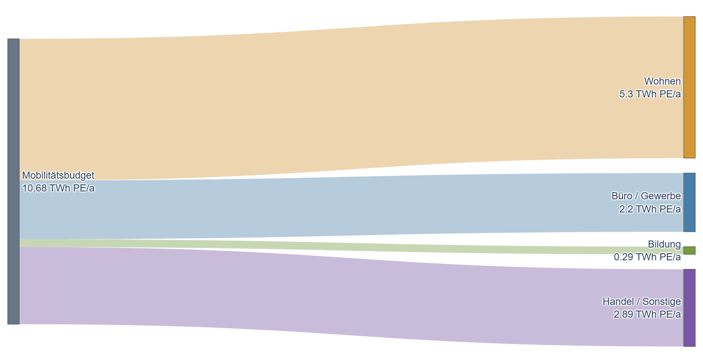

# Kontextfaktor Mobilität {#sec-kontext-mobilitaet}
::: {.lead}
Vom national verfügbaren Budget zur nutzungsbezogenen Gutschrift und zum örtlichen Verkehrsbedarf
:::

Das sektorale Zielbild in @sec-allokation liefert die energetische Grundlage. Erst zusätzliche Zuordnungsentscheidungen begründen ein Mobilitätsbudget. Die folgenden Werte dokumentieren die initiale Operationalisierung 2023; für Transition 2040 bleibt eine neue Gutschrift offen.

## Mobilitätsbudget: vom nationalen Anteil zur Nutzung

### Initiale Operationalisierung 2023

Die folgenden Streicher-basierten Mobilitätsgutschriften bleiben der geltende Bewertungsstand dieser Berichtsfassung. Die veröffentlichte klimaaktiv-Broschüre 2026 beschreibt den Kontextfaktor Mobilität; das bereitgestellte Tool-Handbuch Version 1.08 dokumentiert die nutzungsabhängige virtuelle Deckung und beispielhaft den Wohnwert von 14,11 kWh PE/(m² NGF a) [@klimaaktiv2026peq, S. 10; @peq2026handbuch, S. 66]. Die vollständigen vier Referenzwerte stammen aus der Kalibrierung 2023. Damit wird keine vollständige Prüfung der aktuell produktiven Softwareversion behauptet.

Zentral beziehungsweise regional erzeugte erneuerbare Energie wird in der historischen Zuordnung zunächst für übergeordnete Bedarfe, insbesondere Industrie und öffentlichen Verkehr, reserviert. Der verbleibende Saldo begründet das Mobilitätsbudget. Gebäude übernehmen zugleich dezentrale Erzeugungsaufgaben und die Bilanzierung des ihnen zugeordneten MIV. Diese Priorität ist eine Allokationsentscheidung und keine physische Trennung des Stromnetzes [@schneider2020lokal, Abschn. 3.1.4 und 5.1; @schneider2023context, Abschn. 6.2].

Der motorisierte Individualverkehr erweitert den Energiebedarf, für den das Quartier bilanziell Verantwortung übernimmt. Gleichzeitig erhält er einen Anteil der zentral bereitgestellten erneuerbaren Energie. Dieser Anteil wird über die Nutzungen auf Quartiere verteilt.

Für den MIV sind 6,30 TWh/a Strom und 0,36 TWh/a Biomasse zugeordnet. Mit der primärenergetischen Gewichtung ergibt sich ein Budget von 10,68 TWh PE/a [@schneider2023context, Tab. 8, S. 16].

Die Verteilung folgt den Anteilen der Nutzungen am österreichischen Zielverkehr und ihren nationalen Nutzflächen. Für eine Nutzung \(u\) gilt:

$$
c_{\mathrm{M},u}
=\frac{E_{\mathrm{M},u}}{A_{\mathrm{NGF},u}}.
$$ {#eq-mobilitaetsbudget}

Die nationale Energiemenge \(E_{\mathrm{M},u}\) in kWh PE/a wird durch die zugehörige Nettogrundfläche geteilt. Das Ergebnis ist die jährliche Mobilitätsgutschrift je m² NGF. Bei gemischter Nutzung werden die Gutschriften mit den jeweiligen Quartiersnutzflächen gewichtet.

| Nutzung | Budget [TWh PE/a] | Fläche [Mio. m² NGF] | Gutschrift [kWh PE/(m² NGF a)] |
|---|---:|---:|---:|
| Wohnen | 5,30 | 375,6 | 14,11 |
| Büro und Gewerbe | 2,20 | 53,1 | 41,47 |
| Bildung | 0,29 | 22,5 | 12,93 |
| Handel und sonstige Nutzungen | 2,89 | 96,5 | 29,97 |

: Nutzungsbezogene Mobilitätsallokation, übernommen aus Tabelle 9 [@schneider2023context, S. 16]. {#tbl-mobilitaetsallokation}

Die Gutschrift richtet sich nach der Nutzung; der Mobilitätsbedarf hängt zusätzlich von Standort, Verkehrsverhalten und Fahrzeugflotte ab. Ein hoher Bedarf erzeugt keinen entsprechend hohen Budgetanspruch. Bei gleicher Nutzung bleibt ein Quartier mit geringerem MIV-Bedarf bilanziell im Vorteil [@schneider2026thesis, Abschn. 3.2.7, S. 56–57].

Für die Bewertung wird der Zielverkehr dem Quartier zugeordnet. Die Simulation der Lade- und Speicherflüsse muss dagegen die tatsächliche Anwesenheit und Ladung der Fahrzeuge berücksichtigen. Ein zugeteiltes Mobilitätsbudget ist weder ein physisches Ladeangebot noch eine Aussage über die nutzbare Batteriekapazität.

Die Mobilitätsallokation beruht auf den Mobilitätsdaten von 2013/2014 und dem nationalen Energieszenario. Neue Erhebungen zu Verkehrsverhalten, Fahrzeugflotte und Flächennutzung ermöglichen eine Aktualisierung der Gutschriften. Das Zuordnungsprinzip bleibt dabei bestehen; Ausgangsbudget und Verteilung werden gemeinsam überprüft.


### Verteilung des belegten Primärenergiebudgets

Das Sankey zeigt ausschließlich die Verteilung von **10,68 TWh PE/a** auf Nutzungen, nicht physische Stromflüsse. Die zuvor genannten 6,30 TWh Strom und 0,36 TWh Biomasse werden deshalb nicht als unmittelbar anschließende Flüsse gleicher Einheit dargestellt. Ihre PE-Gewichtung ist ein eigener Rechenschritt [@schneider2023context, Tab. 8–9].

::: {.content-visible when-format="html"}
```{=html}
<iframe src="../Abbildungen/mobilitaetsbudget_sankey.html" title="Verteilung des Mobilitätsbudgets in TWh Primärenergie" style="width:100%;height:540px;border:0" loading="lazy"></iframe>
```
:::

::: {.content-hidden when-format="html"}

:::

## Mobilität: Nutzung bestimmt das Budget, Standort bestimmt den Bedarf

Die Mobilitätsgutschrift wird aus der nationalen Allokation nach Nutzungen verteilt. Für ein gemischt genutztes Quartier ergibt sich der spezifische Kontextwert aus der Flächengewichtung:

$$
c_{\mathrm{Mobilität}}
=\frac{\sum_u A_{\mathrm{NGF},u}\,c_{\mathrm{M},u}}
{\sum_u A_{\mathrm{NGF},u}}.
$$ {#eq-mobilitaet-mischnutzung}

Die nutzungsspezifischen Werte stehen in @tbl-mobilitaetsallokation. Ihre Flächenzuordnung muss mit jener des zugeordneten Verkehrsbedarfs übereinstimmen. Eine zusätzliche Büronutzung verändert sowohl die Gutschrift als auch die zu bilanzierenden Wege; sie ist kein reiner Bilanzbonus.

Für die standortabhängige Abschätzung des Mobilitätsbedarfs werden Gemeinden beziehungsweise Standorte unterschiedlichen Mobilitätsregionen zugeordnet.

{#fig-mobilitaetsregionen width="100%"}

Die räumlichen Unterschiede spiegeln sich im angesetzten motorisierten Individualverkehr wider. Sie beeinflussen den zugeordneten Mobilitätsbedarf, nicht automatisch das nutzungsbezogene Energiebudget.

{#fig-miv-verkehrsleistung width="90%"}

Der Standort wirkt vor allem auf der Bedarfsseite. Kurze Wege, ein geeigneter Nutzungsmix, öffentlicher Verkehr und ein wirksames Mobilitätskonzept können den MIV vermindern. Diese Wirkung ist mit nachvollziehbaren Annahmen über Wege, Verkehrsmittelwahl und Fahrzeugflotte anzusetzen. Die bloße Bereitstellung von Fahrradabstellplätzen oder Ladepunkten begründet noch keine beliebig große Verkehrsreduktion.

Für Architektur und Haustechnik entstehen daraus gemeinsame Aufgaben: Mobilitätsangebote müssen räumlich nutzbar sein, die elektrische Ladeinfrastruktur muss die erwarteten Fahrzeuge bedienen können. Ein geringerer zugeordneter Mobilitätsbedarf senkt nicht zwangsläufig jede lokale Ladespitze. Für die Netz- und Ladeplanung bleiben die Anwesenheitsprofile entscheidend [@schneider2026thesis, Abschn. 3.3.4, S. 65–67].

## Parametrische Struktur der weiteren Allokation

{#fig-transition-allokation-schema}

Die gemeinsame Knoten- und Verbindungsstruktur unterstützt Legacy, Transition sowie WEM/WAM. Quellenbelegte Stromflüsse können als eigene Sankey-Ebene dargestellt werden. Normative Zuordnungen und virtuelle Primärenergie-Gutschriften bleiben separate Ebenen. Offene Werte sind als fehlend markiert und erhalten keine erfundene Linienbreite. Insbesondere darf ein Budget in PJ Primärenergie nicht mit einem Fluss in PJ elektrischer Energie verbunden werden.

Für eine neue Mobilitätsgutschrift sind folgende Entscheidungen erforderlich:

- **Zentral/dezentral:** Anteile je Erzeugungstechnologie, insbesondere Gebäude-PV gegenüber Freiflächen und größeren PV-Anlagen. Ein Fall mit 100 % dezentraler PV ist als ausdrücklich gekennzeichnete Parameterstudie möglich, aber kein Standardwert.
- **Verkehr:** belegte Trennung von MIV, öffentlichem Verkehr und weiteren Verkehrsbedarfen. Eine proportionale Übertragung historischer Anteile wäre eine zusätzliche Annahme und ist derzeit nicht gesetzt.
- **Priorität und Berechtigung:** Reihenfolge und Deckungsanteile der Sektoren, Umgang mit fossiler Erzeugung, Importen und Herkunft der Rückverstromung. Der gesamte Strompool ist nicht automatisch ein zentraler erneuerbarer Pool.
- **Primärenergie und Zeitbezug:** gesicherte Konversionsfaktoren und zeitliche Bewertung sowie konsistente Behandlung von Umwandlung, Speicherung und Verlusten. Erst danach kann ein verfügbares Budget auf Nutzflächen verteilt werden.

Die nationalen Jahresstrombilanzen allein bestimmen keine dieser normativen Regeln. Eine pauschale Skalierung der bisherigen Gutschrift mit dem Verhältnis neuer zu alter Stromerzeugung ist deshalb nicht vorgesehen.

