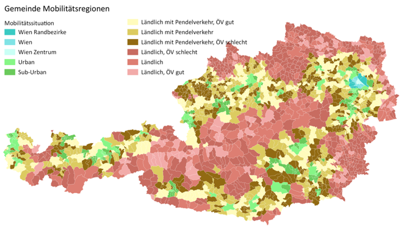
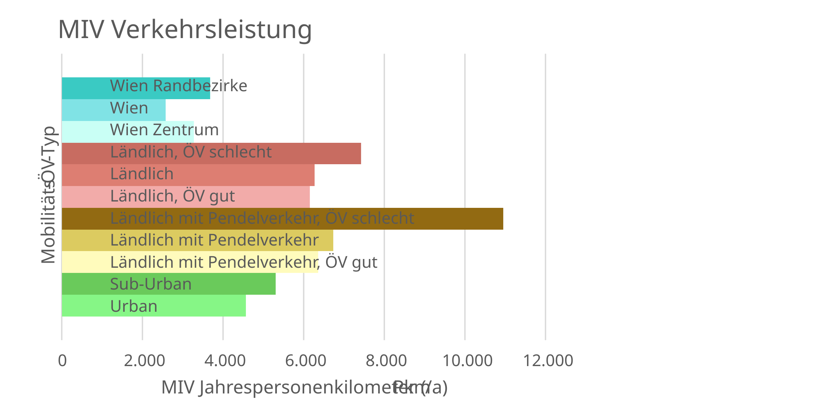

# Kontextfaktor Mobilität {#sec-kontext-mobilitaet}

::: {.lead}
Das in der sektoralen Allokation ermittelte MIV-Budget nutzungsbezogen verteilen und mit dem örtlichen Mobilitätsbedarf vergleichen
:::

Die nationale **Höhe** des erneuerbaren MIV-Budgets wird bereits in @sec-allokation aus der verfügbaren zentralen, nicht-PV-basierten erneuerbaren Erzeugung und den vorrangigen Bedarfen – insbesondere Industrie und ÖPNV – hergeleitet. Sie ist keine eigenständige oder nachträglich festgelegte Mobilitätsgutschrift. Dieses Kapitel beschreibt nur die **räumliche und nutzungsbezogene Anwendung** des daraus hervorgehenden Budgets sowie die standortabhängige MIV-Bedarfsermittlung.

::: {.callout-note title="quantitative Allokation"}
@sec-allokation-ergebnisse zeigt den parametrierten Transition-Referenzfall: 24 PJ/a beziehungsweise 6,667 TWh/a elektrisches MIV-Budget bei den dort dokumentierten Annahmen. Die volle Anrechnung der Wasserstoff-Rückverstromung erhöht es im Vergleichsfall auf 28 PJ/a. Das sind nationale elektrische Zuteilungen, keine neuen nutzungsbezogenen PE-Gutschriften. PE-Faktoren, Verteilungsschlüssel und Ziel-Flächen sind dafür nicht gemeinsam festgelegt. Die vollständige Rechnung steht in @sec-allokation-notebook.
:::

## Vom nationalen MIV-Budget zur Nutzung

Nach der sektoralen Elektrizitätsallokation wird das budgetfähige erneuerbare Mobilitätsvolumen mit einem dokumentierten Primärenergie-Faktorensatz in das nationale PE-Budget überführt. Anschließend wird es anhand einer begründeten Verteilung des individuellen Zielverkehrs den Quartiersnutzungen zugeordnet. Die nationale Verteilung muss insgesamt genau das freigegebene MIV-Budget ergeben und darf nicht zusätzlich denselben zentralen Strom anderen Nutzungen gutschreiben.

Für Nutzung $u$ gilt:

$$
c_{\mathrm{M},u}
=\frac{E_{\mathrm{MIV,Budget}}^{\mathrm{PE}}\,s_u}
{A_{\mathrm{NGF},u}^{2040}},
\qquad \sum_u s_u=1.
$$ {#eq-mobilitaetsbudget}

Dabei ist $s_u$ der Anteil des nationalen Budgets, der dem von Nutzung $u$ verursachten beziehungsweise ihr zugeordneten Zielverkehr zugerechnet wird. Die verwendeten nationalen NGF müssen dem Flächen- und Nutzungsstand des Kalibrierungsszenarios entsprechen. Es wird zwischen **Budgetverteilung je Nutzung** und **tatsächlicher Verkehrsvermeidung am Standort** unterschieden.

::: {.callout-note title="Parameterstand"}
Das nationale elektrische Budget ist berechnet. Nutzungsbezogene PE-Gutschriften sind für Transition nicht numerisch festgelegt, da Faktorensatz, Zielverkehrsanteile und Nutzflächen hierfür nicht gemeinsam bestimmt sind. Die historischen Werte dokumentieren den Bewertungsstand 2023.
:::

## Gemischt genutzte Quartiere

Für ein Quartier mit verschiedenen Nutzungen ergibt sich die flächengewichtete spezifische Mobilitätsgutschrift:

$$
c_{\mathrm{Mobilität}}
=\frac{\sum_u A_{\mathrm{NGF},u}^{\mathrm{Quartier}}c_{\mathrm{M},u}}
{\sum_u A_{\mathrm{NGF},u}^{\mathrm{Quartier}}}.
$$ {#eq-mobilitaet-mischnutzung}

Die gleiche Nutzungszuordnung ist auch für die Ermittlung des Verkehrsbedarfs anzuwenden. Zusätzliche Nutzfläche begründet nicht allein einen Bonus, sondern verändert zugleich den zu bilanzierenden Zielverkehr. Die Mobilitätsgutschrift darf nur zusammen mit dem entsprechenden MIV-Bedarf in die erweiterte PEQ-Bilanz eingehen (@sec-kontext).

## Standortabhängiger MIV-Bedarf: Mobilitätsregionen und Verkehrsleistung

Der tatsächlich zu bewertende MIV-Bedarf wird nicht mit dem nationalen Budget gleichgesetzt. Er hängt von den verursachten Wegen, der Nutzung, den Standortbedingungen, der Verkehrsmittelwahl und der Fahrzeugflotte ab. Für die standortabhängige Referenzabschätzung werden Mobilitätsregionen und Verkehrsdaten aus der österreichischen Mobilitätserhebung verwendet. Ihre Fortschreibung auf den Zielzustand und mögliche projektbezogene Abweichungen sind gesondert zu begründen.

{#fig-mobilitaetsregionen width="100%"}

{#fig-miv-verkehrsleistung width="90%"}

Ein günstiger Standort, kurze Wege, eine hohe ÖV-Güte, gemischte Nutzungen und ein wirksames Mobilitätskonzept können den MIV-Bedarf vermindern. Bei gleicher Nutzung und gleichem nationalem Budget erhält ein Quartier durch solche realen Minderungen einen günstigeren Bilanzsaldo. Die bloße Bereitstellung einzelner Einrichtungen begründet noch keine beliebige Verkehrsreduktion.

## Abgrenzung von Zielverkehr, Strombedarf und Ladeprofilen

Für die Quartiersbilanz wird der definierte motorisierte individuelle **Zielverkehr** zugeordnet. Für die energetische Simulation von Lade- und Speicherflüssen sind hingegen reale Anwesenheit und Ladevorgänge maßgeblich. Ein rechnerisches nationales Mobilitätsbudget stellt weder eine lokale Stromerzeugungsanlage noch verfügbare Ladeleistung oder Batteriekapazität dar. Elektromobilität und flexible Ladevorgänge können die Energiebilanz und Netzbelastung beeinflussen, sind aber mit der tatsächlichen stündlichen Simulation nachzuweisen [@schneider2026thesis, Abschn. 3.3.4].

## Dokumentation und Aktualisierung

Die Mobilitätsberechnung benötigt zwei unabhängig überprüfbare Datenteile: (1) den in @sec-allokation freigegebenen nationalen MIV-Restbetrag und dessen PE-Umrechnung; (2) Nutzungsflächen, Wege-, Modal-Split- und Flottenannahmen zur Budgetverteilung und Standortbewertung. Ein Wechsel der nationalen Szenarioquelle oder der Verkehrserhebung erfordert eine nachvollziehbare Neukalibrierung und darf nicht durch pauschales Skalieren der bisherigen Gutschrift ersetzt werden.

::: {.callout-note title="Historischer Bewertungsstand"}
Die ursprüngliche, Streicher-basierte Operationalisierung verwendete ein primärenergetisches MIV-Budget von 10,68 TWh PE/a und daraus abgeleitete Gutschriften nach Nutzung [@schneider2023context, Tab. 8–9]. Diese Zahlen dienen nur zur historischen Einordnung; die neue Gutschrift ist aus der **Transition-2040-Sektorallokation** herzuleiten. Wenn eine bestehende Toolversion noch historische Werte anwendet, ist das als gesonderter *Implementierungsstand*, nicht als Ergebnis der Neukalibrierung, zu kennzeichnen.
:::
