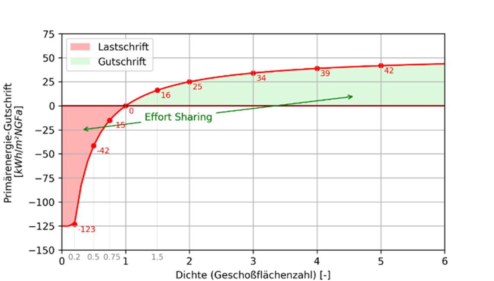

# Kontextfaktoren {#sec-kontext}
::: {.lead}
Anforderungen auf das Quartier übertragen 
:::

Ein dichtes Quartier, eine locker bebaute Siedlung und ein Sanierungsvorhaben können nicht denselben lokalen Energieüberschuss bereitstellen. Kontextfaktoren übersetzen die in @sec-allokation hergeleitete Lastenverteilung in die Bewertung des einzelnen Projekts. Sie machen sichtbar, welcher Beitrag unter den jeweiligen Rahmenbedingungen verlangt wird.

## Eine Bilanz, zwei gleichwertige Darstellungen

Eine angepasste Anforderung kann als eigener Zielwert oder als virtuelle Gut- beziehungsweise Lastschrift gegenüber einem gemeinsamen Nullmaßstab dargestellt werden. Beide Darstellungen sind rechnerisch gleichwertig [@schneider2026thesis, Abschn. 3.2.5–3.2.7].

Mit dem jährlichen spezifischen Primärenergiesaldo \(b_{\mathrm{PE}}\) vor Kontextkorrektur lautet die Bewertungsbilanz:

$$
b_{\mathrm{Bewertung}}
=b_{\mathrm{PE}}+c_{\mathrm{Dichte}}+c_{\mathrm{Mobilität}}+c_{\mathrm{Sanierung}}.
$$ {#eq-kontextbilanz}

Alle Größen sind in kWh PE/(m² NGF a) anzugeben. Positive Kontextwerte entlasten die Anforderung, negative Werte erhöhen sie. Die Mobilitätskomponente wird nur gemeinsam mit dem entsprechenden Mobilitätsbedarf in der erweiterten Bilanz angesetzt. Die Bedingung \(b_{\mathrm{Bewertung}}>0\) lässt sich auch als Anforderung an den Saldo vor Kontextkorrektur schreiben:

$$
b_{\mathrm{PE}}>-
\left(c_{\mathrm{Dichte}}+c_{\mathrm{Mobilität}}+c_{\mathrm{Sanierung}}\right).
$$

Eine positive Bewertungsbilanz bedeutet daher nicht zwingend einen physischen Exportüberschuss. Für Planung und Kommunikation sind der Saldo vor Kontextkorrektur und die einzelnen Kontextkomponenten getrennt auszuweisen. Das kumulierte THG-Budget wird zusätzlich geprüft; es wird nicht in diese jährliche Primärenergiebilanz eingerechnet.

## Dichte: Der städtebauliche Entwurf verändert beide Seiten

Die Geschoßflächenzahl beschreibt das Verhältnis von Bruttogrundfläche zu Grundstücksfläche. Mit steigender Dichte nimmt die verfügbare lokale Erzeugungsfläche je Geschossfläche typischerweise ab. Der Dichtefaktor berücksichtigt diesen strukturellen Zusammenhang durch eine kalibrierte Anforderungsfunktion. Ihre Form und nationale Einordnung sind in @sec-allokation beschrieben.

Bei niedriger Dichte verlangt die Regel einen zusätzlichen Überschuss. Bei hoher Dichte kann sie einen negativen Saldo vor Kontextkorrektur zulassen. Daraus folgt keine pauschale Empfehlung, durch zusätzliche Geschossfläche eine günstigere Bewertung herzustellen: Mehr Fläche verändert zugleich Bedarf, Herstellungsemissionen und absolute Ressourceninanspruchnahme. Ein Variantenvergleich muss alle diese Änderungen erfassen.

Die Architektur beeinflusst das tatsächliche Potenzial durch Baukörperstellung, Verschattung, Dach- und Fassadennutzung. Der Dichtefaktor ersetzt diese Prüfung nicht. Zwei Quartiere mit derselben GFZ können unterschiedliche nutzbare PV-Flächen haben. Ebenso konkurrieren auf dem Dach PV, technische Aufbauten, Begrünung, Aufenthalt und Wartungswege um Fläche. Der nachgewiesene Ertrag muss aus einem umsetzbaren Entwurf stammen.

Die Dichtekorrektur verändert die Anforderungen abhängig von der Geschoßflächenzahl. Niedrige Dichten führen zu zusätzlichen Anforderungen, während höhere Dichten eine Gutschrift erhalten können.

{#fig-dichtekurve width="95%"}

@fig-dichtekurve veranschaulicht die Verteilung der energetischen Anforderungen zwischen unterschiedlichen baulichen Dichten. Die dargestellten Werte sind von den tatsächlich erreichten Energieflüssen des Quartiers zu unterscheiden.

## Mobilität: Nutzung bestimmt das Budget, Standort bestimmt den Bedarf

Die Mobilitätsgutschrift wird aus der nationalen Allokation nach Nutzungen verteilt. Für ein gemischt genutztes Quartier ergibt sich der spezifische Kontextwert aus der Flächengewichtung:

$$
c_{\mathrm{Mobilität}}
=\frac{\sum_u A_{\mathrm{NGF},u}\,c_{\mathrm{M},u}}
{\sum_u A_{\mathrm{NGF},u}}.
$$ {#eq-mobilitaet-mischnutzung}

Die nutzungsspezifischen Werte stehen in @tbl-mobilitaetsallokation. Ihre Flächenzuordnung muss mit jener des zugeordneten Verkehrsbedarfs übereinstimmen. Eine zusätzliche Büronutzung verändert sowohl die Gutschrift als auch die zu bilanzierenden Wege; sie ist kein reiner Bilanzbonus.

Für die standortabhängige Abschätzung des Mobilitätsbedarfs werden Gemeinden beziehungsweise Standorte unterschiedlichen Mobilitätsregionen zugeordnet.

{#fig-mobilitaetsregionen width="100%"}

Die räumlichen Unterschiede spiegeln sich im angesetzten motorisierten Individualverkehr wider. Sie beeinflussen den zugeordneten Mobilitätsbedarf, nicht automatisch das nutzungsbezogene Energiebudget.

{#fig-miv-verkehrsleistung width="90%"}

Der Standort wirkt vor allem auf der Bedarfsseite. Kurze Wege, ein geeigneter Nutzungsmix, öffentlicher Verkehr und ein wirksames Mobilitätskonzept können den MIV vermindern. Diese Wirkung ist mit nachvollziehbaren Annahmen über Wege, Verkehrsmittelwahl und Fahrzeugflotte anzusetzen. Die bloße Bereitstellung von Fahrradabstellplätzen oder Ladepunkten begründet noch keine beliebig große Verkehrsreduktion.

Für Architektur und Haustechnik entstehen daraus gemeinsame Aufgaben: Mobilitätsangebote müssen räumlich nutzbar sein, die elektrische Ladeinfrastruktur muss die erwarteten Fahrzeuge bedienen können. Ein geringerer zugeordneter Mobilitätsbedarf senkt nicht zwangsläufig jede lokale Ladespitze. Für die Netz- und Ladeplanung bleiben die Anwesenheitsprofile entscheidend [@schneider2026thesis, Abschn. 3.3.4, S. 65–67].

## Sanierung: Entlastung für die Bedingungen des Bestands

Die Sanierungsgutschrift beträgt 15 kWh PE/(m² NGF a) für den berücksichtigten Sanierungsanteil. Für einen Anteil \(f_{\mathrm{Sanierung}}\) ergibt sich:

$$
c_{\mathrm{Sanierung}}=15\,f_{\mathrm{Sanierung}}
\quad\text{in kWh PE/(m² NGF a)}.
$$ {#eq-sanierungskontext}

Bei einem Sanierungsanteil von 50 % sind dies 7,5 kWh PE/(m² NGF a), wie in der klimaaktiv-Broschüre erläutert [@klimaaktiv2026peq, S. 14]. Im Nachweis sind die zugeordneten Sanierungsflächen offenzulegen. Neubauanteile werden nicht allein durch ihre Einbindung in ein Bestandsquartier zu Sanierungsflächen.

Die Höhe ist normativ festgelegt. Sie berücksichtigt erschwerte Handlungsmöglichkeiten im Bestand, beispielsweise geometrische oder konstruktive Grenzen einer energetischen Verbesserung. Sie ist keine Berechnung der eingesparten grauen Emissionen. Erhaltene Bausubstanz und neue Bauteile wirken über die eigene THG-Bilanz; die Primärenergiegutschrift darf nicht noch einmal als vermiedene CO₂-Menge angesetzt werden.

::: {.callout-note appearance="simple"  icon="true"}
Für eine Weiterentwicklung kommen differenzierte Regeln nach Sanierungserschwernis, Gebäudealter oder Denkmalschutz in Betracht. Solche Regeln brauchen eine begründete Verteilungswirkung und handhabbare Nachweise. Bis dahin wird die festgelegte Gutschrift angewendet, ohne eine bislang nicht vorliegende quantitative Kalibrierung zu unterstellen.

:::
