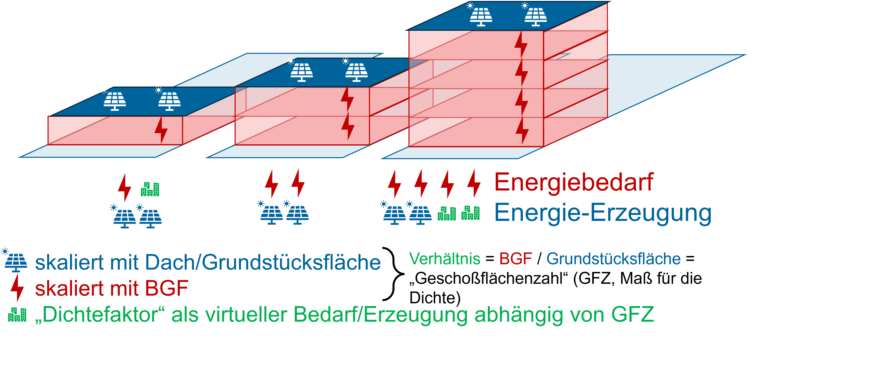
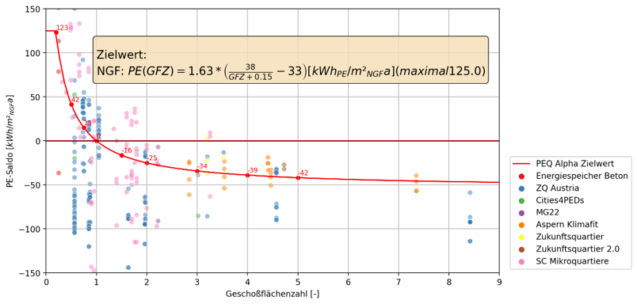

# Kalibrierung der PEQ-Energieanforderungen {#sec-kalibrierung}

::: {.lead}
Nationale Zielbilanz, neue Gebäudetypologien und dichteabhängige Anforderungen in Übereinstimmung bringen
:::

Die sektorale Allokation legt den nationalen Referenzsaldo für den Gebäudesektor fest (@sec-allokation). Die Gebäude- und Dichteverteilung definiert, **welche Flächen** zur Erfüllung dieses Ziels beitragen (@sec-gebaeudebestand). Gegenstand dieses Kapitels ist die Kalibrierung der **typologie- und dichteabhängigen PEQ-Anforderungen**. Das Ziel ist keine beliebige positive Bilanz jedes einzelnen Gebäudes: Die Summe der konsistent umgerechneten, flächengewichteten Beiträge muss mit dem national zugewiesenen Ziel vereinbar sein.

Der Dichtefaktor verteilt die Anforderungen zwischen unterschiedlichen baulichen Dichten. Die Sanierungsanpassung wird **nach energetischer Gebäudetypologie** festgelegt und im selben Modell abgestimmt. Eine allgemeine, von der Typologie unabhängige Pauschalgutschrift gehört nicht zur neuen Kalibrierung.

## Bilanzfunktionen der Gebäudetypologien {#sec-typologiesalden}

Für jede neue energetische Typologie $k$ werden die relevanten jährlichen Bedarfe, Erzeugungsannahmen, Bewertungsgrenzen und Anforderungsparameter aus dem Gebäudeszenario beziehungsweise der Kalibrierung dokumentiert. Dabei ist zwischen zwei Rollen zu unterscheiden: **Nicht-PEQ-Klassen** gehen mit ihrem begründeten, szenariotypischen Bilanzbeitrag in die nationale Aggregation ein; für **PEQ-Klassen** wird die erforderliche Bilanzqualität als Zielwertfunktion bestimmt. Eine bestimmte PV-Ausstattung oder ein spezifischer Energiebedarf ist nicht automatisch bereits ein allgemein geltender PEQ-Grenzwert.

Die Typologieparameter werden in einer versionierten Tabelle zusammengeführt. Zu klären ist dabei insbesondere, ob ein typologischer Zielsaldo bereits einen Sanierungsvorteil enthält. In diesem Fall darf derselbe Vorteil nicht ein zweites Mal als zusätzliche Sanierungsgutschrift verbucht werden.

| Parameter | Bedeutung | Status |
|---|---|---|
| $k$, $A_{k,j}^{2040}$ | Gebäudetyp und Fläche nach GFZ-Klasse | Aus @sec-gebaeudebestand |
| $e_k$, $p_k$ | Typologiebezogener Energiebedarf und lokale Erzeugung | Gelieferte PV30/noFlex-Kennwerte in @sec-gebaeudesektormodell |
| $b_{k,j}^{\mathrm{ref}}$ | Modellierter Referenzsaldo für Nicht-PEQ-Klassen | Aus Szenarioannahmen zu bestimmen |
| $t_{k,j}^{\mathrm{PEQ}}$ | Zu kalibrierender Mindestbeitrag für PEQ-Klassen | Neu zu kalibrieren |
| $c_{\mathrm{S},k}$ | **Typologiespezifische Sanierungsanpassung** für die jeweils berechtigte PEQ-Klasse | Neu zu kalibrieren |
| $c_{\mathrm{D}}(d;\theta)$ | Dichteabhängige Zielwertkorrektur | Neu zu kalibrieren |
| $\theta$ | Parameter der Lastenverteilung und gegebenenfalls weitere Nebenbedingungen | Gemeinsam festzulegen |

: Parametrisierung der neuen Energieanforderungen. Typologiespezifische Zielsalden und Kontextgutschriften sind nicht doppelt zu erfassen. {#tbl-kalibrierparameter}

## Kontextfaktor Dichte: Begründung und physikalisches Prinzip {#sec-kontext-dichte}

Mit zunehmender baulicher Dichte steigt der Energiebedarf näherungsweise mit der genutzten Geschossfläche, während die für lokale erneuerbare Erzeugung verfügbaren Dach-, Fassaden- und Grundstücksflächen vergleichsweise knapp werden. Eine einheitlich geforderte positive physische Jahresbilanz würde daher niedrig verdichtete Projekte häufig begünstigen und hohe städtebauliche Dichten benachteiligen. Die GFZ-basierte Anpassung vermeidet, dass kompakte Siedlungsformen allein wegen ihrer kleineren lokalen Erzeugungsflächen als weniger ambitioniert gelten [@Fellner2020Mikroquartiere; @Schoefmann2020Zukunftsquartier; @schneider2023context].

{#fig-dichte-prinzip width="95%"}

Sei $A_G$ die Grundstücksfläche, $A_B$ die Bruttogrundfläche und $d=A_B/A_G$ die GFZ. Bei einem Erzeugungspotenzial $p$ je Grundstücksfläche und einem Bedarf $e$ je BGF ergibt sich schematisch:

$$
b(d)=\frac{pA_G-eA_B}{A_B}=\frac{p}{d}-e.
$$ {#eq-dichte-prinzip}

Die Gleichung beschreibt den physikalischen Zusammenhang; die Anforderung folgt aus der nationalen Kalibrierung. Eine Zielwertfunktion kann durch Parameter, eine Verschiebung der Dichteachse und eine Begrenzung der Gutschrift den Zusammenhang in eine Lastenverteilungsregel übersetzen. Die Parameter sind anhand der nationalen Gebäudeverteilung und Zielbilanz festzulegen [@schneider2023context, Gl. 7–8]. Gebäudeform, Verschattung, Dach- und Fassadennutzung bleiben Gegenstand der tatsächlichen Quartiersbilanz.

{#fig-dichte-datenpunkte}

## Parametrisierung der Zielwert- und Gutschriftenfunktion

Bei der Neubestimmung der Funktion ist zwischen dem unveränderten **physikalisch errechneten Quartierssaldo** und den **virtuellen Zielwertkorrekturen** zu unterscheiden. Für eine PEQ-berechtigte Typologie $k$ lautet die Bewertungsbedingung schematisch:

$$
b_{\mathrm{PE,phys}}-t_{k,0}^{\mathrm{PE}}
+c_{\mathrm{D}}(d;\theta)+c_{\mathrm{S},k}(\theta)>0.
$$ {#eq-zielwert-typologie}

Bei positiv definierter Gutschrift kann man dies äquivalent als Mindestanforderung an die reale, noch nicht kontextkorrigierte Bilanz schreiben:

$$
b_{\mathrm{PE,phys}}>
 t_{k,0}^{\mathrm{PE}}-c_{\mathrm{D}}(d;\theta)-c_{\mathrm{S},k}(\theta).
$$

Dabei ist $t_{k,0}^{\mathrm{PE}}$ das einheitlich definierte Basiskriterium der betroffenen PEQ-Klasse; bei einem Nullmaßstab ist es null. Diese Gleichungen definieren die **Parameterstruktur** des Entwurfs. Vor einer Festlegung sind Dichteachsenverschiebung, Begrenzungen, Typologiezuordnung und Nebenbedingungen abzustimmen. Für Nicht-PEQ-Klassen werden stattdessen die prognostizierten Bilanzbeiträge dokumentiert. Mobilität wird nicht als frei wählbarer Kalibrierrest in die Dichtefunktion eingerechnet: Das nationale MIV-Budget entsteht in @sec-allokation und wird in @sec-kontext-mobilitaet verwendet.

Für die Sanierungsanpassung gilt ausdrücklich: **kein einheitlicher Faktor für sämtliche sanierten Flächen**. Der Wert $c_{\mathrm{S},k}$ hängt von der zugewiesenen Typologie ab und wird mit deren energetischen Annahmen und nationalem Flächenanteil gemeinsam kalibriert. Ob für bestimmte Klassen der Anpassungswert null ist und wie unterschiedliche Sanierungsintensitäten bewertet werden, ist anhand der neuen Excel-Klassen fachlich zu begründen.

## Nationale Aggregation und Kalibrierbedingung

Die Flächenverteilung nach Typologie $k$ und Dichteklasse $j$ wird aus @sec-gebaeudebestand übernommen. Ein konsistent auf **BGF** bezogener jährlicher nationaler Modellbeitrag lässt sich in den **fest vorgegebenen Beitrag der Nicht-PEQ-Klassen** und die **kalibrierten Beiträge der PEQ-Klassen** zerlegen:

$$
B_{\mathrm{Sektor}}^{\mathrm{Modell}}(\theta)
=\sum_{k\in\mathrm{NichtPEQ}}\sum_j A_{k,j}^{2040}\,b_{k,j}^{\mathrm{ref}}
+\sum_{k\in\mathrm{PEQ}}\sum_j A_{k,j}^{2040}\,t_{k,j}^{\mathrm{PEQ}}(\theta).
$$ {#eq-sektor-aggregation}

Die Beiträge werden als jährliche elektrische Energie je BGF aggregiert. Für NGF-bezogene Kennwerte gilt der dokumentierte Flächenfaktor; die PE-Bewertung folgt getrennt in der Quartiersbilanz.

Die Parameter $\theta$ werden so gewählt, dass sich der nationale aggregierte Zielbeitrag und der aus @sec-allokation stammende, in dieselbe Bilanzgröße überführte Referenzsaldo innerhalb einer ausgewiesenen Toleranz entsprechen:

$$
B_{\mathrm{Sektor}}^{\mathrm{Modell}}(\theta)
\stackrel{!}{=}B_{\mathrm{Geb,Ziel}}^{\mathrm{Transition\ 2040}}.
$$ {#eq-kalibrierziel}

Die Bilanzgleichheit allein legt die Parameter nicht notwendigerweise eindeutig fest. Zusätzliche Bedingungen – etwa begründete Grenzen der Dichtefunktion, technologische Potenziale, typologische Zielqualitäten und vertretbare Sanierungsanforderungen – müssen ausdrücklich angegeben werden. Die Verteilung der Gebäudequalitäten und ihre Flächenanteile sind daher nicht bloß eine Rechenhilfe, sondern zentrale Szenarioannahmen.

## Kalibrierungsstand und Ergebnisvergleich

Unter den Annahmen des Referenzfalls ergeben sich 31 PJ/a zentrale Restdeckung und 0 PJ/a für den Gebäudesektorsaldo einschließlich MIV (@sec-allokation-ergebnisse). Die Bottom-up-Rechnung umfasst 603 positiv gewichtete Typen, ihre GFZ-Verteilungen und die Erwartungswerte der historischen Dichtefunktion (@sec-gebaeudesektormodell).

Der physische Pool-Stromsaldo beträgt −59,25 PJ/a. Einschließlich derselben einmaligen MIV-Zuordnung ergibt sich −100,25 PJ/a, also −100,25 PJ/a gegenüber dem Top-down-Beispiel. Die virtuellen Dichte-Erwartungswerte werden dabei nicht als reale Deckung hinzuaddiert. Der Pool enthält nur PV30/noFlex sowie erhebliche Gas- und Ölmengen. Eine neue Zielwertfunktion lässt sich deshalb nicht allein durch Gleichsetzen dieses Pool-Ergebnisses mit dem nationalen Ziel bestimmen. PEQ-Flächenanteile, energetische Entwicklung der übrigen Typen und alternative PV-Ausstattungen sind zuerst festzulegen.

::: {.callout-note title="Geltungsbereich des Entwurfs"}
Die 2040-Flächenmatrix, Energieaggregation und GFZ-Zuordnung sind berechnet. Die historische Dichtefunktion wird als Referenzansatz ausgewertet. PEQ-Flächenanteile, Versorgungspfade, PE-Faktorversion und typologische Sanierungswerte sind nicht normativ festgelegt. Der Ergebnisvergleich beschreibt diesen Parameterstand.
:::

Die Ergebnisdarstellung umfasst Flächen, Typenbeiträge, Dichtekorrektur und den Abstand zum Referenzsaldo (@sec-gebaeude-abgleich). Quelldateien und Parameter sind in den Rechenanhängen versioniert.

## Sensitivitäten und normative Entscheidungen

Neben dem Referenzfall sind insbesondere Änderungen der Gebäude-PV-Allokation, der Flächenanteile der Gebäudetypen, der GFZ-Verteilung sowie der typologiebezogenen Sanierungsparameter als Sensitivitäten sinnvoll. Auch Änderungen des Umfangs der MIV-/ÖPNV-Zuordnung wirken über @sec-allokation auf das nationale Zielbild. Solche Varianten sind vom **freigegebenen Referenzszenario** klar zu unterscheiden.

::: {.callout-note title="Historische Einordnung"}
Die ursprüngliche Kalibrierung verwendete fünf energetische Gebäudeklassen und eine spezifische Dichtefunktion [@schneider2023context]. Diese historische Lösung erläutert die Entstehung der Methode, ersetzt aber weder die neuen Typologien noch die Kalibrierung mit UBA Transition 2040.
:::
