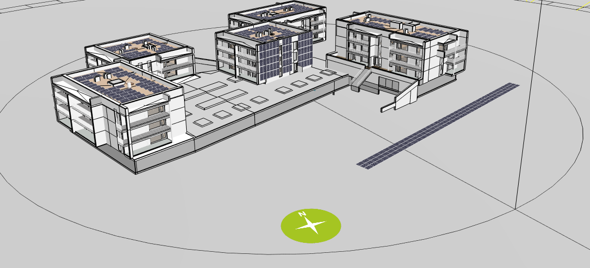
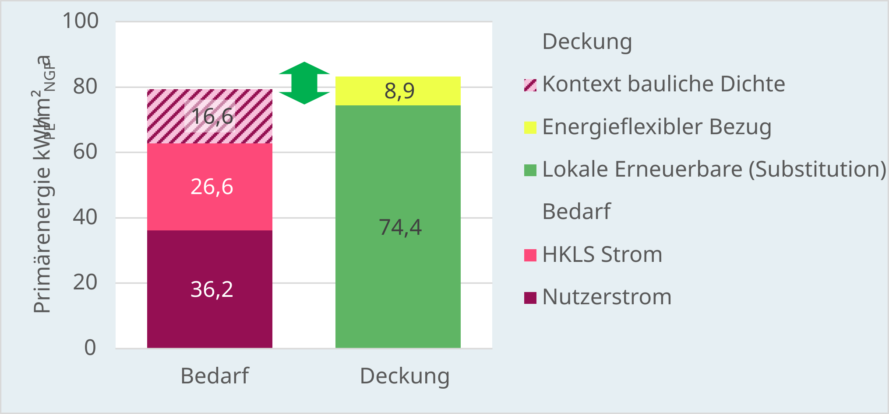
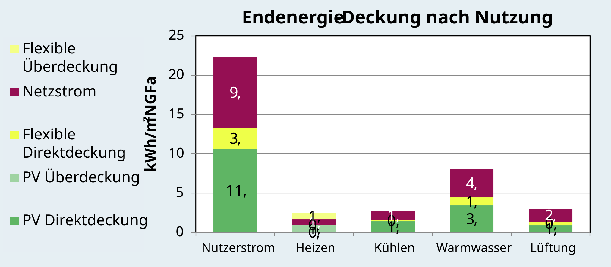

# Am Bichl III {#sec-am-bichl}

::: {.lead}
Ambitionierte Energieziele bis zur Fertigstellung sichern
:::

::: {.peq-project-labels}
[{.peq-label-logo} Plus-Energie-Quartier](02-standard.qmd){.peq-tag .peq-tag-standard} [Neubau]{.peq-tag} [Wohnen]{.peq-tag .peq-tag-wohnen} [Photovoltaik]{.peq-tag .peq-tag-pv} [Energieflexibilität]{.peq-tag .peq-tag-flex}
:::

{width="100%"}

Das Wohnquartier Am Bichl III zeigt, dass ambitionierte Neubauten die Anforderungen an ein Plus-Energie-Quartier erreichen können. Fünf Gebäude mit 50 Wohnungen verbinden eine effiziente Gebäudehülle, Wärmepumpen und umfangreiche Photovoltaik. Die Primärenergiebilanz des Gebäudebetriebs übertrifft den projektspezifischen Zielwert.[^quelle]

## Projekt auf einen Blick

| Merkmal | Angabe |
|---|---|
| Standort | Am Bichl 31–35, Innsbruck-Igls, Tirol |
| Bauträger | IIG – Innsbrucker Immobiliengesellschaft |
| Architektur | he & du ZT KG |
| Nutzung | Wohnen, 50 Wohnungen in fünf Gebäuden |
| Bruttogrundfläche | 5.360 m² |
| Geschossflächenzahl | 0,73 |
| Qualitätsstufe | Plus-Energie-Quartier, Gebäudebetrieb |
| Deklarationsphase | Fertigstellung |
| Bewertungsstand | August 2026, PEQ-Nachweistool v1.10 |

Mobilität und die Lebenszyklus-Treibhausgasbilanz sind **nicht Bestandteil dieser Deklaration**. Die [Fertigstellungsdeklaration](07-anwendung.qmd) zeichnet die erreichte Qualität des umgesetzten Projekts aus.

## Die Planungsfrage

Wie lässt sich eine ambitionierte Energiequalität in einem Wohnquartier mit vergleichsweise geringer baulicher Dichte erreichen und bis zur Umsetzung erhalten? Der [Dichtefaktor](05-kontextfaktoren.qmd#sec-kontext-dichte) führt bei dieser baulichen Dichte zu einer zusätzlichen energetischen Anforderung. Gute Gebäudequalität, lokale Erzeugung und Energieflexibilität wirken zusammen, um diese zu erfüllen. Die [Begleitung von der Planung bis zur Fertigstellungsdeklaration](07-anwendung.qmd) macht die Zielerreichung über den Projektverlauf nachvollziehbar.

## Maßnahmen im Quartier

Die Gebäude verbinden eine hochwertige thermische Hülle mit Komfortlüftung und Wärmerückgewinnung. Drei zentral geregelte Luft-Wärmepumpen versorgen die Fußbodenheizung. Die Warmwasserbereitung erfolgt wohnungsweise über Wärmepumpen-Booster, die den Heizungsrücklauf als Wärmequelle nutzen.

Photovoltaik nutzt die Gebäudedächer, eine Südfassade und den Carport. Insgesamt stehen **198,4 kWp** installierte PV-Leistung zur Verfügung.

{#fig-am-bichl-pv width="100%"}

## Das Ergebnis

| Kennzahl | Ergebnis |
|---|---:|
| Primärenergiesaldo des Projekts | **20,4 kWhₚₑ,ges/(m² NGF·a)** |
| Projektspezifischer Zielwert | **16,6 kWhₚₑ,ges/(m² NGF·a)** |
| Abstand zum Zielwert | **+3,8 kWhₚₑ,ges/(m² NGF·a)** |
| Installierte PV-Leistung | **198,4 kWp** |
| PV-Leistung bezogen auf BGF | rund **37 Wp/m² BGF**[^pv] |
| Heizwärmebedarf | **7,5 kWh/(m² NGF·a)**[^kennwerte] |

Der Primärenergiesaldo liegt um **3,8 kWh pro Quadratmeter Nettogrundfläche und Jahr** über dem Zielwert. Das Quartier erfüllt damit die Anforderungen an ein Plus-Energie-Quartier im Gebäudebetrieb.

{#fig-am-bichl-pe width="100%"}

Die Endenergiebetrachtung zeigt, wofür Strom im Quartier benötigt wird. Neben dem Nutzerstrom prägt insbesondere die Warmwasserbereitung den Bedarf. Photovoltaik und flexibler Netzbezug ergänzen den konventionellen Netzstrom in den einzelnen Anwendungen.

{#fig-am-bichl-ee width="100%"}

## Welche Rolle spielt Energieflexibilität?

Zentral regelbare Wärmepumpen, thermische Speichermasse und Wärmespeicher ermöglichen es, die Wärmebereitstellung zeitlich anzupassen. Die zentrale Gebäudeleittechnik und die modulierenden Wärmepumpen bieten dafür eine wichtige Voraussetzung: Die heute außentemperaturgeführte Regelung kann künftig um Signale der lokalen PV-Erzeugung oder des Stromsystems erweitert werden. Damit wird eine gezielte Verschiebung der Wärmebereitstellung möglich.

Im zukünftigen Stromsystem ergänzen sich lokale Sonnenenergie und Strom aus überregionaler Windkraft. Wärmepumpen können windreiche Stunden nutzen, um Wärme bereitzustellen und thermische Speicher zu laden. Das verbessert die Nutzung erneuerbarer Energie auch dann, wenn die lokale PV-Erzeugung gering ist.

{#fig-am-bichl-winter width="100%"}

Die bilanzielle Flexibilitätsgutschrift beträgt **8,9 kWhₚₑ,ges/(m² NGF·a)**.[^flex] Am Bichl III verbindet damit bereits berücksichtigte Flexibilitätsbeiträge mit technischen Voraussetzungen für eine weiterentwickelte Betriebsführung.

## Was hat die Begleitung beigetragen?

Im Übergang von Planung zu Fertigstellung wurden Gebäudeparameter, Bezugsflächen, PV-Auslegung und Flexibilitätsannahmen mit dem aktualisierten Projektstand abgeglichen. So blieb nachvollziehbar, welche Qualität die ausgeführte Lösung erreicht.

Die frühe Kenntnis der Bilanzanforderungen half dabei, die umfangreichen PV-Flächen im weiteren Planungsprozess weitgehend zu sichern und zu realisieren.[^erfahrung] Ein früh vereinbartes Ziel bietet eine Grundlage, um die Bedeutung einzelner Maßnahmen auch bei späteren Änderungen zu beurteilen.

## Was können andere Projekte daraus lernen?

Die Bilanzierung sollte beginnen, solange Gebäudequalität, PV-Flächen und Versorgungskonzept noch gestaltet werden können. Der Abgleich zur Fertigstellung macht Änderungen sichtbar. Bei Energieflexibilität lohnt es sich, Regelung, technische Voraussetzungen und tatsächlich bewerteten Betrieb von Anfang an zu unterscheiden.

[Qualitätsstufen und Anforderungen](02-standard.qmd) · [Deklaration und Projektphasen](07-anwendung.qmd) · [Weitere Praxisbeispiele](07-praxisbeispiele.qmd)

[^quelle]: *Fertigstellungsdeklaration Am Bichl III*, 19.08.2026, ergänzt am 04.09.2026; PEQ-Nachweistool v1.10. Abbildungen: Projekt- und Veranstaltungsunterlagen.

[^kennwerte]: Heizwärmebedarf aus dem PEQ-Modell; Abweichungen zum Energieausweis können durch detaillierte Annahmen zu inneren Wärmegewinnen und solaren Einträgen entstehen.

[^flex]: Die modellierte Flexibilitätsgutschrift umfasst netzdienlichen Bezug gemäß Lastprofilen und die thermische Trägheit im Heizfall. Die Winterwoche zeigt den simulierten Verlauf.

[^erfahrung]: Projekterfahrung: Simon Schneider, Oktober 2026.

[^pv]: 198,4 kWp / 5.360 m² BGF ≈ 37 Wp/m² BGF.
