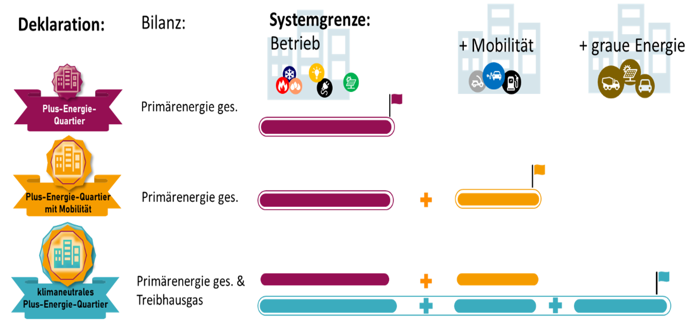

# Nachweisführung in der Planung {#sec-anwendung}

::: {.lead}
Vom Quartierskonzept zum überprüfbaren Ergebnis
:::

Ein PEQ-Nachweis soll zeigen, **welche Anforderungen ein Quartier erfüllt, auf welchen Eingaben das Ergebnis beruht und welche Maßnahmen dafür erforderlich sind**. Dafür werden Quartiersabgrenzung, Fachplanungen, Varianten und Bewertungsstand nachvollziehbar zusammengeführt.

## Vom Konzept zur überprüfbaren Deklaration

Bereits in der frühen Planung werden Quartiersgrenze, Nutzungen und angestrebte Qualitätsstufe festgelegt. Ein erster Variantenvergleich zeigt, welche Beiträge Gebäudehülle, Energieversorgung, erneuerbare Erzeugung und Mobilität leisten müssen. Unsichere Eingaben sind zunächst als Annahmen zu kennzeichnen.

Im weiteren Planungsverlauf werden diese Annahmen durch Fachberechnungen präzisiert: etwa Bauphysik, PV-Ertragsberechnung, Mobilitätskonzept und bauliche Ökobilanz. Für die Bewertung werden die Ergebnisse innerhalb derselben Systemgrenzen zusammengeführt [@schneider2026thesis, Abschn. 3.3.6 und 3.4.2].

| Arbeitsschritt | Ergebnis | Wesentliche Abstimmung |
|---|---|---|
| Abgrenzung und Ziel | Bewertetes Quartier, Nutzungen und Qualitätsstufe | Bauherrschaft, Architektur, Nachweisführung |
| Konzeptvergleich | Vergleichbare Varianten und kritische Annahmen | Architektur, Bauphysik, Haustechnik, Mobilität |
| Vertiefung | Plausibilisierte Eingaben und Betriebskonzept | Fachplanungen, gegebenenfalls Netzbetreiber |
| Dokumentation | Nachvollziehbare Eingaben, Bilanzen und Quellen | Nachweisführung, Qualitätssicherung |
| Fertigstellung | Abgleich mit der tatsächlich ausgeführten Lösung | Planung, Ausführung, Qualitätssicherung |
| Betrieb | Abgleich von Prognose und gemessenem Verhalten, sofern vorgesehen | Betrieb, Monitoring |

: Empfohlener Arbeitsablauf; die Tabelle begründet keine zusätzlichen formalen Deklarationsstufen. {#tbl-nachweisprozess}

::: {.callout-note appearance="simple" icon=false title="Abbildungsvorschlag A1 · Nachweisprozess"}
**Prozessdiagramm:** Konzept → Variantenprüfung → Planungsdeklaration → Ausführungsabgleich/Fertigstellungsdeklaration → optionales Monitoring. Zuständigkeiten und zunehmende Datengenauigkeit mit darstellen.

<!-- Später ersetzen durch z. B.:
{#fig-nachweisprozess width="100%"}
-->
:::

## Qualitätsstufe und Deklarationsphase unterscheiden

Die **Qualitätsstufe** legt fest, welche energetischen und klimabezogenen Anforderungen geprüft werden (siehe [Standard](02-standard.qmd)). Die **Deklarationsphase** bezeichnet hingegen den Stand des Projekts und seiner Nachweisunterlagen. Eine Planungsdeklaration basiert auf dokumentierten Planungsannahmen; eine Fertigstellungsdeklaration muss die tatsächlich realisierte Lösung abbilden. Ein gemessener Betriebsnachweis ist davon wiederum zu unterscheiden.
Die drei Qualitätsstufen unterscheiden sich durch ihren Bilanzumfang. Unabhängig davon ist festzuhalten, auf welchem Planungs- oder Nachweisstand die jeweilige Bewertung beruht.

{#fig-deklarationsumfang width="100%"}

::: {.callout-important appearance="simple" icon=false title="Zwei unabhängige Dimensionen"}
**Stufe ≠ Phase:** Ein klimaneutrales Plus-Energie-Quartier kann in der Planung bewertet werden, ohne dass seine spätere Betriebsperformance damit bereits nachgewiesen wäre.
:::

## Verantwortlichkeiten und Datenqualität

Die Fachplanungen liefern für ihren Bereich überprüfbare Grundlagen: Flächen und Nutzungen, Gebäudehülle und Komfort, Wärme- und Stromversorgung, lokale Erzeugung, Mobilität sowie Bauteilmengen und Ökobilanzdaten. Die gemeinsame Quartiersbewertung verbindet diese Informationen, ersetzt aber weder detaillierte Anlagenplanung noch einzelne Fachnachweise.

Für jede maßgebliche Eingabe ist festzuhalten, ob sie ein Referenzwert, eine projektspezifische Berechnung oder eine bestätigte Ausführungsangabe ist. Besonders ergebnisrelevante Annahmen sollten durch eine weniger günstige Variante auf Robustheit geprüft werden.

::: {.callout-note appearance="simple" icon=false title="Abbildungsvorschlag A2 · Daten und Verantwortlichkeiten"}
**Matrix oder Datenflussdiagramm:** Architektur, Bauphysik, Haustechnik, Mobilitätsplanung und Ökobilanz → gemeinsame Quartiersbewertung → Ergebnis und Qualitätssicherung. Optional Eingaben nach Planungsstand farblich kennzeichnen.

<!-- {#fig-datenfluss width="90%"} -->
:::

## PEExcel als Nachweiswerkzeug

Die Berechnung und der Variantenvergleich erfolgen mit dem [PEExcel-Nachweistool](https://simonschaluppe.github.io/peexcel/). **Bedienung, Datenmodell, Exportformate, Softwareversionen und technische Modellimplementierung werden auf der eigenständigen Toolwebsite dokumentiert.** Dieser Hintergrundbericht erläutert stattdessen die Bewertungsgrundlagen (@sec-allokation, @sec-kontext und @sec-bilanzregeln) sowie die fachliche Interpretation der Ergebnisse (@sec-ergebnisse).

::: {.callout-tip appearance="minimal" icon=false title="Weiterführende Unterlagen"}
[PEExcel-Dokumentation und Download](https://simonschaluppe.github.io/peexcel/) · [Ergebnisinterpretation](07-ergebnisse.qmd) · [Praxisbeispiele](07-praxisbeispiele.qmd)
:::

## Abbildungs- und Callout-Galerie (redaktionelle Auswahl)

::: {.callout-note appearance="minimal" icon=false title="Option A3 · Ablauf am Tool"}
**Screenshot-Folge:** Projektdaten → Szenarioauswahl → Bilanzübersicht. Nur verwenden, wenn die Screenshots zum dokumentierten Toolstand passen.
:::

::: {.callout-warning appearance="minimal" icon=false title="Option A4 · Typischer Fehler"}
**Grenzänderung beim Variantenvergleich:** Wird die Quartiersfläche verändert, ändern sich möglicherweise gleichzeitig Bedarf, Dichtekontext und Budgetzuordnung. Solche Varianten nur mit ausgewiesenen Flächenbezügen vergleichen.
:::
