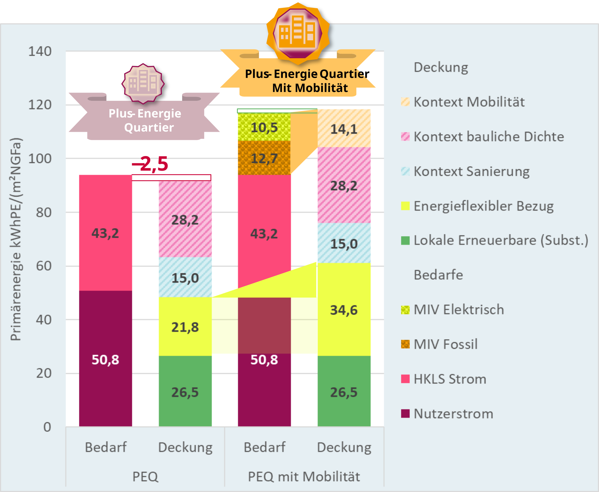
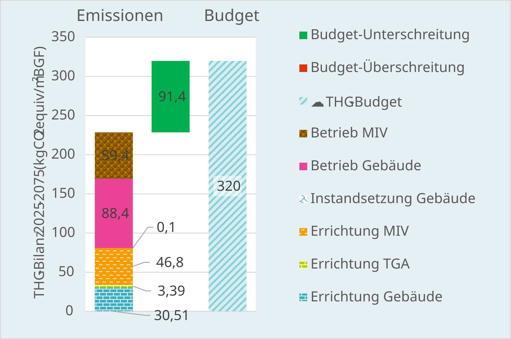

# Ergebnisse verstehen {#sec-ergebnisse}

::: {.lead}
Von der Zielerreichung zur nachvollziehbaren Planungsentscheidung
:::

Die erreichte Qualitätsstufe fasst die Bewertung zusammen. Für die Planung ist ebenso wichtig, **welche realen Energie- und Emissionsflüsse, Kontextfaktoren und Annahmen** dahinterstehen. Eine nachvollziehbare Ergebnisdarstellung zeigt deshalb die einzelnen Beiträge und nicht nur „bestanden“ oder „nicht bestanden“.

## Primärenergiebilanz

Der berechnete Energiebedarf, die lokale Erzeugung sowie Bezug und Export über die Quartiersgrenze sind **physische Größen**. Erst die Gewichtung ergibt den Primärenergiesaldo. Dichte-, Mobilitäts- und Sanierungskontext verändern den Bewertungsmaßstab, nicht den realen Energiefluss. Die zugrunde liegenden Regeln erläutern @sec-bilanzregeln und @sec-kontext.

Eine positive Bewertungsbilanz ist nicht gleichbedeutend mit Autarkie oder einem physischen Nettoexport. Für aussagekräftige Vergleiche sind Rohsaldo und jede Kontextkorrektur getrennt auszuweisen.

Die Ergebnisdarstellung stellt Energiebedarf und Energieaufbringung gegenüber und weist die Kontextkomponenten gesondert aus. Die Erweiterung um Mobilität verändert sowohl die bilanzierten Bedarfe als auch die zugerechneten Budgets.

::: {.callout-note appearance="simple" icon=false title="Abbildungsvorschlag E2 · Bilanzzerlegung (Plotly)"}
**Interaktives Diagramm:** Energiebilanz vor Kontext → Dichtegutschrift/-lastschrift → Mobilitätsbudget → Sanierungsgutschrift → bewerteter Saldo. Tooltips mit Definition, Einheit, Vorzeichen und Quelle. Für PDF eine statische Fassung vorsehen.

<!-- {#fig-bilanzzerlegung width="100%"} -->
:::

{#fig-energiebilanz-erklaert width="95%"}

## Treibhausgasbudget und zeitlicher Verlauf

Die THG-Bewertung der dritten Qualitätsstufe umfasst die im Standard festgelegten baulichen, betrieblichen und mobilitätsbezogenen Emissionen. Die kumulierte Bilanz wird dem zugeteilten Budget gegenübergestellt. **Zeitpunkt und Art der Emissionen** sind für die Interpretation wesentlich: Herstellungsemissionen entstehen bei der baulichen Maßnahme, während Betriebsemissionen über die Jahre anfallen.

Das für den dokumentierten Methodenstand verwendete Referenzbudget und seine Annahmen werden in @sec-zielwert-thg erläutert; die Systemgrenzen stehen in @sec-bilanzregeln.

Die kumulierte THG-Bilanz setzt sich aus den einzelnen baulichen, betrieblichen und mobilitätsbezogenen Emissionsbeiträgen zusammen. Die Gegenüberstellung mit dem Budget zeigt den verbleibenden Spielraum beziehungsweise eine Überschreitung.

{#fig-emissionsbilanz-erklaert width="95%"}

