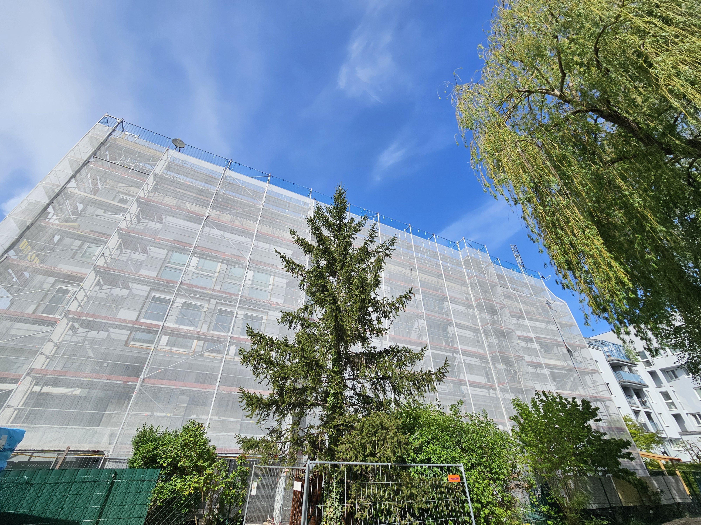
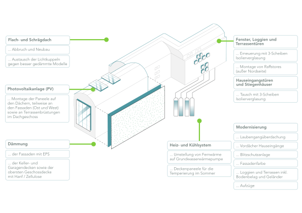
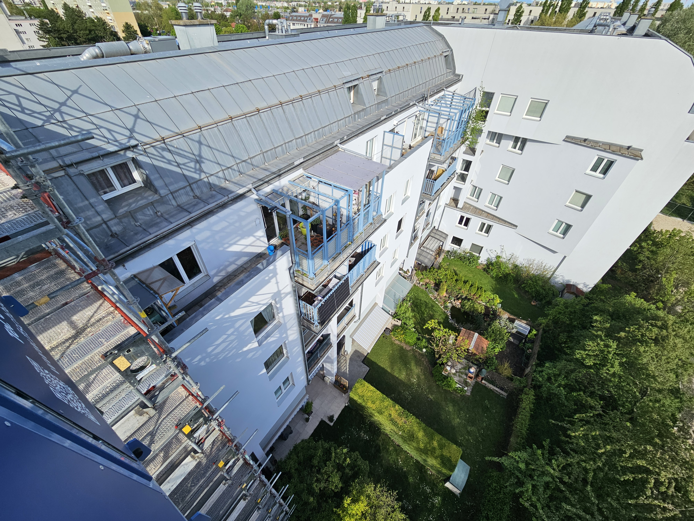
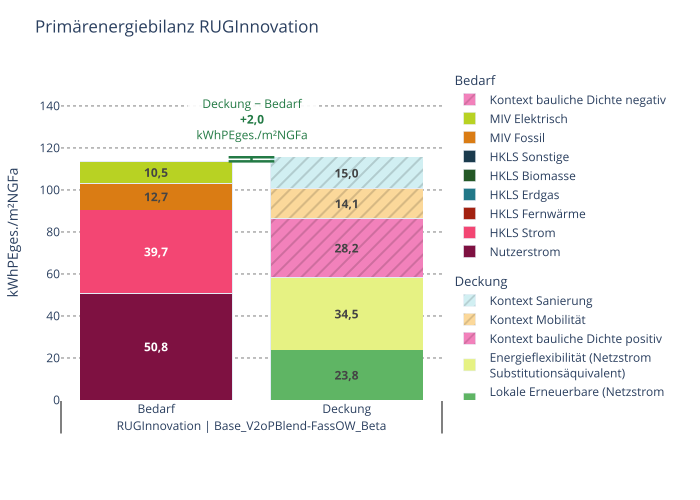
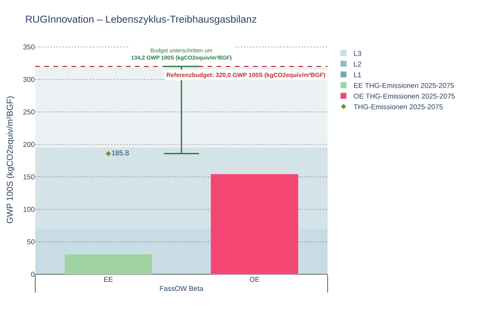

# RUGInnovation {#sec-ruginnovation}

::: {.lead}
Ein Wohnquartier für die erneuerbare Wärmeversorgung weiterentwickeln
:::
[{.peq-label-logo} klimaneutrales Plus-Energie-Quartier](02-standard.qmd){.peq-tag .knpeq-tag-standard} [Sanierung]{.peq-tag .peq-tag-sanierung} [Wohnen]{.peq-tag .peq-tag-wohnen} [Wärmeversorgung]{.peq-tag .peq-tag-waerme} [Photovoltaik]{.peq-tag .peq-tag-pv}

{width="100%"}

Wie kann ein bestehendes Wohnquartier einen Beitrag zum klimaneutralen Energiesystem leisten? RUGInnovation verbindet die thermische Sanierung der Wohnhausanlage Rugierstraße 28 mit dem Umstieg auf eine Grundwasserwärmepumpe und zusätzlicher Photovoltaik. Die Maßnahmen betreffen sowohl den Energiebedarf als auch die Versorgung und den sommerlichen Komfort.[^projekt]

## Projekt auf einen Blick

| Merkmal | Angabe |
|---|---|
| Standort | Rugierstraße 28, Wien-Donaustadt |
| Projektträger | Österreichisches Siedlungswerk (ÖSW) |
| Bestand | Wohnhausanlage, Baujahr 1990 |
| Vorhaben | Umfassende thermische und energietechnische Sanierung |
| Wärmeversorgung | Umstellung von Fernwärme auf Grundwasserwärmepumpe |
| Lokale Stromerzeugung | Photovoltaik auf Dächern, an Fassaden und Terrassenbrüstungen vorgesehen |
| Sommerlicher Komfort | Außenliegender Sonnenschutz und Deckenpaneele zur Temperierung |

## Die Planungsfrage

Im Bestand müssen Gebäudehülle, vorhandene Wärmeverteilung und die Möglichkeiten erneuerbarer Versorgung aufeinander abgestimmt werden. Bei RUGInnovation wird deshalb die Verbesserung der Hülle mit einem neuen Wärme- und Temperierungskonzept verbunden. Der [Sanierungskontext](05-kontext-sanierung.qmd) berücksichtigt die besonderen Ausgangsbedingungen bei der PEQ-Bewertung.

Die Berechnungsvarianten untersuchen unter anderem Verschattung, Wärmepumpeneffizienz, Mobilität und unterschiedliche PV-Belegungen. Damit lässt sich nachvollziehen, welche planerischen Entscheidungen für Energie- und Klimaziele besonders relevant sind.[^modell]

## Gebäudehülle und Versorgung gemeinsam verbessern

{#fig-rug-massnahmen width="100%"}

Das Sanierungskonzept umfasst Fassadendämmung, Dämmung von Keller- und Garagendecken sowie der obersten Geschossdecke. Fenster und Türen erhalten eine Dreifachverglasung. Raffstores verbessern den Sonnenschutz; Deckenpaneele ermöglichen eine Temperierung im Sommer.

Die Umstellung auf eine Grundwasserwärmepumpe verbindet Heizen und sommerliche Temperierung. Photovoltaik erschließt zusätzlich zu den Dächern auch Teile der Ost- und Westfassaden sowie Terrassenbrüstungen. Dadurch wird die nutzbare Erzeugungsfläche über die Dachflächen hinaus erweitert.

{width="100%"}

## Energie- und Klimabilanz

Die finale Variante erreicht den projektspezifischen Primärenergie-Zielwert mit einem Abstand von **+2,0 kWhₚₑ,ges/(m² NGF·a)**. Dabei werden der Gebäudebetrieb, die Mobilität und die Kontextbeiträge gemeinsam betrachtet.[^ergebnis]

| Kennzahl | Wert |
|---|---:|
| Bruttogrundfläche | 10.570,1 m² |
| Geschossflächenzahl | 2,27 |
| PV-Leistung | 117 kWp |
| Primärenergie-Bilanz | **+2,0 kWhₚₑ,ges/(m² NGF·a)** |

Die bauliche Dichte und der Sanierungskontext prägen den Bewertungsmaßstab. Die Kombination aus Photovoltaik, Energieflexibilität und den Kontextbeiträgen ermöglicht die rechnerische Zielerreichung. Eine positive Bewertung bedeutet dabei keine Energieautarkie.

::: {.content-visible when-format="html"}
<iframe src="../Abbildungen/praxis/ruginnovation-primary_energy_balance.html" title="Interaktive Primärenergiebilanz RUGInnovation" style="width:100%;height:660px;border:0" loading="lazy"></iframe>

Primärenergiebilanz einschließlich Mobilität: Bedarf und bewertete Deckung mit den Beiträgen aus Photovoltaik, Energieflexibilität, Dichte, Mobilität und Sanierung.
:::

::: {.content-hidden when-format="html"}
{#fig-rug-pe width="100%"}
:::

### Lebenszyklus-Treibhausgasbilanz

Die untersuchte Variante weist **185,81 kg CO₂e/m² BGF** über den bilanzierten Lebenszyklus aus. Gegenüber dem Referenzbudget von **320 kg CO₂e/m² BGF** verbleibt ein Spielraum von **134,19 kg CO₂e/m² BGF**. Die Grafik unterscheidet die baulichen und betrieblichen Emissionen und stellt ihre Summe dem Budget gegenüber.[^thg]

::: {.content-visible when-format="html"}
<iframe src="../Abbildungen/praxis/ruginnovation-gwp_ee.html" title="Interaktive Lebenszyklus-Treibhausgasbilanz RUGInnovation" style="width:100%;height:660px;border:0" loading="lazy"></iframe>

Lebenszyklus-Treibhausgasbilanz der untersuchten Variante mit Referenzbudget und verbleibendem Spielraum.
:::

::: {.content-hidden when-format="html"}
{#fig-rug-thg width="100%"}
:::

Die Angaben beschreiben die untersuchte Variante. Qualitätsstufe und Deklarationsphase werden nach Abgleich mit den Deklarationsunterlagen ergänzt.

## Was können andere Sanierungsprojekte daraus lernen?

Eine Sanierung eröffnet die Möglichkeit, Gebäudehülle, Wärmeversorgung, sommerlichen Komfort und lokale Stromerzeugung gemeinsam weiterzuentwickeln. Die PEQ-Bewertung macht die Beiträge der einzelnen Maßnahmen vergleichbar. Entscheidend ist, welche Kombination unter den konkreten Bedingungen des Bestands die angestrebte Qualität erreicht.

[Sanierungsfahrpläne](07-renovierungsfahrplan.qmd) · [Qualitätsstufen und Anforderungen](02-standard.qmd) · [Alle Praxisbeispiele](07-praxisbeispiele.qmd)

[^projekt]: ÖSW: *Informationen zur klimafitten Sanierung der Rugierstraße 28*, Februar 2024. Maßnahmen gemäß Projektkonzept; Fotos aus den bereitgestellten Projektunterlagen, April 2025.

[^modell]: PEExcel-Projektexport *ka_Projekt_Rugierstrasse.xlsx*. Ausgewählte Variante: `RUGInnovation | Base_V2oPBlend-FassOW_Beta`.

[^ergebnis]: Gespeicherte Ergebnisse der ausgewählten Variante; Grafiken mit `pexl.reporting.materialize` und `pexl.plot.plotly.render`. Der Import-/Exportsaldo ergibt +1,87 gegenüber dem Zielwert; die separat gespeicherte Netzäquivalentbilanz der Primärenergiegrafik ergibt +1,95 kWhₚₑ,ges/(m² NGF·a). Die geringe Abweichung ist im Export enthalten.

[^thg]: Gespeicherte Lebenszyklusergebnisse der ausgewählten Variante; Referenzbudget des dokumentierten Bewertungsstands: 320 kg CO₂e/m² BGF.
