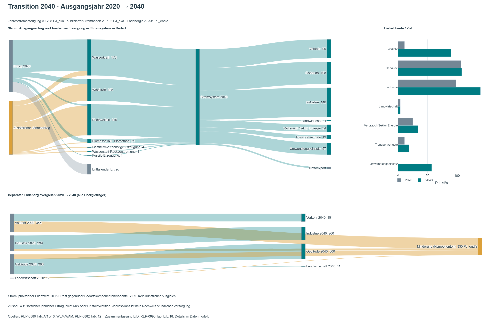
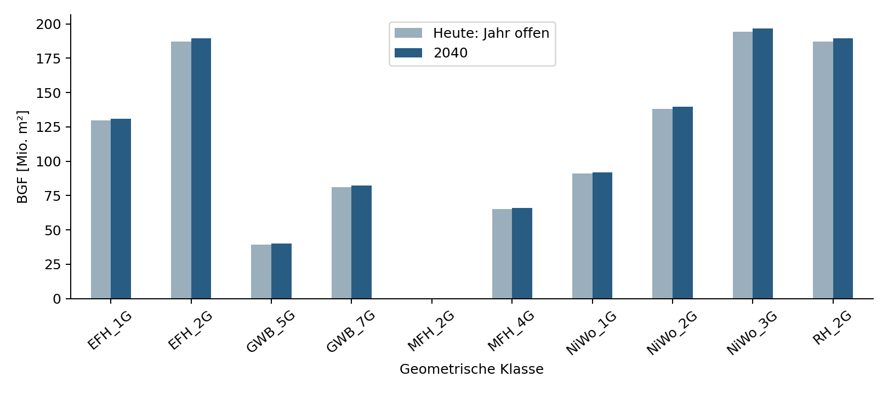

# Review der Methodik: Verständlichkeit und Gliederung {#sec-review-methodik}

Stand: 23.10.2026. Vergleichsbasis: `d7705cd`, Bearbeitung auf `main`.
Alle zehn Methodikkapitel wurden geprüft. Dieser Bericht dokumentiert redaktionelle Änderungen und die ausdrücklich ergänzte Dichte-Bewertungsvariante; eine normative Neukalibrierung ist damit nicht verbunden.

## Nummerierte Änderungen

1. **Gliederung Methodik.** Die Reihenfolge vom nationalen Zielbild über Allokation, Gebäudemodell und Kontextfaktoren zur THG- und Quartiersbilanz bleibt erhalten. Doppelte Erläuterungen und redaktionelle Produktionsanweisungen sind entfernt.

2. **Sachstand statt Arbeitsauftrag.** Formulierungen mit „vorläufig“, „zukünftig“, „künftig“, „einzufügen“ und „noch zu ergänzen“ sind in den betroffenen Berichtstexten durch Modellannahme, Referenzfall oder konkreten Datenstatus ersetzt. Fehlende normative Festlegungen bleiben als solche benannt; sie werden nicht als beschlossene Ergebnisse dargestellt.

3. **Methodikeinleitung.** Die Erklärung der Kontextbilanz wurde gekürzt. Das Statusfeld nennt Ergebnisse und nicht festgelegte Parameter statt einen noch abzuarbeitenden Arbeitsplan.

4. **Zielszenario: Tabellen verschoben.** Die bisherigen Tabellen 4.1–4.4 stehen im Anhang „Nationale Energie- und Stromtabellen“. Tabellen-IDs und Daten bleiben erhalten, die Nummerierung folgt dem Anhang.

5. **Zielszenario: Diagramme.** Die ersten drei Tabellen sind im Hauptkapitel durch Plotly-Stapelgrafiken ersetzt. Die Restetabelle wird als drei getrennte Bilanzidentitäten mit positiven/negativen Stapeln und Restmarkierung gezeigt; unabhängige Rundungsreste werden nicht sinnlos addiert.

6. **Allokation: Glossar.** Definitionen für zentralen Pool, budgetfähig, Gebäude-/Freiflächen-PV, MIV-Anteil, ÖPNV, Mobilitätsbudget und Saldo ergänzt. „Budgetfähig“ ist eine Anrechnungsregel des Modells, kein Herkunftsnachweis.

7. **Allokation: Variablen und Formel.** Die Symboltabelle verwendet renderbare Quarto-Mathematik. G_MIV bezeichnet das Budget; E_MIV den Bedarf. Die Formel enthält jetzt min/max-Begrenzungen entsprechend dem vorhandenen ausführbaren Algorithmus.

8. **Allokation: zentraler Pool.** Die Schrittetabelle ist durch ein Plotly-Wasserfalldiagramm ersetzt. 303 PJ/a zentrale Erzeugung, priorisierte Bedarfe und 24 PJ/a MIV-Budget bleiben nachvollziehbar.

9. **Allokation: Stellschrauben.** Die breite, begrifflich unklare Tabelle wurde in PV-Gesamtmenge/Gebäude/Freifläche, Verkehr-Gesamtmenge/ÖPNV/MIV/übriger Verkehr sowie Ergebnisse aufgeteilt. Absolute Mengen in PJ/a und die Bezugsgrößen der Prozentanteile sind explizit.

10. **Allokation: Vergleichsgrafiken.** Je Variante werden Gebäudebedarf + MIV und Gebäude-PV + Mobilitätsgutschrift gegenübergestellt. Ein separates Diagramm zeigt Saldo und zentrale Unterdeckung. Dieselbe Darstellung steht im Allokationsnotebook.

11. **Gebäudemodell: PV-Herkunft.** Ergänzt: Die PV-Erzeugung ist die Summe der gelieferten Kennwerte PV_total_direct und PV_to_Egrid; Kontrolle gegen Tabelle2.PV_total. Keine neue Ertragssimulation und keine GFZ-Skalierung der PV.

12. **Gebäudemodell: Variablen.** Im Abschnitt 7 des Notebooks sind k, u, g, j, d_j, R, z, s, E[c_D], A_BGF und C_D mit Bedeutung und Einheit erklärt. Ein Zahlenbeispiel erläutert das negative Vorzeichen für EFH_1G.

13. **Gebäudemodell: alle Typen.** Plotly-Auswahl für alle 900 Typen ergänzt: spezifischer Strombedarf, PV und virtueller Dichtewert. Geometrieauswahl und Achsenregler ermöglichen lesbare Ausschnitte; Tooltip mit nationaler Fläche. Die nicht zugeordnete Klasse MFH_2G bleibt ohne Kontextwert.

14. **Gebäudemodell: tatsächliche Anwendung der Dichteformel.** Neu berechneter Vergleichsfall über alle positiv gewichteten Flächen: C_D = −57,808696 PJ-Äquivalent/a. Dies ist eine ausdrücklich ausgewiesene Bewertungsvariante. Die bestehende physische Bilanz wird nicht überschrieben und PEQ-Berechtigung nicht unterstellt.

15. **Gebäudemodell: Top-down/Bottom-up-Vergleich.** Abschnitt 8 zeigt drei Säulengruppen: UBA-Allokation, Gebäudepool und Gebäudepool einschließlich Dichteformel. Dieselbe MIV-Zuordnung gilt in allen Gruppen. Erweiterte Salden: −7,00 / −107,25 / −165,06 PJ bzw. PJ-EE-Äquivalent/a.

16. **Dichtekalibrierung.** Wiederholte Hinweise zur Nichtvergleichbarkeit von Strom und PE gekürzt; stattdessen eine positive Definition von Aggregationseinheit und Umrechnung. Ein Arbeitsauftrag-Platzhalter wurde durch den Geltungsbereich des Entwurfs ersetzt.

17. **Mobilität und Sanierung.** Anweisungen „noch zu berechnen“ und „Tabelle ergänzen“ durch den dokumentierten Parameterstand ersetzt. Vorhandene historische Gutschriften werden weiterhin als historische Werte eingeordnet.

18. **THG.** Doppelte Einleitung und triviale Wiederholungen gestrichen. Datenlücken sind als Datenumfang formuliert. Die Flächen- und Budgetannahmen, Systemgrenzen und Emissionspfade bleiben inhaltlich erhalten.

19. **Quartiersbilanz.** Vier Abbildungs-Produktionshinweise entfernt; vorhandene Abbildungen bleiben. Wiederholungen zu Flächen-/Einheitenvergleich, Speicher als Energiequelle, Autarkie und Zeitbegriffen gestrafft. Die maßgeblichen Bilanzregeln bleiben erhalten.

20. **Fortschreibung.** Überschrift und Einleitung auf Methodenstand und Einflussgrößen konzentriert; Zukunftsankündigungen in konkrete Varianten/Parameterstände überführt. Keine Änderung von Senken- oder Budgetannahmen.

21. **Einheitliche Grafikgestaltung.** Farben und Grundlayout liegen in styles/plotly_formatting.py; auch die vorhandenen sektoralen und Mobilitäts-Sankeys verwenden diese Palette. Schraffuren markieren virtuelle Kontextwerte. Alle neuen HTML-Grafiken funktionieren ohne CDN.

22. **Reproduzierbarkeit.** Wissenschaftliche Zusatzrechnungen bleiben im Gebäudenotebook. Berechnungen/methodik_plots.py formatiert die übergebenen Ergebnisse und die nationalen Quelltabellen. Original-Excel und ursprüngliche physische Typenkennwerte bleiben unverändert.

23. **Interne Dokumentation.** Dieser Reviewbericht ist in den Profilen intern und redaktion eingebunden, im Publikationsprofil ausgeschlossen. Der neue Szenariotabellen-Anhang ist dagegen Teil der Publikation.

## Wortlautvergleich der geänderten Kapitel

Die folgenden nummerierten Einträge enthalten die geänderten Textblöcke vollständig. Reine Leerzeilenänderungen sind ausgelassen. Die Codeblöcke verhindern, dass historische Formeln oder Querverweise als aktuelle Kapitelinhalte interpretiert werden.

24. **Kapitel/03-methodik.qmd, Ausgangszeile 59: Umformulierung / Umgliederung.**

    Bisher:

    ~~~~text
    Für einen Quartierssaldo \(b_{\mathrm{PE}}\) vor Kontextkorrektur gilt schematisch:
    ~~~~

    Jetzt:

    ~~~~text
    Für einen Quartierssaldo $b_{\mathrm{PE}}$ vor Kontextkorrektur gilt schematisch:
    ~~~~

25. **Kapitel/03-methodik.qmd, Ausgangszeile 66: Umformulierung / Umgliederung.**

    Bisher:

    ~~~~text
    Alle Größen müssen dieselbe flächenbezogene Primärenergie-Einheit und Systemgrenze verwenden, etwa kWh PE/(m² NGF·a). Positive Kontextwerte sind Gutschriften, negative erhöhen die Anforderung. Der **Mobilitätswert** entsteht aus der nationalen Sektorallokation und wird ausschließlich bei Einbeziehung des entsprechenden MIV-Bedarfs angesetzt. Der **Sanierungswert** ist künftig *typologieabhängig* und wird nicht als genereller Pauschalwert festgelegt. Dichte- und Sanierungsparameter sind gemeinsam auf den sektoralen Zielsaldo abzustimmen; bereits in einem typologischen Zielsaldo berücksichtigte Wirkungen dürfen nicht noch einmal addiert werden.
    ~~~~

    Jetzt:

    ~~~~text
    Die Bewertung erfolgt in kWh PE/(m² NGF·a). Positive Kontextwerte entlasten die Anforderung, negative erhöhen sie. Der **Mobilitätswert** entsteht aus der nationalen Sektorallokation und wird ausschließlich bei Einbeziehung des entsprechenden MIV-Bedarfs angesetzt. Der **Sanierungswert** ist *typologieabhängig* und wird nicht als genereller Pauschalwert festgelegt. Dichte- und Sanierungsparameter sind gemeinsam auf den sektoralen Zielsaldo abzustimmen; bereits in einem typologischen Zielsaldo berücksichtigte Wirkungen dürfen nicht noch einmal addiert werden.
    ~~~~

26. **Kapitel/03-methodik.qmd, Ausgangszeile 68: Umformulierung / Umgliederung.**

    Bisher:

    ~~~~text
    Die Bewertungsbedingung \(b_{\mathrm{Bewertung}}>0\) verlangt keinen physischen Exportüberschuss. Die reale Bilanz und alle virtuellen Korrekturen sind daher getrennt auszuweisen. Das kumulierte THG-Budget ist eine zusätzliche eigenständige Prüfung und keine Primärenergie-Gutschrift.
    
    ::: {.callout-note title="Kalibrierungsstand dieser Arbeitsfassung"}
    UBA Transition 2040 ist das festgelegte Referenzszenario. Die sektorale Allokation und die neue Gebäudetypologie mit Flächenverteilung sind inzwischen in getrennten ausführbaren Notebooks ausgewertet (@sec-allokation-notebook; @sec-gebaeudesektormodell). Der Vergleich zeigt einen noch nicht geschlossenen Szenarioabstand. Solange die sektorale Zuordnung und die Parameterkalibrierung nicht abgeschlossen sind, werden historische Zielwerte nicht als neue Ergebnisse ausgewiesen. Die ursprüngliche Streicher-basierte Kalibrierung ist als methodischer Vorläufer dokumentiert [@schneider2020lokal; @schneider2023context].
    ~~~~

    Jetzt:

    ~~~~text
    ::: {.callout-note title="Sachstand des Publikationsentwurfs"}
    UBA Transition 2040 ist das festgelegte Referenzszenario. Die sektorale Allokation und die neue Gebäudetypologie mit Flächenverteilung sind in getrennten ausführbaren Notebooks ausgewertet (@sec-allokation-notebook; @sec-gebaeudesektormodell). Der Vergleich weist den Szenarioabstand und die Wirkung der historischen Dichteformel aus. Normative PEQ-Anteile und neue Typologiegrenzwerte sind im Entwurf nicht festgelegt. Die ursprüngliche Streicher-basierte Kalibrierung ist als methodischer Vorläufer dokumentiert [@schneider2020lokal; @schneider2023context].
    ~~~~

27. **Kapitel/03-zielszenario.qmd, Ausgangszeile 4: Umformulierung / Umgliederung.**

    Bisher:

    ~~~~text
    UBA Transition 2040 als einheitliche Referenz für die nationale Energieaufgabe
    ~~~~

    Jetzt:

    ~~~~text
    UBA Transition 2040 als Referenz der nationalen Energieaufgabe
    ~~~~

28. **Kapitel/03-zielszenario.qmd, Ausgangszeile 7: Umformulierung / Umgliederung.**

    Bisher:

    ~~~~text
    Das Szenario **UBA Transition 2040** ist die Grundlage der Neukalibrierung der energiebezogenen PEQ-Anforderungen. Dieses Kapitel dokumentiert die veröffentlichten Energie- und Strombilanzen und ihren Vergleich mit dem Ausgangsjahr. Die **Zuordnung** von Erzeugung und Bedarf zu Gebäuden, Industrie und Verkehr erfolgt erst in @sec-allokation; die Anforderungen an Gebäudetypologien und Quartiere werden in @sec-gebaeudebestand und @sec-kalibrierung abgeleitet.
    ~~~~

    Jetzt:

    ~~~~text
    UBA Transition 2040 (REP-0880) beschreibt die Erzeugung und den Bedarf im Zieljahr 2040 [@uba2023transition]. WEM/WAM 2023 und 2025 dienen als Vergleichsszenarien. Die sektorale Zuordnung folgt in @sec-allokation, der Abgleich mit Gebäudetypologien in @sec-gebaeudebestand.
    ~~~~

29. **Kapitel/03-zielszenario.qmd, Ausgangszeile 9: Umformulierung / Umgliederung.**

    Bisher:

    ~~~~text
    ## Referenzszenario und Datenstand
    
    Maßgeblich ist UBA Transition 2040 (REP-0880) für das **Zieljahr 2040** [@uba2023transition]. Für Vergleiche werden WEM/WAM 2023 sowie WEM/WAM 2025 getrennt ausgewiesen. Diese Vergleichsszenarien ändern die festgelegte Referenz für die Neukalibrierung nicht [@uba2025szenarien].
    
    Die zugrunde liegenden Größen sind zunächst **physische jährliche Energiemengen**. Stromerzeugung, Strombedarf und Saldo werden in PJ elektrischer Energie pro Jahr verglichen; der Endenergieverbrauch aller Energieträger wird separat ausgewiesen. Primärenergiegewichtungen und virtuelle Gutschriften sind keine Bestandteile dieser physischen nationalen Stromtabelle.
    
    ## Nationale Elektrizitätsbilanz 2040
    
    
    
    Die veröffentlichte nationale Elektrizitätsbilanz ist der Ausgangspunkt der sektoralen Stromaufteilung. Dabei sind Stromerzeugung nach Technologie, Strombedarfe nach Sektor sowie Energieumwandlung, Eigenverbrauch, Netzverluste und gegebenenfalls Nettoimporte nachvollziehbar zu trennen. Insbesondere sind die Rückverstromung gespeicherter Energieträger und die zugehörigen Umwandlungsbedarfe konsistent abzubilden; eine Erzeugungsposition darf nicht mit ihrem vorgelagerten Stromeinsatz doppelt als neue Nettoenergie gezählt werden.
    
    ## Endenergie aller Energieträger im Vergleich
    
    
    
    Der Endenergievergleich umfasst sämtliche Energieträger und darf nicht mit dem Strombedarf gleichgesetzt werden [@uba2023transition, Tab. A; @uba2023zusammenfassung, Tab. B; @uba2025szenarien, Tab. B]. Die veröffentlichten Gesamtsummen bleiben neben den Summen gerundeter Einzelpositionen erhalten. Bilanzreste werden nicht stillschweigend auf Sektoren umgelegt. Für WEM/WAM 2025 folgt die vorhandene Normierung Tabelle E (S. 12) in REP-0995; deren Abweichungen gegenüber Tabelle 19 desselben Berichts sind separat dokumentiert. Für Transition ist REP-0880, Tabelle 16, maßgeblich [@uba2025szenarien; @uba2023transition].
    
    ## Entwicklung vom Ausgangsjahr 2020 bis 2040
    
    Das Ausgangsjahr der Transition-Bilanz ist **2020** und nicht das Erscheinungsjahr dieses Berichts. Von 2020 bis 2040 steigt die veröffentlichte jährliche Stromerzeugung von 249 auf 457 PJ und der Strombedarf von 257 auf 450 PJ. Zugleich sinkt der gesamte energetische Endverbrauch von 1.053 auf 722 PJ. Dies zeigt die zunehmende Elektrifizierung bei sinkendem Endenergieverbrauch über sämtliche Träger [@uba2023transition, Tab. A, 15 und 16].
    ~~~~

    Jetzt:

    ~~~~text
    ## Stromerzeugung und Strombedarf
    ~~~~

30. **Kapitel/03-zielszenario.qmd, Ausgangszeile 33: Umformulierung / Umgliederung.**

    Bisher:

    ~~~~text
    <iframe src="../Abbildungen/transition_sankey.html" title="UBA Transition 2040: Stromausbau, Strombedarf und Endenergieminderung" style="width:100%;height:1760px;border:0" loading="lazy"></iframe>
    ~~~~

    Jetzt:

    ~~~~text
    <iframe src="../Abbildungen/methodik/stromerzeugung.html" title="Stromerzeugung nach Energieträgern" style="width:100%;height:620px;border:0" loading="lazy"></iframe>
    ~~~~

31. **Kapitel/03-zielszenario.qmd, Ausgangszeile 35: Ergänzung.**

    Jetzt:

    ~~~~text
    [Grafik separat öffnen](../Abbildungen/methodik/stromerzeugung.html)
    :::
    ~~~~

32. **Kapitel/03-zielszenario.qmd, Ausgangszeile 36: Umformulierung / Umgliederung.**

    Bisher:

    ~~~~text
    [Interaktive Grafik in voller Breite öffnen](../Abbildungen/transition_sankey.html)
    ~~~~

    Jetzt:

    ~~~~text
    ::: {.content-visible when-format="html"}
    ```{=html}
    <iframe src="../Abbildungen/methodik/strombedarf.html" title="Strombedarf nach Sektoren" style="width:100%;height:620px;border:0" loading="lazy"></iframe>
    ```
    [Grafik separat öffnen](../Abbildungen/methodik/strombedarf.html)
    :::
    
    Die gestapelten Säulen zeigen die veröffentlichten Komponenten. Rauten markieren die publizierten Gesamtsummen; Nettoimporte beziehungsweise Exporte sind bei der Erzeugung gesondert dargestellt. Für Transition gelten REP-0880, Tabellen 15 und 16; die Vergleichsdaten stammen aus REP-0882 und REP-0995 [@uba2023transition; @uba2023zusammenfassung; @uba2025szenarien].
    
    ## Bilanzreste und Datengrundlage
    
    ::: {.content-visible when-format="html"}
    ```{=html}
    <iframe src="../Abbildungen/methodik/bilanzreste.html" title="Komponenten, publizierte Summen und Bilanzreste" style="width:100%;height:850px;border:0" loading="lazy"></iframe>
    ```
    [Grafik separat öffnen](../Abbildungen/methodik/bilanzreste.html)
    :::
    
    Die gerundeten Bedarfskomponenten von Transition ergeben 452 PJ/a gegenüber einer publizierten Summe von 450 PJ/a. Die Komponentenbilanz einschließlich Nettoexport weist damit −2 PJ/a aus. Diese Differenz bleibt erhalten. Die vollständigen Tabellen zu Erzeugung, Bedarf, Resten und Endenergie stehen in @sec-szenariotabellen; ihre Quellen- und Tabellenverweise bleiben dort nachvollziehbar.
    
    ## Entwicklung von 2020 bis 2040
    
    Die jährliche Stromerzeugung steigt von 249 auf 457 PJ, der veröffentlichte Strombedarf von 257 auf 450 PJ. Der gesamte energetische Endverbrauch sinkt von 1.053 auf 722 PJ. Transition verbindet damit Elektrifizierung und eine Minderung des Endenergieverbrauchs [@uba2023transition, Tab. A, 15 und 16].
    
    ::: {.content-visible when-format="html"}
    ```{=html}
    <iframe src="../Abbildungen/transition_sankey.html" title="Transition 2040: Ausbau und Bedarfsentwicklung gegenüber 2020" style="width:100%;height:1760px;border:0" loading="lazy"></iframe>
    ```
    [Interaktive Grafik separat öffnen](../Abbildungen/transition_sankey.html)
    ~~~~

33. **Kapitel/03-zielszenario.qmd, Ausgangszeile 40: Umformulierung / Umgliederung.**

    Bisher:

    ~~~~text
    {#fig-transition-sankey}
    ~~~~

    Jetzt:

    ~~~~text
    {#fig-transition-sankey}
    ~~~~

34. **Kapitel/03-zielszenario.qmd, Ausgangszeile 43: Umformulierung / Umgliederung.**

    Bisher:

    ~~~~text
    Die Grafik stellt Jahresenergiemengen, keine installierten Leistungen und keine virtuellen Primärenergie-Gutschriften dar. Die Minderung des Endenergieverbrauchs beträgt nach veröffentlichten Gesamtsummen 331 PJ, nach gerundeten Sektorkomponenten 330 PJ. Beim Ziel-Strombedarf stehen 450 PJ Gesamtsumme einer Komponentensumme von 452 PJ gegenüber; diese Abweichungen werden ausgewiesen, nicht korrigierend verteilt. Zentral/dezentral sowie MIV/ÖPNV/übriger Verkehr sind **nachgelagerte, dokumentationspflichtige Modellaufteilungen** und keine unmittelbar veröffentlichten UBA-Kategorien.
    ~~~~

    Jetzt:

    ~~~~text
    Die Minderung der Endenergie beträgt nach Gesamtsummen 331 PJ/a und nach gerundeten Sektorkomponenten 330 PJ/a. Für WEM/WAM 2025 folgt die Normierung Tabelle E in REP-0995; Abweichungen zu Tabelle 19 desselben Berichts sind im Datenanhang dokumentiert.
    ~~~~

35. **Kapitel/03-zielszenario.qmd, Ausgangszeile 45: Umformulierung / Umgliederung.**

    Bisher:

    ~~~~text
    ## Schnittstelle zur sektoralen Allokation
    ~~~~

    Jetzt:

    ~~~~text
    ## Übergang zur Allokation
    ~~~~

36. **Kapitel/03-zielszenario.qmd, Ausgangszeile 47: Umformulierung / Umgliederung.**

    Bisher:

    ~~~~text
    Die Übertragung in @sec-allokation benötigt eine eindeutige, versionierte Strombilanz mit der Aufteilung nach Technologien und Sektoren. Besonders offen sind die Zuordnung von PV-Erzeugung zu Gebäuden beziehungsweise anderen Flächen und die Abgrenzung des Verkehrssektors in MIV, ÖPNV und weitere Verkehrsleistungen. Die Quelldaten sind dabei unveränderlich; solche Aufteilungen werden als gesonderte Modellparameter geführt.
    ~~~~

    Jetzt:

    ~~~~text
    Die UBA-Tabellen enthalten weder die für PEQ benötigte Aufteilung der PV auf Gebäude und Freiflächen noch jene des Verkehrs auf MIV und ÖPNV. Diese Aufteilungen sind explizite Parameter der Allokation in @sec-allokation. Die Quelldaten bleiben davon unverändert.
    ~~~~

37. **Kapitel/03-zielszenario.qmd, Ausgangszeile 49: Umformulierung / Umgliederung.**

    Bisher:

    ~~~~text
    Das vorhandene Notebook `Redaktion/transitionsszenarien/Berechnungen/Transition_2040.ipynb` dient als Daten- und Rechengrundlage. Seine Varianten für PV-Zuordnung, MIV/ÖPNV und zusätzliche Verbrauchsminderung sind nicht automatisch als neue PEQ-Anforderung zu interpretieren.
    
    ::: {.callout-note title="Historische Einordnung"}
    Die ursprüngliche PEQ-Zielwertableitung beruhte auf „Energieautarkie für Österreich 2050“ nach Streicher et al. und der darauf aufbauenden sektoralen Allokation [@streicher2010energieautarkie; @schneider2020lokal; @schneider2023context]. Sie ist für die vorliegende Neukalibrierung **kein konkurrierendes Referenzszenario**. Die vollständige historische Parametrisierung gehört in den Methodenanhang.
    :::
    ~~~~

    Jetzt:

    ~~~~text
    Die historische Ableitung nach Streicher et al. bildet den methodischen Ausgangspunkt; das Referenzszenario dieses Entwurfs ist Transition 2040 [@streicher2010energieautarkie; @schneider2020lokal; @schneider2023context].
    ~~~~

38. **Kapitel/03-allokation.qmd, Ausgangszeile 4: Umformulierung / Umgliederung.**

    Bisher:

    ~~~~text
    Vom nationalen Stromsystem nach UBA Transition 2040 zum Energiebeitrag des Gebäudesektors und zum MIV-Budget
    ~~~~

    Jetzt:

    ~~~~text
    Vom nationalen Stromsystem zum Gebäudesektorsaldo und zum Mobilitätsbudget
    ~~~~

39. **Kapitel/03-allokation.qmd, Ausgangszeile 7: Umformulierung / Umgliederung.**

    Bisher:

    ~~~~text
    Das nationale Zielbild in @sec-zielszenario beschreibt Erzeugung und Bedarf im Zieljahr 2040. Die **sektorale Allokation** legt fest, welche Anteile zentral erzeugter erneuerbarer Energie und welche Strombedarfe den einzelnen Sektoren zugeordnet werden. Zwei Ergebnisse sind für die PEQ-Kalibrierung erforderlich: (1) der dem Gebäudesektor zugeordnete Stromsaldo als nationaler Kalibrierungsmaßstab und (2) das **erneuerbare Mobilitätsbudget**, das später nutzungsbezogen auf Quartiere verteilt wird. Beide Ergebnisse stammen aus demselben Zuordnungsmodell; das Mobilitätsbudget darf nicht erst nachträglich unabhängig von der Sektorbilanz festgelegt werden.
    ~~~~

    Jetzt:

    ~~~~text
    Die Allokation verteilt die Stromerzeugung und den Bedarf aus UBA Transition 2040 auf sektorale Verantwortungsbereiche. Sie liefert zwei verbundene Größen: den Zielsaldo für Gebäude einschließlich MIV und das aus zentraler Erzeugung zugeordnete Mobilitätsbudget. Die Rechnung ist in @sec-allokation-notebook dokumentiert.
    ~~~~

40. **Kapitel/03-allokation.qmd, Ausgangszeile 9: Umformulierung / Umgliederung.**

    Bisher:

    ~~~~text
    ## Zuordnungsprinzip und Bilanzgrenzen
    ~~~~

    Jetzt:

    ~~~~text
    ## Begriffe und Bilanzgrößen
    ~~~~

41. **Kapitel/03-allokation.qmd, Ausgangszeile 11: Umformulierung / Umgliederung.**

    Bisher:

    ~~~~text
    Im Ausgangsmodell werden zentrale erneuerbare Energiequellen vorrangig für Industrie und öffentlichen Verkehr verwendet. Der verbleibende Anteil bildet die Grundlage für eine virtuelle Deckung des motorisierten Individualverkehrs (MIV). Gebäude übernehmen gleichzeitig die Verantwortung für ihren betrieblichen Bedarf, den ihnen zugerechneten MIV-Bedarf und den zugewiesenen lokalen erneuerbaren Erzeugungsbeitrag [@schneider2020lokal, Abschn. 3.1.4 und 5.1; @schneider2023context, Abschn. 6.1–6.2].
    ~~~~

    Jetzt:

    ~~~~text
    | Begriff | Bedeutung im Modell |
    |---|---|
    | Zentraler Pool | Für die priorisierten Bedarfe angesetzte Nicht-PV-Stromerzeugung; „zentral“ bezeichnet die Allokation, nicht Anlagengröße oder Eigentum. |
    | Budgetfähig | Nach der gewählten Zuordnungsregel für diesen Pool anrechenbar. Der Begriff beschreibt eine Modellentscheidung, keinen Herkunftsnachweis. |
    | Gebäude-PV | Anteil der nationalen PV-Erzeugung, der dem Gebäudesektor zugeordnet wird. |
    | Freiflächen-PV | Im Modell die gesamte PV außerhalb von Gebäuden; sie bleibt als eigener nationaler Pool ausgewiesen. |
    | MIV-Anteil | Anteil des MIV am **elektrischen Energiebedarf** des Verkehrs; kein Wege- oder Personenkilometeranteil. |
    | ÖPNV | Öffentlicher Personenverkehr; eigene Teilmenge des elektrischen Verkehrsbedarfs. Übriger Verkehr wird separat geführt. |
    | MIV-Budget / Mobilitätsgutschrift | Dem MIV zugeteilte Deckung aus dem zentralen Pool in PJ Strom/a. Die nutzungsbezogene PE-Gutschrift ist in @sec-kontext-mobilitaet definiert. |
    | Saldo | Zugeordnete Deckung minus Bedarf; positiv bedeutet Überschuss, negativ Deckungslücke. |
    ~~~~

42. **Kapitel/03-allokation.qmd, Ausgangszeile 13: Umformulierung / Umgliederung.**

    Bisher:

    ~~~~text
    Diese Zuordnung ist eine **Bilanz- und Lastenverteilungsregel** und keine Aussage über physisch getrennte Stromnetze. Die hier beschriebene Neukalibrierung nutzt UBA Transition 2040 statt des historischen Referenzszenarios. Sämtliche Zuordnungen müssen deshalb anhand der neuen Strombilanz erneut vorgenommen und abgestimmt werden.
    ~~~~

    Jetzt:

    ~~~~text
    : Glossar der sektoralen Allokation. {#tbl-allokation-glossar}
    ~~~~

43. **Kapitel/03-allokation.qmd, Ausgangszeile 15: Umformulierung / Umgliederung.**

    Bisher:

    ~~~~text
    ## Zentrale und dezentrale erneuerbare Erzeugung
    ~~~~

    Jetzt:

    ~~~~text
    ## Erzeugungszuordnung und Prioritäten
    ~~~~

44. **Kapitel/03-allokation.qmd, Ausgangszeile 17: Umformulierung / Umgliederung.**

    Bisher:

    ~~~~text
    Für die Allokationslogik wird zunächst ein zentral verfügbarer, **nicht aus PV stammender** erneuerbarer Strompool abgegrenzt. Darunter fallen entsprechend den bilanzierten Positionen insbesondere Wasserkraft, Windkraft sowie verfügbare Stromerzeugung aus Rückverstromung und Speichern. Die konkrete technische Zuordnung folgt den UBA-Kategorien und ihren Systemgrenzen; die Bezeichnung „zentral“ ist hier eine **Modellkategorie**, keine Aussage über Eigentum oder Anlagengröße.
    ~~~~

    Jetzt:

    ~~~~text
    Der Referenzfall ordnet die 149 PJ/a PV vollständig den Gebäuden zu. Freiflächen-PV bleibt in Varianten separat; sie wird nicht in den zentralen Nicht-PV-Pool umgebucht. Diese Regel macht sichtbar, wie sich die Gebäudeaufgabe mit der PV-Zuordnung verändert.
    ~~~~

45. **Kapitel/03-allokation.qmd, Ausgangszeile 19: Umformulierung / Umgliederung.**

    Bisher:

    ~~~~text
    **PV-Strom wird getrennt geführt**, insbesondere Gebäude-PV und PV außerhalb von Gebäuden. Welche Energiemenge an Gebäude-PV dem Gebäudesektor zugerechnet wird und wie sonstige PV-Erzeugung verwendet wird, ist ausdrücklich festzulegen. PV außerhalb von Gebäuden wird nicht stillschweigend dem nicht-PV-Mobilitätsbudget zugeschlagen.
    ~~~~

    Jetzt:

    ~~~~text
    Dem zentralen Pool werden Wasserkraft (173 PJ/a), Windkraft (105), Biomasse (21) und die normierte Position Geothermie/sonstige (4) zugeordnet: zusammen **303 PJ/a**. Wasserstoff-Rückverstromung (4 PJ/a) ist im Referenzfall wegen der nicht dokumentierten Herkunft nicht angerechnet; eine Variante zeigt die vollständige Anrechnung. Fossile Erzeugung (1 PJ/a) bleibt außerhalb des Pools [@uba2023transition, Tab. 16].
    ~~~~

46. **Kapitel/03-allokation.qmd, Ausgangszeile 21: Umformulierung / Umgliederung.**

    Bisher:

    ~~~~text
    Die Verfügbarkeit des zentralen Pools ist konsistent mit Energiesektor-Eigenverbrauch, Speichern, Umwandlungsbedarfen, Transportverlusten und Stromimporten zu berechnen. Insbesondere sind Elektrolyse-/Methanisierungs-Strombedarfe und die daraus folgende Rückverstromung **nicht als zwei unabhängige zusätzliche Energiequellen** zu bilanzieren. Ein- und Ausspeicherungen sowie Verluste werden nur an einer festgelegten Stelle der Bilanz berücksichtigt.
    ~~~~

    Jetzt:

    ~~~~text
    ::: {.content-visible when-format="html"}
    ```{=html}
    <iframe src="../Abbildungen/methodik/zentraler_pool.html" title="Herleitung des zentralen MIV-Budgets" style="width:100%;height:650px;border:0" loading="lazy"></iframe>
    ```
    [Grafik separat öffnen](../Abbildungen/methodik/zentraler_pool.html)
    :::
    ~~~~

47. **Kapitel/03-allokation.qmd, Ausgangszeile 23: Umformulierung / Umgliederung.**

    Bisher:

    ~~~~text
    | Modellgröße | Abgrenzung | Kalibrierungsstand |
    ~~~~

    Jetzt:

    ~~~~text
    
    Die zentrale Erzeugung deckt zuerst Industrie, Landwirtschaft, Energiebranche, Umwandlung, Netzverluste und Nettoexport sowie ÖPNV und übrigen Verkehr. Bei 20 % ÖPNV und 80 % MIV an 90 PJ/a Verkehrsbedarf verbleiben **24 PJ/a für MIV**. Die Priorität folgt dem Allokationsansatz nach @schneider2020lokal und @schneider2023context; die Mengen stammen aus Transition 2040.
    
    | Position | Ansatz im Referenzfall |
    |---|---|
    | Nicht-PV-Pool | Wasser, Wind, Biomasse, Geothermie/sonstige |
    | PV | 100 % Gebäude, 0 % Freifläche |
    | Verkehr | 80 % MIV, 20 % ÖPNV, 0 % übriger Verkehr |
    | Systempositionen | Einmaliger Abzug von Energiebranche, Umwandlung, Verlusten und Nettoexport |
    | H₂-Rückverstromung | 0 % anrechenbar; Vergleichsvariante mit 100 % |
    
    : Zuordnungsregeln des Referenzfalls. Die PV- und Verkehrsanteile sind Modellannahmen. {#tbl-allokation-datenbedarf}
    
    ## Berechnung von Mobilitätsbudget und Gebäudesaldo {#sec-allokation-miv}
    
    Für die Berechnung gelten folgende jährliche Stromgrößen:
    
    | Symbol | Definition | Einheit |
    ~~~~

48. **Kapitel/03-allokation.qmd, Ausgangszeile 25: Umformulierung / Umgliederung.**

    Bisher:

    ~~~~text
    | Erneuerbare Stromerzeugung ohne PV | Quellen und Stromerzeugung aus Rückverstromung/Speichern gemäß UBA-Bilanz | Technologieliste und Nettoabgrenzung festzulegen |
    | Gebäude-PV | PV-Erzeugung auf beziehungsweise an Gebäuden | Anteil am nationalen PV-Ausbau festzulegen |
    | Andere PV | Freiflächen-PV und weitere nicht dem Gebäude zugeordnete PV | Allokationsregel festzulegen |
    | Netz-/Umwandlungspositionen | Verluste und energiewirtschaftliche Bedarfe, sofern nicht bereits im Nettowert enthalten | Abgleich mit Quelltabellen nötig |
    | Importe, nicht erneuerbare Anteile | Gesonderte Bilanzpositionen, keine automatische erneuerbare MIV-Gutschrift | Behandlung zu dokumentieren |
    ~~~~

    Jetzt:

    ~~~~text
    | $E_{\mathrm{Z}}$ | Angerechnete zentrale Erzeugung | PJ/a |
    | $E_{\mathrm{V}}$ | Summe der priorisierten Bedarfe einschließlich ÖPNV, übrigen Verkehrs und Nettoexports | PJ/a |
    | $E_{\mathrm{MIV}}$ | Elektrischer MIV-Bedarf | PJ/a |
    | $G_{\mathrm{MIV}}$ | Zugeordnetes MIV-Budget | PJ/a |
    | $E_{\mathrm{PV,Geb}}$ | Dem Gebäude zugeordnete PV-Erzeugung | PJ/a |
    | $E_{\mathrm{Geb}}$ | Betriebsstrombedarf des Gebäudesektors | PJ/a |
    | $B_{\mathrm{Geb,Ziel}}$ | Zielsaldo für Gebäude einschließlich MIV | PJ/a |
    ~~~~

49. **Kapitel/03-allokation.qmd, Ausgangszeile 31: Umformulierung / Umgliederung.**

    Bisher:

    ~~~~text
    : Für die sektorale Allokation benötigte Strombilanzpositionen. Fehlende Zuordnungen sind **keine Nullwerte**. {#tbl-allokation-datenbedarf}
    
    ## Vorrangige Bedarfe: Industrie und öffentlicher Verkehr
    
    Die Industrie wird auf Basis der entsprechenden nationalen Strombedarfsposition erfasst. Der Verkehrsbedarf von UBA Transition 2040 ist für die PEQ-Definition gesondert nach **öffentlichem Verkehr, motorisiertem Individualverkehr und übrigen Verkehrsbedarfen** aufzuschlüsseln. Soweit das UBA-Szenario die benötigte Unterteilung nicht unmittelbar liefert, ist eine belegte ergänzende Zuordnung erforderlich; historische MIV/ÖPNV-Anteile werden nicht ungeprüft übernommen.
    
    Die Zuordnung weiterer Bedarfe, insbesondere des Energiesektors und anderer Endverbraucher, erfolgt ausdrücklich und ohne doppelte Belastung. Es ist zu dokumentieren, welche Positionen bereits von einer verfügbaren Nettoerzeugung abgezogen sind und welche als vorrangige externe Bedarfe zu berücksichtigen sind.
    
    ## Ermittlung des erneuerbaren MIV-Budgets {#sec-allokation-miv}
    
    Das **nationale MIV-Budget entsteht innerhalb der sektoralen Allokation** als Differenz zwischen dem hierfür verfügbaren zentralen erneuerbaren Strompool und den vorrangig zugeordneten Strombedarfen. Schematisch gilt in **elektrischer Energie**:
    ~~~~

    Jetzt:

    ~~~~text
    Das Budget ist auf den verfügbaren positiven Rest und den MIV-Bedarf begrenzt:
    ~~~~

50. **Kapitel/03-allokation.qmd, Ausgangszeile 44: Umformulierung / Umgliederung.**

    Bisher:

    ~~~~text
    E_{\mathrm{MIV,Budget}}^{\mathrm{el}}
    =E_{\mathrm{zentral,verf}}^{\mathrm{el}}
    -E_{\mathrm{Industrie,zugeordnet}}^{\mathrm{el}}
    -E_{\mathrm{ÖPNV,zugeordnet}}^{\mathrm{el}}
    -E_{\mathrm{sonstige,zugeordnet}}^{\mathrm{el}}.
    ~~~~

    Jetzt:

    ~~~~text
    G_{\mathrm{MIV}}=\min\left(E_{\mathrm{MIV}},\max(0,E_{\mathrm{Z}}-E_{\mathrm{V}})\right).
    ~~~~

51. **Kapitel/03-allokation.qmd, Ausgangszeile 51: Umformulierung / Umgliederung.**

    Bisher:

    ~~~~text
    Die letzte Position enthält nur solche zusätzlichen Verwendungen, die nicht bereits bei der Nettoabgrenzung des zentralen Pools berücksichtigt wurden. Ergibt die Rechnung keinen positiven Rest, ist dies als **Allokationskonflikt beziehungsweise Fehlbetrag** sichtbar zu machen und nicht durch eine erfundene Gutschrift zu verdecken. Die Verwendung des Restes als MIV-Budget ist selbst eine dokumentierte Zuordnungsregel.
    
    **Erst nach der Stromallokation** wird der ermittelte budgetfähige Stromanteil mit den einschlägigen Primärenergiefaktoren in eine PE-Größe überführt. Strommengen (PJ Strom/a) und Gutschriften (PJ PE/a) werden dabei nicht gleichgesetzt. Die weitere Verteilung auf Wohn-, Büro-, Bildungs- und andere Nutzflächen sowie die Gegenüberstellung mit dem standortabhängigen MIV-Bedarf erfolgt in @sec-kontext-mobilitaet.
    
    ## Gebäude-PV, zugeordneter Bedarf und Gebäudesektorsaldo
    
    Die zweite Ausgangsgröße für die Neukalibrierung ist die Bilanz des Gebäudesektors. Ihr liegen die dem Gebäude zugewiesene PV-Erzeugung und die Gebäude- und Mobilitätsbedarfe zugrunde. Bei einer im Gebäudesektor geführten MIV-Bilanz wird die aus dem zentralen Pool finanzierte Stromdeckung **einmalig** berücksichtigt; dieselbe erneuerbare Energiemenge darf nicht zusätzlich in einem anderen sektoralen Saldo als verfügbarer Überschuss erscheinen.
    
    Für die Dokumentation sind mindestens die folgenden Positionen nötig:
    
    | Position | Beschreibung |
    |---|---|
    | \(E_{\mathrm{PV,Geb}}\) | Dem Gebäudesektor zugeordnete PV-Stromerzeugung |
    | \(E_{\mathrm{Geb,Betrieb}}\) | Strombedarf für Betrieb und Nutzung der Gebäude |
    | \(E_{\mathrm{MIV}}\) | Zu bilanzierender Strombedarf des individuellen motorisierten Verkehrs |
    | \(E_{\mathrm{MIV,Budget}}\) | Einmalig zugeteilter zentraler Erneuerbaren-Anteil für MIV |
    | \(B_{\mathrm{Geb,Ziel}}\) | Resultierender, konsistent abgegrenzter nationaler Gebäudesektorsaldo |
    
    Das Vorzeichen eines Saldos wird als *Erzeugung beziehungsweise Deckung minus zugeordneter Bedarf* ausgewiesen. Eine schematische Darstellung – **nur bei gleicher Bilanzgrenze und ausschließlich elektrischen Größen** – lautet:
    ~~~~

    Jetzt:

    ~~~~text
    Ein negativer Rest $E_{\mathrm{Z}}-E_{\mathrm{V}}$ wird als zentrale Unterdeckung ausgewiesen. Ein Rest oberhalb des MIV-Bedarfs bleibt unverteilt.
    ~~~~

52. **Kapitel/03-allokation.qmd, Ausgangszeile 72: Umformulierung / Umgliederung.**

    Bisher:

    ~~~~text
    B_{\mathrm{Geb,Ziel}}^{\mathrm{el}}
    =E_{\mathrm{PV,Geb}}^{\mathrm{el}}
    +E_{\mathrm{MIV,Budget}}^{\mathrm{el}}
    -E_{\mathrm{Geb,Betrieb}}^{\mathrm{el}}
    -E_{\mathrm{MIV}}^{\mathrm{el}}.
    ~~~~

    Jetzt:

    ~~~~text
    B_{\mathrm{Geb,Ziel}}=E_{\mathrm{PV,Geb}}+G_{\mathrm{MIV}}-E_{\mathrm{Geb}}-E_{\mathrm{MIV}}.
    ~~~~

53. **Kapitel/03-allokation.qmd, Ausgangszeile 79: Umformulierung / Umgliederung.**

    Bisher:

    ~~~~text
    Ob weitere Strombedarfe oder Zuordnungen hinzukommen, ist am UBA-Sektormodell zu prüfen. Diese Gleichung wird im folgenden Rechenanhang für ausdrücklich gesetzte Annahmen ausgewertet. Der nationale Abgleich erfolgt zunächst auf elektrischer Endenergiebasis. Die spätere Bewertung mit heutigen Primärenergiefaktoren bleibt ein eigener Schritt; elektrische und primärenergetische Größen dürfen nicht unmittelbar gleichgesetzt werden.
    ~~~~

    Jetzt:

    ~~~~text
    Im Referenzfall: $149+24-108-72=-7$ PJ/a. Ohne MIV beträgt der Gebäudesaldo $149-108=+41$ PJ/a. Das MIV-Budget von 24 PJ/a entspricht 6,667 TWh/a.
    ~~~~

54. **Kapitel/03-allokation.qmd, Ausgangszeile 81: Umformulierung / Umgliederung.**

    Bisher:

    ~~~~text
    ## Vorläufige quantitative Allokation {#sec-allokation-ergebnisse}
    ~~~~

    Jetzt:

    ~~~~text
    ## Quantitative Allokation und Stellschrauben {#sec-allokation-ergebnisse}
    ~~~~

55. **Kapitel/03-allokation.qmd, Ausgangszeile 83: Umformulierung / Umgliederung.**

    Bisher:

    ~~~~text
    Der ausführbare Anhang @sec-allokation-notebook enthält die vollständigen Berechnungen, Parameter und Bilanzkontrollen. Grundlage sind REP-0880 Tabelle 15 (S. 60) und Tabelle 16 (S. 63). Das Modell arbeitet mit 457 PJ Stromerzeugung, 7 PJ Nettoexport und 452 PJ Bedarfskomponenten. Die publizierte Bedarfssumme beträgt 450 PJ; der Komponentenrest von −2 PJ wird erhalten [@uba2023transition].
    ~~~~

    Jetzt:

    ~~~~text
    Die Rechnung verwendet 457 PJ/a Erzeugung, 7 PJ/a Nettoexport und 452 PJ/a Bedarfskomponenten. Der Rest von −2 PJ/a bleibt in der nationalen Zuordnungsbilanz erhalten. Die veröffentlichten Summen und ihre Rundungsreste stehen in @sec-szenariotabellen.
    ~~~~

56. **Kapitel/03-allokation.qmd, Ausgangszeile 85: Umformulierung / Umgliederung.**

    Bisher:

    ~~~~text
    ### Rechenannahmen und gemeinsamer nationaler Saldo
    
    Das **vorläufige Rechenbeispiel** ordnet die gesamte PV-Erzeugung den Gebäuden zu und teilt den elektrischen Verkehrsbedarf in 80 % MIV und 20 % ÖPNV. Diese Anteile sind keine UBA-Ergebnisse oder bereits beschlossenen Vorgaben. Andere Verkehrsbedarfe bleiben als eigene parametrierbare Kategorie vorgesehen; ihr Nullanteil gilt nur im Beispiel.
    
    Dem zentralen Pool werden Wasser (173 PJ), Wind (105 PJ), Biomasse (21 PJ) und vorläufig die gesamte normierte Position Geothermie/sonstige (4 PJ) zugeordnet. Die 4 PJ Wasserstoff-Rückverstromung bleiben mangels dokumentierter Herkunft zunächst außerhalb des budgetfähigen Pools; ihre volle Anrechnung wird als eigene Variante gezeigt. Die fossile Erzeugung von 1 PJ bleibt separat. Diese Zuordnung ist eine Rechenannahme, kein Herkunftsnachweis einzelner Strommengen.
    
    | Rechenschritt im Beispiel | Elektrische Jahresenergie [PJ/a] |
    |---|---:|
    | Zentral budgetfähige Erzeugung | 303 |
    | Industrie | −140 |
    | Landwirtschaft | −4 |
    | Verbrauch des Energiesektors | −34 |
    | Umwandlungseinsatz | −57 |
    | Transportverluste | −19 |
    | Nettoexport | −7 |
    | ÖPNV, hier 20 % von 90 PJ Verkehr | −18 |
    | **Verbleibendes MIV-Budget** | **24** |
    
    Die Systembedarfe und der Nettoexport werden in diesem Modell einmalig vorrangig aus dem zentralen Pool finanziert. Eine alternative Priorität wäre eine zusätzliche normative Entscheidung. Bei Anrechnung der Rückverstromung bleibt der Umwandlungseinsatz bestehen; er wird nicht zusätzlich als Erzeugung behandelt.
    
    Bei 149 PJ Gebäude-PV und 108 PJ Betriebsstrombedarf beträgt der betriebliche Gebäudesaldo +41 PJ/a. Mit 72 PJ MIV-Bedarf und 24 PJ einmalig zugeordnetem MIV-Budget ergibt sich für die **erweiterte Bilanzgrenze Gebäude einschließlich MIV ein Zielsaldo von −7 PJ/a**. Das elektrische MIV-Budget entspricht **6,667 TWh/a**. Es ist noch keine Primärenergie- oder flächenbezogene Gutschrift.
    
    ### Stellschrauben und Grenzen
    ~~~~

    Jetzt:

    ~~~~text
    Die folgenden Tabellen zeigen **Gesamtmenge und Teilmengen**. Alle Werte sind PJ Strom/a. PV-Anteile beziehen sich auf die nationale PV-Erzeugung; Verkehrsanteile auf den nationalen elektrischen Verkehrsbedarf. Die gewählten Anteile sind Varianten des Modells, keine von UBA veröffentlichten Aufteilungen.
    ~~~~

57. **Kapitel/03-allokation.qmd, Ausgangszeile 111: Umformulierung / Umgliederung.**

    Bisher:

    ~~~~text
    {#fig-allokation-varianten width="100%"}
    
    Mit \(f\) als Anteil der PV außerhalb von Gebäuden, \(m\) als elektrischem MIV-Anteil und \(h\) als angerechnetem Anteil der 4 PJ Rückverstromung gilt für die oben gewählten übrigen Zuordnungen:
    
    $$
    E_{MIV,Budget}^{el}=90m-48+4h,\qquad B_{Geb,Ziel}^{el}=-7+4h-149f.
    $$
    
    Diese vereinfachten Beziehungen gelten nur, solange der zentrale Rest nicht negativ ist und das Budget den MIV-Bedarf nicht überschreitet. Der ausführbare Algorithmus weist bei einem negativen Rest einen Fehlbetrag aus und vergibt keine negative Gutschrift. Ein überschüssiger Rest oberhalb des MIV-Bedarfs bliebe unverteilt. Bei gedeckter Priorität heben sich Änderungen des MIV-Bedarfs und seiner zugeordneten Deckung im Gebäudesaldo auf; sie verändern dennoch das MIV-Budget.
    
    PV außerhalb von Gebäuden bleibt in diesen Varianten ein **noch nicht zugeordneter Pool**. Ihr Betrag wird weder dem nicht-PV-Mobilitätsbudget zugeschlagen noch aus der nationalen Prüfung entfernt. Der Gebäudesaldo plus verbleibender zentraler Rest plus andere PV plus nicht budgetfähige Erzeugung entspricht in allen Fällen dem Quellenrest von −2 PJ. Die Abhängigkeit von \(f\) bedeutet somit nicht, dass andere PV national verloren geht, sondern dass ihre Zuteilung noch aussteht.
    
    ### Endenergiezuordnung und spätere Primärenergiebewertung
    
    Die sektorale Zuordnung für 2040 erfolgt hier auf elektrischer Endenergiebasis. Eine nachgelagerte PE-Bewertung soll mit einem dokumentierten heutigen Konversionsfaktorensatz die Vergleichbarkeit mit heutigen Nachweisverfahren herstellen. Sie ist keine Prognose der Primärenergieintensität 2040. Ohne belegte Faktoren, Zeitgewichtung, Nutzungsanteile und Flächen wird aus dem elektrischen MIV-Budget keine neue spezifische PE-Gutschrift berechnet. Die historische Operationalisierung wird nicht durch dieses Rechenbeispiel ersetzt.
    
    Die Bottom-up-Gebäudesektorrechnung liegt inzwischen auf Basis der aktualisierten Typologie-Excel vor (@sec-gebaeudebestand; @sec-gebaeudesektormodell). Der gelieferte Pool erreicht einen betrieblichen Stromsaldo von −59,25 PJ/a; unter derselben MIV-Zuordnung ergibt sich −107,25 PJ/a und damit ein Abstand von −100,25 PJ/a zum hier dargestellten Top-down-Beispiel. Die Festlegung der PEQ-Anteile, der PV-Ausstattung und der Dichtekalibrierung bleibt offen. Die Differenz ist kein Rundungsrest und wird nicht durch eine zusätzliche Gutschrift geschlossen.
    
    ## Bilanzschluss, Konsistenz und Freigabe der Kalibriergrundlage
    
    Vor der Übernahme in @sec-kalibrierung sind sowohl die nationalen Stromsummen als auch die Zuordnungen zu schließen: Erzeugung und Bedarf laut Quelle, zugeordnete Mengen je Pool und Sektor, separat ausgewiesene Rest- und Verlustpositionen sowie Umrechnung in die für die Quartiersbewertung relevanten Größen. Die Summe der sektoralen Ansprüche darf verfügbare erneuerbare Ressourcen nicht mehrfach beanspruchen.
    
    ::: {.callout-important title="Noch abzustimmende Allokationsparameter"}
    **Offen:** genaue Zuordnung der UBA-Technologien zur zentralen Nettoerzeugung; Anteil Gebäude-PV versus übrige PV; nachgewiesene Zerlegung des Verkehrs in MIV/ÖPNV/übrigen Verkehr; Behandlung von Umwandlungs- und Speicherpositionen; primärenergetische Umrechnung; schließlich der abgestimmte nationale Gebäudesektorsaldo und das MIV-Budget. Die vorläufigen Zahlen in @sec-allokation-ergebnisse sind ausdrücklich bedingte Rechenergebnisse; sie werden nicht als gültige PEQ-Gutschriften oder freigegebene Zielwerte ausgegeben.
    ~~~~

    Jetzt:

    ~~~~text
    ::: {.content-visible when-format="html"}
    ```{=html}
    <iframe src="../Abbildungen/methodik/allokation_deckung.html" title="Bedarf und Deckung von Gebäude und MIV je Variante" style="width:100%;height:690px;border:0" loading="lazy"></iframe>
    ```
    [Grafik separat öffnen](../Abbildungen/methodik/allokation_deckung.html)
    ~~~~

58. **Kapitel/03-allokation.qmd, Ausgangszeile 137: Umformulierung / Umgliederung.**

    Bisher:

    ~~~~text
    ::: {.callout-note title="Historische Referenz – keine aktuelle Kalibrierung"}
    Die Streicher-basierte Operationalisierung 2023 wies dem Gebäudesektor 114,8 PJ/a PV-Erzeugung und 137,6 PJ/a Strombedarf nach sektoraler Zuordnung zu; daraus ergab sich ein Saldo von rund −22,7 PJ/a [@schneider2023context, Tab. 6]. Diese Größen dienen ausschließlich der Nachvollziehbarkeit der ursprünglichen Methode und werden **nicht** auf UBA Transition 2040 übertragen.
    ~~~~

    Jetzt:

    ~~~~text
    ::: {.content-visible when-format="html"}
    ```{=html}
    <iframe src="../Abbildungen/methodik/allokation_saldo.html" title="Saldo und zentrale Unterdeckung je Variante" style="width:100%;height:620px;border:0" loading="lazy"></iframe>
    ```
    [Grafik separat öffnen](../Abbildungen/methodik/allokation_saldo.html)
    ~~~~

59. **Kapitel/03-allokation.qmd, Ausgangszeile 140: Ergänzung.**

    Jetzt:

    ~~~~text
    
    
    Je Variante stehen **Gebäudestrombedarf + MIV-Strombedarf** der Deckung aus **Gebäude-PV + Mobilitätsgutschrift** gegenüber. Das zweite Diagramm zeigt den resultierenden Saldo und einen etwaigen zentralen Fehlbetrag. Der positive Gebäudesaldo der 40-%-MIV-Variante ist daher zusammen mit der zentralen Unterdeckung von 12 PJ/a zu lesen.
    
    Mit $f$ als Freiflächenanteil der PV, $m$ als MIV-Anteil am Verkehr und $h$ als angerechnetem Anteil der H₂-Rückverstromung ergibt sich bei gedeckter Priorität und nicht bindender Budgetobergrenze:
    
    $$G_{\mathrm{MIV}}=90m-48+4h,\qquad B_{\mathrm{Geb,Ziel}}=-7+4h-149f.$$
    
    Eine Änderung des MIV-Anteils verändert Bedarf und Budget im selben Umfang, solange diese Bedingungen gelten. Mehr Freiflächen-PV vermindert dagegen die dem Gebäude zugeordnete Deckung. Die nicht zugeordnete PV bleibt Bestandteil der nationalen Bilanz.
    
    ## Übergang zur Gebäude- und Quartiersbewertung
    
    Der Gebäudepool erreicht −59,25 PJ/a im Betrieb und −107,25 PJ/a einschließlich derselben MIV-Zuordnung. Der Abstand zum Top-down-Ziel beträgt damit −100,25 PJ/a (@sec-gebaeudebestand). Er kennzeichnet Unterschiede in PV-Erzeugung und Gebäudebedarf der beiden Szenarien.
    
    Die sektorale Kalibrierung erfolgt auf elektrischer Endenergiebasis. Für den Quartiersnachweis werden die Ergebnisse mit dem dokumentierten heutigen PE-Faktorensatz bewertet. Die nutzungsbezogene Verteilung des Mobilitätsbudgets steht in @sec-kontext-mobilitaet, die Dichte- und Typologiekalibrierung in @sec-kalibrierung. Der Entwurf dokumentiert die verwendeten Annahmen und ihren Ergebnisstand; eine normative Festlegung von PEQ-Flächenanteilen und neuer Dichtefunktion ist darin nicht enthalten.
    ~~~~

60. **Kapitel/03-gebaeudebestand.qmd, Ausgangszeile 7: Umformulierung / Umgliederung.**

    Bisher:

    ~~~~text
    Das Gebäudesektormodell verknüpft die Flächenstruktur des Zieljahres 2040 mit den energetischen Kennwerten der Gebäudetypen und ihren Dichteverteilungen. Es bildet die Bottom-up-Seite zur sektoralen Allokation in @sec-allokation. Die erste Auswertung des gelieferten Pools ergibt **137,49 PJ/a Strombedarf**, **78,25 PJ/a PV-Erzeugung** und einen **betrieblichen Stromsaldo von −59,25 PJ/a**. Diese Zahlen beschreiben den gelieferten Szenariostand. Sie sind noch keine mit UBA Transition abgestimmten PEQ-Zielwerte.
    ~~~~

    Jetzt:

    ~~~~text
    Das Gebäudesektormodell verknüpft die Flächenstruktur des Zieljahres 2040 mit den energetischen Kennwerten der Gebäudetypen und ihren Dichteverteilungen. Es bildet die Bottom-up-Seite zur sektoralen Allokation in @sec-allokation. Die Auswertung des Pools ergibt **137,49 PJ/a Strombedarf**, **78,25 PJ/a PV-Erzeugung** und einen **betrieblichen Stromsaldo von −59,25 PJ/a**. Diese Zahlen beschreiben den gelieferten Szenariostand. Der Abgleich mit UBA Transition zeigt den Szenarioabstand.
    ~~~~

61. **Kapitel/03-gebaeudebestand.qmd, Ausgangszeile 15: Umformulierung / Umgliederung.**

    Bisher:

    ~~~~text
    Die nationale Flächensumme beträgt **1.126,579 Mio. m² BGF für 2040**, gegenüber **1.112,341 Mio. m² BGF** in der Quellspalte „heute“. Deren konkretes Bezugsjahr ist noch zu bestätigen. Sie wird deshalb nicht mit 2020 gleichgesetzt. Die Energiekennwerte beziehen sich laut Simulationsblatt auf **NGF**. Für diese erste Aggregation gilt die aus der bestehenden GFZ-Analyse übernommene einheitliche Modellannahme:
    ~~~~

    Jetzt:

    ~~~~text
    Die nationale Flächensumme beträgt **1.126,579 Mio. m² BGF für 2040**, gegenüber **1.112,341 Mio. m² BGF** in der Quellspalte „heute“. Deren konkretes Bezugsjahr ist nicht bestätigt. Sie wird deshalb nicht mit 2020 gleichgesetzt. Die Energiekennwerte beziehen sich laut Simulationsblatt auf **NGF**. Für die Aggregation gilt die aus der bestehenden GFZ-Analyse übernommene einheitliche Modellannahme:
    ~~~~

62. **Kapitel/03-gebaeudebestand.qmd, Ausgangszeile 21: Umformulierung / Umgliederung.**

    Bisher:

    ~~~~text
    Für 2040 folgen daraus 901,263 Mio. m² NGF. Eine typologiespezifische Umrechnung ist später möglich. Es erfolgt keine Skalierung auf die GFZ-Bestandsfläche von 1.058,935 Mio. m² BGF oder auf die separate Flächenannahme der THG-Allokation. Diese Größen haben unterschiedliche Grundlagen.
    ~~~~

    Jetzt:

    ~~~~text
    Für 2040 folgen daraus 901,263 Mio. m² NGF. Der Flächenfaktor ist für alle Typen einheitlich. Es erfolgt keine Skalierung auf die GFZ-Bestandsfläche von 1.058,935 Mio. m² BGF oder auf die separate Flächenannahme der THG-Allokation. Diese Größen haben unterschiedliche Grundlagen.
    ~~~~

63. **Kapitel/03-gebaeudebestand.qmd, Ausgangszeile 41: Umformulierung / Umgliederung.**

    Bisher:

    ~~~~text
    {#fig-gebaeude-flaechen width="100%"}
    ~~~~

    Jetzt:

    ~~~~text
    {#fig-gebaeude-flaechen width="100%"}
    ~~~~

64. **Kapitel/03-gebaeudebestand.qmd, Ausgangszeile 43: Umformulierung / Umgliederung.**

    Bisher:

    ~~~~text
    Die Neubaufläche ist nicht mit dem Nettoflächenzuwachs gleichzusetzen. Für einen nachvollziehbaren Entwicklungspfad fehlen noch die zeitliche Definition dieser Kategorien und eine Übergangsbilanz mit Abbruch, Ersatzneubau und Sanierung. Die Reinschrift enthält ein separates, zunächst leeres Feld für BGF 2020. Es wird nicht automatisch aus „heute“ gefüllt.
    ~~~~

    Jetzt:

    ~~~~text
    Die Neubaufläche ist nicht mit dem Nettoflächenzuwachs gleichzusetzen. Für einen nachvollziehbaren Entwicklungspfad fehlen die zeitliche Definition dieser Kategorien und eine Übergangsbilanz mit Abbruch, Ersatzneubau und Sanierung. Die Reinschrift enthält ein separates, leeres Feld für BGF 2020. Es wird nicht automatisch aus „heute“ gefüllt.
    ~~~~

65. **Kapitel/03-gebaeudebestand.qmd, Ausgangszeile 46: Ergänzung.**

    Jetzt:

    ~~~~text
    
    Die PV-Erzeugung wird **aus der Typen-Excel übernommen**: `PV_total_direct` plus `PV_to_Egrid` in `Strombed_estim`, gegengeprüft gegen `PV_total` in `Tabelle2`. Das Sektormodell simuliert keine eigenen PV-Flächen oder Erträge. Alle gelieferten Typen verwenden die Variante `PV30|noFlex`. Die nationale Erzeugung entsteht durch Multiplikation des spezifischen Ertrags mit der zugeordneten NGF; eine zusätzliche GFZ-bedingte Skalierung der PV findet nicht statt.
    
    ~~~~

66. **Kapitel/03-gebaeudebestand.qmd, Ausgangszeile 63: Umformulierung / Umgliederung.**

    Bisher:

    ~~~~text
    Fernwärme-, Gas-, Biomasse- und Ölbedarfe werden eigenständig bilanziert. Geringer elektrischer Heizbedarf dieser Typen bedeutet nicht, dass ihre Wärmeversorgung energiefrei wäre. Die Sammelgröße `EUI_other` wird bei den als `Oel` gekennzeichneten Typen Öl zugeordnet; weitere Beträge blieben separat unter sonstiger thermischer Endenergie erhalten.
    ~~~~

    Jetzt:

    ~~~~text
    Fernwärme-, Gas-, Biomasse- und Ölbedarfe werden eigenständig bilanziert. Die Sammelgröße `EUI_other` wird bei den als `Oel` gekennzeichneten Typen Öl zugeordnet; weitere Beträge blieben separat unter sonstiger thermischer Endenergie erhalten.
    ~~~~

67. **Kapitel/03-gebaeudebestand.qmd, Ausgangszeile 69: Umformulierung / Umgliederung.**

    Bisher:

    ~~~~text
    Insbesondere die verbleibenden **76,67 PJ/a Gas** und **58,51 PJ/a Öl** zeigen, dass die gelieferte Flächen-/Versorgungsstruktur noch kein vollständig dekarbonisiertes Szenario darstellt. Diese Mengen werden weder als Strom behandelt noch aus der Bilanz entfernt. Die Anwendungsaufteilung der thermischen Energie steht in @sec-gebaeude-endenergie.
    ~~~~

    Jetzt:

    ~~~~text
    Insbesondere die verbleibenden **76,67 PJ/a Gas** und **58,51 PJ/a Öl** zeigen, dass die gelieferte Flächen-/Versorgungsstruktur kein vollständig dekarbonisiertes Szenario darstellt. Diese Mengen werden weder als Strom behandelt noch aus der Bilanz entfernt. Die Anwendungsaufteilung der thermischen Energie steht in @sec-gebaeude-endenergie.
    ~~~~

68. **Kapitel/03-gebaeudebestand.qmd, Ausgangszeile 75: Umformulierung / Umgliederung.**

    Bisher:

    ~~~~text
    Der PE-Saldo von **−409,36 PJ PE/a** ist ein Ergebnis des gelieferten Bewertungsstands. Die konkreten Konversionsfaktoren und ihr Bezugsjahr sind noch zu bestätigen. Effektive Faktoren unterscheiden sich zwischen Typen und zwischen Import und Export; eine einfache Multiplikation sämtlicher Stromflüsse mit einem Jahresmittel würde die gelieferten PEI nicht reproduzieren. Die sektorale Aufgabe 2040 bleibt auf Endenergiebasis definiert. Eine Bewertung mit heutigen Faktoren stellt die Vergleichbarkeit mit heutigen Nachweisverfahren her und ist keine Prognose der PE-Intensitäten 2040 (@sec-gebaeude-pe).
    ~~~~

    Jetzt:

    ~~~~text
    Der PE-Saldo von **−409,36 PJ PE/a** ist ein Ergebnis des gelieferten Bewertungsstands. Die konkreten Konversionsfaktoren und ihr Bezugsjahr sind nicht bestätigt. Effektive Faktoren unterscheiden sich zwischen Typen und zwischen Import und Export; eine einfache Multiplikation sämtlicher Stromflüsse mit einem Jahresmittel würde die gelieferten PEI nicht reproduzieren. Die sektorale Aufgabe 2040 bleibt auf Endenergiebasis definiert. Eine Bewertung mit heutigen Faktoren stellt die Vergleichbarkeit mit heutigen Nachweisverfahren her und ist keine Prognose der PE-Intensitäten 2040 (@sec-gebaeude-pe).
    ~~~~

69. **Kapitel/03-gebaeudebestand.qmd, Ausgangszeile 81: Umformulierung / Umgliederung.**

    Bisher:

    ~~~~text
    Die im GFZ-Modell zusammengefasste Kategorie „Ein- und Zweifamilienhäuser“ erhält die identischen Regeln der beiden entsprechenden Excel-Nutzungen nur einmal. Dadurch wird keine Referenzfläche doppelt gezählt. Aus den zugeordneten BGF-Mengen entstehen je Geometrie bedingte GFZ-Verteilungen. Unterschiedliche energetische Varianten derselben Geometrie übernehmen im ersten Modellstand dieselbe Verteilung.
    ~~~~

    Jetzt:

    ~~~~text
    Die im GFZ-Modell zusammengefasste Kategorie „Ein- und Zweifamilienhäuser“ erhält die identischen Regeln der beiden entsprechenden Excel-Nutzungen nur einmal. Dadurch wird keine Referenzfläche doppelt gezählt. Aus den zugeordneten BGF-Mengen entstehen je Geometrie bedingte GFZ-Verteilungen. Unterschiedliche energetische Varianten derselben Geometrie übernehmen im Modell dieselbe Verteilung.
    ~~~~

70. **Kapitel/03-gebaeudebestand.qmd, Ausgangszeile 85: Umformulierung / Umgliederung.**

    Bisher:

    ~~~~text
    Die Erwartungswerte in @tbl-gebaeude-typologien werden über sämtliche GFZ-Bins berechnet. Der Funktionswert am mittleren GFZ wäre wegen der Nichtlinearität nicht gleichwertig. Als vorläufige elektrische Referenz dient die historische Tabellenparametrisierung aus @schneider2023context, Gl. 7 und Tab. 5, mit 30,4, 26,4, Achsenverschiebung 0,15 und Begrenzung 62. Die gemischte EE-/PE-Beschriftung der Quellentabelle ist im Notebook dokumentiert; der Referenzansatz ist noch keine neu freigegebene Dichtefunktion.
    ~~~~

    Jetzt:

    ~~~~text
    Die Erwartungswerte in @tbl-gebaeude-typologien werden über sämtliche GFZ-Bins berechnet. Der Funktionswert am mittleren GFZ wäre wegen der Nichtlinearität nicht gleichwertig. Als elektrische Referenz dient die historische Tabellenparametrisierung aus @schneider2023context, Gl. 7 und Tab. 5, mit 30,4, 26,4, Achsenverschiebung 0,15 und Begrenzung 62. Die gemischte EE-/PE-Beschriftung der Quellentabelle ist im Notebook dokumentiert; der Referenzansatz ist eine historische Referenz, keine normative Neufestlegung.
    
    Der Erwartungswert $\mathbb{E}_k[c_D]$ ist der BGF-gewichtete Mittelwert des Dichtewerts über die GFZ-Verteilung von Typ $k$. Der Index $j$ bezeichnet einen GFZ-Bin, $s_{j|k}$ dessen Flächenanteil und $d_j$ seine GFZ. Der nationale virtuelle Beitrag lautet $C_D=\sum_k A_{BGF,k}\mathbb{E}_k[c_D]$. Positive Werte entlasten die Bewertungsbilanz, negative erhöhen die Anforderung.
    ~~~~

71. **Kapitel/03-gebaeudebestand.qmd, Ausgangszeile 89: Ergänzung.**

    Jetzt:

    ~~~~text
    ::: {.content-visible when-format="html"}
    ```{=html}
    <iframe src="../Abbildungen/methodik/typen_deckung.html" title="Alle Gebäudetypen: Strombedarf, PV und virtueller Dichtewert" style="width:100%;height:850px;border:0" loading="lazy"></iframe>
    ```
    [Grafik separat öffnen](../Abbildungen/methodik/typen_deckung.html)
    :::
    
    Die Auswahl enthält alle 900 Typen, gegliedert nach Geometrie; der Achsenregler zeigt einen lesbaren Ausschnitt. Der Tooltip nennt Archetyp und nationale Fläche. Bedarf wird negativ, PV positiv und die virtuelle Dichtekorrektur schraffiert gezeigt. MFH_2G besitzt keine zugeordnete GFZ-Verteilung und keine nationale Fläche; sein Kontextwert bleibt leer.
    
    
    ~~~~

72. **Kapitel/03-gebaeudebestand.qmd, Ausgangszeile 91: Umformulierung / Umgliederung.**

    Bisher:

    ~~~~text
    Für Typologie \(k\) und GFZ-Bin \(j\) gilt:
    ~~~~

    Jetzt:

    ~~~~text
    Für Typologie $k$ und GFZ-Bin $j$ gilt:
    ~~~~

73. **Kapitel/03-gebaeudebestand.qmd, Ausgangszeile 101: Umformulierung / Umgliederung.**

    Bisher:

    ~~~~text
    Der Abstand zum vorläufigen Top-down-Saldo beträgt **−100,25 PJ/a**. Er ergibt sich aus geringerer PV-Erzeugung und höherem Gebäudestrombedarf des gelieferten Pools. Werden auf beiden Seiten dieselben 24 PJ/a MIV-Budget und 72 PJ/a MIV-Bedarf angesetzt, bleibt diese Differenz unverändert. Sie ist ein Szenariounterschied und wird nicht durch nachträgliche Flächenskalierung oder eine neue Gutschrift geschlossen.
    ~~~~

    Jetzt:

    ~~~~text
    ::: {.content-visible when-format="html"}
    ```{=html}
    <iframe src="../Abbildungen/methodik/sektorvergleich.html" title="Sektorvergleich Top-down, Bottom-up und Dichte-Bewertung" style="width:100%;height:690px;border:0" loading="lazy"></iframe>
    ```
    [Grafik separat öffnen](../Abbildungen/methodik/sektorvergleich.html)
    :::
    ~~~~

74. **Kapitel/03-gebaeudebestand.qmd, Ausgangszeile 103: Umformulierung / Umgliederung.**

    Bisher:

    ~~~~text
    Für die Kalibrierung in @sec-kalibrierung fehlen noch die definierten PEQ-Flächenanteile, die abgestimmte Versorgung der übrigen Typen sowie alternative PV-/Flexibilitätsvarianten. Die gelieferte Typologiematrix und ihre Ergebnisse bilden nun eine prüfbare Grundlage für diese Entscheidungen. Die THG-Allokation erhält dadurch nicht automatisch eine neue Flächenbasis.
    ~~~~

    Jetzt:

    ~~~~text
    Die dritte Vergleichsgruppe addiert die historische Dichtefunktion rechnerisch über **alle positiv gewichteten Typen**. Das ergibt einen virtuellen Beitrag von −57,81 PJ-Äquivalent/a: Der betriebliche Bewertungssaldo beträgt damit −117,06 PJ-Äquivalent/a und einschließlich derselben MIV-Zuordnung −165,06 PJ-Äquivalent/a. Die physischen Energieflüsse bleiben unverändert. Diese vollständige Anwendung ist ein transparenter Vergleichsfall; sie ersetzt keine Festlegung der PEQ-berechtigten Flächenanteile.
    
    
    Der Abstand zum Top-down-Saldo beträgt **−100,25 PJ/a**. Er ergibt sich aus geringerer PV-Erzeugung und höherem Gebäudestrombedarf des gelieferten Pools. Werden auf beiden Seiten dieselben 24 PJ/a MIV-Budget und 72 PJ/a MIV-Bedarf angesetzt, bleibt diese Differenz unverändert. Sie ist ein Szenariounterschied und wird nicht durch nachträgliche Flächenskalierung oder eine neue Gutschrift geschlossen.
    
    Für die Kalibrierung in @sec-kalibrierung fehlen die definierten PEQ-Flächenanteile, die abgestimmte Versorgung der übrigen Typen sowie alternative PV-/Flexibilitätsvarianten. Die gelieferte Typologiematrix und ihre Ergebnisse bilden die Grundlage für diese Entscheidungen. Die THG-Allokation erhält dadurch nicht automatisch eine neue Flächenbasis.
    ~~~~

75. **Kapitel/05-kontextfaktoren.qmd, Ausgangszeile 9: Umformulierung / Umgliederung.**

    Bisher:

    ~~~~text
    Der Dichtefaktor verteilt die Anforderungen zwischen unterschiedlichen baulichen Dichten. Die Sanierungsanpassung wird künftig **nach energetischer Gebäudetypologie** festgelegt und im selben Modell abgestimmt. Eine allgemeine, von der Typologie unabhängige Pauschalgutschrift gehört nicht zur neuen Kalibrierung.
    ~~~~

    Jetzt:

    ~~~~text
    Der Dichtefaktor verteilt die Anforderungen zwischen unterschiedlichen baulichen Dichten. Die Sanierungsanpassung wird **nach energetischer Gebäudetypologie** festgelegt und im selben Modell abgestimmt. Eine allgemeine, von der Typologie unabhängige Pauschalgutschrift gehört nicht zur neuen Kalibrierung.
    ~~~~

76. **Kapitel/05-kontextfaktoren.qmd, Ausgangszeile 13: Umformulierung / Umgliederung.**

    Bisher:

    ~~~~text
    Für jede neue energetische Typologie \(k\) werden die relevanten jährlichen Bedarfe, Erzeugungsannahmen, Bewertungsgrenzen und Anforderungsparameter aus dem Gebäudeszenario beziehungsweise der Kalibrierung dokumentiert. Dabei ist zwischen zwei Rollen zu unterscheiden: **Nicht-PEQ-Klassen** gehen mit ihrem begründeten, szenariotypischen Bilanzbeitrag in die nationale Aggregation ein; für **PEQ-Klassen** wird die erforderliche Bilanzqualität als Zielwertfunktion bestimmt. Eine bestimmte PV-Ausstattung oder ein spezifischer Energiebedarf ist nicht automatisch bereits ein allgemein geltender PEQ-Grenzwert.
    ~~~~

    Jetzt:

    ~~~~text
    Für jede neue energetische Typologie $k$ werden die relevanten jährlichen Bedarfe, Erzeugungsannahmen, Bewertungsgrenzen und Anforderungsparameter aus dem Gebäudeszenario beziehungsweise der Kalibrierung dokumentiert. Dabei ist zwischen zwei Rollen zu unterscheiden: **Nicht-PEQ-Klassen** gehen mit ihrem begründeten, szenariotypischen Bilanzbeitrag in die nationale Aggregation ein; für **PEQ-Klassen** wird die erforderliche Bilanzqualität als Zielwertfunktion bestimmt. Eine bestimmte PV-Ausstattung oder ein spezifischer Energiebedarf ist nicht automatisch bereits ein allgemein geltender PEQ-Grenzwert.
    ~~~~

77. **Kapitel/05-kontextfaktoren.qmd, Ausgangszeile 19: Umformulierung / Umgliederung.**

    Bisher:

    ~~~~text
    | \(k\), \(A_{k,j}^{2040}\) | Gebäudetyp und Fläche nach GFZ-Klasse | Aus @sec-gebaeudebestand |
    | \(e_k\), \(p_k\) | Typologiebezogener Energiebedarf und lokale Erzeugung | Gelieferte PV30/noFlex-Kennwerte in @sec-gebaeudesektormodell |
    | \(b_{k,j}^{\mathrm{ref}}\) | Modellierter Referenzsaldo für Nicht-PEQ-Klassen | Aus Szenarioannahmen zu bestimmen |
    | \(t_{k,j}^{\mathrm{PEQ}}\) | Zu kalibrierender Mindestbeitrag für PEQ-Klassen | Neu zu kalibrieren |
    | \(c_{\mathrm{S},k}\) | **Typologiespezifische Sanierungsanpassung** für die jeweils berechtigte PEQ-Klasse | Neu zu kalibrieren |
    | \(c_{\mathrm{D}}(d;\theta)\) | Dichteabhängige Zielwertkorrektur | Neu zu kalibrieren |
    | \(\theta\) | Parameter der Lastenverteilung und gegebenenfalls weitere Nebenbedingungen | Gemeinsam festzulegen |
    ~~~~

    Jetzt:

    ~~~~text
    | $k$, $A_{k,j}^{2040}$ | Gebäudetyp und Fläche nach GFZ-Klasse | Aus @sec-gebaeudebestand |
    | $e_k$, $p_k$ | Typologiebezogener Energiebedarf und lokale Erzeugung | Gelieferte PV30/noFlex-Kennwerte in @sec-gebaeudesektormodell |
    | $b_{k,j}^{\mathrm{ref}}$ | Modellierter Referenzsaldo für Nicht-PEQ-Klassen | Aus Szenarioannahmen zu bestimmen |
    | $t_{k,j}^{\mathrm{PEQ}}$ | Zu kalibrierender Mindestbeitrag für PEQ-Klassen | Neu zu kalibrieren |
    | $c_{\mathrm{S},k}$ | **Typologiespezifische Sanierungsanpassung** für die jeweils berechtigte PEQ-Klasse | Neu zu kalibrieren |
    | $c_{\mathrm{D}}(d;\theta)$ | Dichteabhängige Zielwertkorrektur | Neu zu kalibrieren |
    | $\theta$ | Parameter der Lastenverteilung und gegebenenfalls weitere Nebenbedingungen | Gemeinsam festzulegen |
    ~~~~

78. **Kapitel/05-kontextfaktoren.qmd, Ausgangszeile 35: Umformulierung / Umgliederung.**

    Bisher:

    ~~~~text
    Sei \(A_G\) die Grundstücksfläche, \(A_B\) die Bruttogrundfläche und \(d=A_B/A_G\) die GFZ. Bei einem Erzeugungspotenzial \(p\) je Grundstücksfläche und einem Bedarf \(e\) je BGF ergibt sich schematisch:
    ~~~~

    Jetzt:

    ~~~~text
    Sei $A_G$ die Grundstücksfläche, $A_B$ die Bruttogrundfläche und $d=A_B/A_G$ die GFZ. Bei einem Erzeugungspotenzial $p$ je Grundstücksfläche und einem Bedarf $e$ je BGF ergibt sich schematisch:
    ~~~~

79. **Kapitel/05-kontextfaktoren.qmd, Ausgangszeile 41: Umformulierung / Umgliederung.**

    Bisher:

    ~~~~text
    Die Gleichung ist eine **physikalische Orientierung**, noch keine kalibrierte Anforderung. Eine Zielwertfunktion kann durch Parameter, eine Verschiebung der Dichteachse und eine Begrenzung der Gutschrift den Zusammenhang in eine Lastenverteilungsregel übersetzen. Die Parameter sind anhand der nationalen Gebäudeverteilung und Zielbilanz festzulegen [@schneider2023context, Gl. 7–8]. Gebäudeform, Verschattung, Dach- und Fassadennutzung bleiben Gegenstand der tatsächlichen Quartiersbilanz.
    ~~~~

    Jetzt:

    ~~~~text
    Die Gleichung beschreibt den physikalischen Zusammenhang; die Anforderung folgt aus der nationalen Kalibrierung. Eine Zielwertfunktion kann durch Parameter, eine Verschiebung der Dichteachse und eine Begrenzung der Gutschrift den Zusammenhang in eine Lastenverteilungsregel übersetzen. Die Parameter sind anhand der nationalen Gebäudeverteilung und Zielbilanz festzulegen [@schneider2023context, Gl. 7–8]. Gebäudeform, Verschattung, Dach- und Fassadennutzung bleiben Gegenstand der tatsächlichen Quartiersbilanz.
    ~~~~

80. **Kapitel/05-kontextfaktoren.qmd, Ausgangszeile 47: Umformulierung / Umgliederung.**

    Bisher:

    ~~~~text
    Bei der Neubestimmung der Funktion ist zwischen dem unveränderten **physikalisch errechneten Quartierssaldo** und den **virtuellen Zielwertkorrekturen** zu unterscheiden. Für eine PEQ-berechtigte Typologie \(k\) lautet die Bewertungsbedingung schematisch:
    ~~~~

    Jetzt:

    ~~~~text
    Bei der Neubestimmung der Funktion ist zwischen dem unveränderten **physikalisch errechneten Quartierssaldo** und den **virtuellen Zielwertkorrekturen** zu unterscheiden. Für eine PEQ-berechtigte Typologie $k$ lautet die Bewertungsbedingung schematisch:
    ~~~~

81. **Kapitel/05-kontextfaktoren.qmd, Ausgangszeile 61: Umformulierung / Umgliederung.**

    Bisher:

    ~~~~text
    Dabei ist \(t_{k,0}^{\mathrm{PE}}\) das einheitlich definierte Basiskriterium der betroffenen PEQ-Klasse; bei einem Nullmaßstab ist es null. Diese Gleichungen beschreiben die **Parameterstruktur**, nicht schon die endgültige Funktionsform. Vor einer Festlegung sind Dichteachsenverschiebung, Begrenzungen, Typologiezuordnung und Nebenbedingungen abzustimmen. Für Nicht-PEQ-Klassen werden stattdessen die prognostizierten Bilanzbeiträge dokumentiert. Mobilität wird nicht als frei wählbarer Kalibrierrest in die Dichtefunktion eingerechnet: Das nationale MIV-Budget entsteht in @sec-allokation und wird in @sec-kontext-mobilitaet verwendet.
    ~~~~

    Jetzt:

    ~~~~text
    Dabei ist $t_{k,0}^{\mathrm{PE}}$ das einheitlich definierte Basiskriterium der betroffenen PEQ-Klasse; bei einem Nullmaßstab ist es null. Diese Gleichungen definieren die **Parameterstruktur** des Entwurfs. Vor einer Festlegung sind Dichteachsenverschiebung, Begrenzungen, Typologiezuordnung und Nebenbedingungen abzustimmen. Für Nicht-PEQ-Klassen werden stattdessen die prognostizierten Bilanzbeiträge dokumentiert. Mobilität wird nicht als frei wählbarer Kalibrierrest in die Dichtefunktion eingerechnet: Das nationale MIV-Budget entsteht in @sec-allokation und wird in @sec-kontext-mobilitaet verwendet.
    ~~~~

82. **Kapitel/05-kontextfaktoren.qmd, Ausgangszeile 63: Umformulierung / Umgliederung.**

    Bisher:

    ~~~~text
    Für die Sanierungsanpassung gilt ausdrücklich: **kein einheitlicher Faktor für sämtliche sanierten Flächen**. Der Wert \(c_{\mathrm{S},k}\) hängt von der zugewiesenen Typologie ab und wird mit deren energetischen Annahmen und nationalem Flächenanteil gemeinsam kalibriert. Ob für bestimmte Klassen der Anpassungswert null ist und wie unterschiedliche Sanierungsintensitäten bewertet werden, ist anhand der neuen Excel-Klassen fachlich zu begründen.
    ~~~~

    Jetzt:

    ~~~~text
    Für die Sanierungsanpassung gilt ausdrücklich: **kein einheitlicher Faktor für sämtliche sanierten Flächen**. Der Wert $c_{\mathrm{S},k}$ hängt von der zugewiesenen Typologie ab und wird mit deren energetischen Annahmen und nationalem Flächenanteil gemeinsam kalibriert. Ob für bestimmte Klassen der Anpassungswert null ist und wie unterschiedliche Sanierungsintensitäten bewertet werden, ist anhand der neuen Excel-Klassen fachlich zu begründen.
    ~~~~

83. **Kapitel/05-kontextfaktoren.qmd, Ausgangszeile 67: Umformulierung / Umgliederung.**

    Bisher:

    ~~~~text
    Die Flächenverteilung nach Typologie \(k\) und Dichteklasse \(j\) wird aus @sec-gebaeudebestand übernommen. Ein konsistent auf **BGF** bezogener jährlicher nationaler Modellbeitrag lässt sich in den **fest vorgegebenen Beitrag der Nicht-PEQ-Klassen** und die **kalibrierten Beiträge der PEQ-Klassen** zerlegen:
    ~~~~

    Jetzt:

    ~~~~text
    Die Flächenverteilung nach Typologie $k$ und Dichteklasse $j$ wird aus @sec-gebaeudebestand übernommen. Ein konsistent auf **BGF** bezogener jährlicher nationaler Modellbeitrag lässt sich in den **fest vorgegebenen Beitrag der Nicht-PEQ-Klassen** und die **kalibrierten Beiträge der PEQ-Klassen** zerlegen:
    ~~~~

84. **Kapitel/05-kontextfaktoren.qmd, Ausgangszeile 75: Umformulierung / Umgliederung.**

    Bisher:

    ~~~~text
    Die Beiträge \(b_{k,j}^{\mathrm{ref}}\) und \(t_{k,j}^{\mathrm{PEQ}}\) müssen hier in derselben auf BGF bezogenen, national aggregierbaren Bilanzgröße ausgedrückt sein. Die Ziel- und Flächenbezüge sind vor der Aggregation zu harmonisieren: Ein PEQ-Zielwert in kWh PE/(m² NGF·a) kann nicht unmittelbar mit nationaler BGF multipliziert werden. Ebenso kann eine in PJ **elektrischer Energie** ausgewiesene nationale Sektorbilanz nicht ohne Definition und Umrechnung mit einem Primärenergiesaldo gleichgesetzt werden. Diese Umrechnung – einschließlich NGF/BGF und geeigneter PE-Gewichtung – gehört ausdrücklich zur Kalibrierrechnung und zu ihrer Dokumentation.
    ~~~~

    Jetzt:

    ~~~~text
    Die Beiträge werden als jährliche elektrische Energie je BGF aggregiert. Für NGF-bezogene Kennwerte gilt der dokumentierte Flächenfaktor; die PE-Bewertung folgt getrennt in der Quartiersbilanz.
    ~~~~

85. **Kapitel/05-kontextfaktoren.qmd, Ausgangszeile 77: Umformulierung / Umgliederung.**

    Bisher:

    ~~~~text
    Die Parameter \(\theta\) werden so gewählt, dass sich der nationale aggregierte Zielbeitrag und der aus @sec-allokation stammende, in dieselbe Bilanzgröße überführte Referenzsaldo innerhalb einer ausgewiesenen Toleranz entsprechen:
    ~~~~

    Jetzt:

    ~~~~text
    Die Parameter $\theta$ werden so gewählt, dass sich der nationale aggregierte Zielbeitrag und der aus @sec-allokation stammende, in dieselbe Bilanzgröße überführte Referenzsaldo innerhalb einer ausgewiesenen Toleranz entsprechen:
    ~~~~

86. **Kapitel/05-kontextfaktoren.qmd, Ausgangszeile 86: Umformulierung / Umgliederung.**

    Bisher:

    ~~~~text
    ## Kalibrierergebnis und Qualitätssicherung
    ~~~~

    Jetzt:

    ~~~~text
    ## Kalibrierungsstand und Ergebnisvergleich
    ~~~~

87. **Kapitel/05-kontextfaktoren.qmd, Ausgangszeile 88: Umformulierung / Umgliederung.**

    Bisher:

    ~~~~text
    Die Top-down-Seite ist als parametrierbare Rechnung in @sec-allokation-notebook umgesetzt. Unter den ausdrücklich vorläufigen Annahmen in @sec-allokation-ergebnisse ergeben sich 24 PJ/a elektrisches MIV-Budget und −7 PJ/a für den erweiterten Gebäudesektorsaldo einschließlich MIV. Die Bottom-up-Seite liegt nun in @sec-gebaeudesektormodell vor: 603 positiv gewichtete Typen, ihre GFZ-Verteilungen und die jeweiligen Erwartungswerte der vorläufigen historischen Dichtefunktion. Die Einzelzielzuordnung zu Dichteklassen ist mit 100 % bestätigt; bei zwei Zielklassen gelten die gelieferten Anteile.
    ~~~~

    Jetzt:

    ~~~~text
    Unter den Annahmen des Referenzfalls ergeben sich 24 PJ/a elektrisches MIV-Budget und −7 PJ/a für den Gebäudesektorsaldo einschließlich MIV (@sec-allokation-ergebnisse). Die Bottom-up-Rechnung umfasst 603 positiv gewichtete Typen, ihre GFZ-Verteilungen und die Erwartungswerte der historischen Dichtefunktion (@sec-gebaeudesektormodell).
    ~~~~

88. **Kapitel/05-kontextfaktoren.qmd, Ausgangszeile 90: Umformulierung / Umgliederung.**

    Bisher:

    ~~~~text
    Der physische Pool-Stromsaldo beträgt −59,25 PJ/a. Einschließlich derselben einmaligen MIV-Zuordnung ergibt sich −107,25 PJ/a, also −100,25 PJ/a gegenüber dem Top-down-Beispiel. Die virtuellen Dichte-Erwartungswerte werden dabei nicht als reale Deckung hinzuaddiert. Der Pool enthält nur PV30/noFlex sowie noch erhebliche Gas- und Ölmengen. Eine neue Zielwertfunktion lässt sich deshalb nicht allein durch Gleichsetzen dieses Pool-Ergebnisses mit dem nationalen Ziel bestimmen. PEQ-Flächenanteile, energetische Entwicklung der übrigen Typen und alternative PV-Ausstattungen sind zuerst festzulegen.
    ~~~~

    Jetzt:

    ~~~~text
    Der physische Pool-Stromsaldo beträgt −59,25 PJ/a. Einschließlich derselben einmaligen MIV-Zuordnung ergibt sich −107,25 PJ/a, also −100,25 PJ/a gegenüber dem Top-down-Beispiel. Die virtuellen Dichte-Erwartungswerte werden dabei nicht als reale Deckung hinzuaddiert. Der Pool enthält nur PV30/noFlex sowie erhebliche Gas- und Ölmengen. Eine neue Zielwertfunktion lässt sich deshalb nicht allein durch Gleichsetzen dieses Pool-Ergebnisses mit dem nationalen Ziel bestimmen. PEQ-Flächenanteile, energetische Entwicklung der übrigen Typen und alternative PV-Ausstattungen sind zuerst festzulegen.
    ~~~~

89. **Kapitel/05-kontextfaktoren.qmd, Ausgangszeile 92: Umformulierung / Umgliederung.**

    Bisher:

    ~~~~text
    ::: {.callout-important title="Ergebnis der Neukalibrierung einzufügen"}
    **Vorhanden:** gelieferte 2040-Typologie- und Flächenmatrix, flächengewichtete Energiebilanzen, GFZ-Zuordnung und elektrischer Abgleich. **Noch offen:** freigegebene PEQ-Anteile und Versorgungspfade, abgestimmter UBA-Gebäudesektorsaldo, Bestätigung der BGF-/NGF-Annahme und PE-Faktorversion, endgültige Dichtefunktion sowie typologische Sanierungsparameter. Die historische Referenzkurve wird nicht als neue Kalibrierung ausgegeben.
    ~~~~

    Jetzt:

    ~~~~text
    ::: {.callout-note title="Geltungsbereich des Entwurfs"}
    Die 2040-Flächenmatrix, Energieaggregation und GFZ-Zuordnung sind berechnet. Die historische Dichtefunktion wird als Referenzansatz ausgewertet. PEQ-Flächenanteile, Versorgungspfade, PE-Faktorversion und typologische Sanierungswerte sind nicht normativ festgelegt. Der Ergebnisvergleich beschreibt diesen Parameterstand.
    ~~~~

90. **Kapitel/05-kontextfaktoren.qmd, Ausgangszeile 96: Umformulierung / Umgliederung.**

    Bisher:

    ~~~~text
    Nach Einsetzen der Werte sollen mindestens dargestellt werden: die nationale Flächenverteilung der Klassen über die GFZ; die Bilanzbeiträge nach Typologie; die neue dichteabhängige Anforderung; der Beitrag der typologiespezifischen Sanierungsanpassungen; der aggregierte Modellwert und die Differenz zum Referenzsaldo. Die Parameter und verwendeten Quelldateiversionen sind reproduzierbar auszuweisen.
    ~~~~

    Jetzt:

    ~~~~text
    Die Ergebnisdarstellung umfasst Flächen, Typenbeiträge, Dichtekorrektur und den Abstand zum Referenzsaldo (@sec-gebaeude-abgleich). Quelldateien und Parameter sind in den Rechenanhängen versioniert.
    ~~~~

91. **Kapitel/05-kontextfaktoren.qmd, Ausgangszeile 103: Umformulierung / Umgliederung.**

    Bisher:

    ~~~~text
    Die ursprüngliche Kalibrierung verwendete fünf energetische Gebäudeklassen und eine spezifische Dichtefunktion [@schneider2023context]. Diese historische Lösung erläutert die Entstehung der Methode, ersetzt aber weder die neuen Typologien noch die hier durchzuführende Kalibrierung mit UBA Transition 2040.
    ~~~~

    Jetzt:

    ~~~~text
    Die ursprüngliche Kalibrierung verwendete fünf energetische Gebäudeklassen und eine spezifische Dichtefunktion [@schneider2023context]. Diese historische Lösung erläutert die Entstehung der Methode, ersetzt aber weder die neuen Typologien noch die Kalibrierung mit UBA Transition 2040.
    ~~~~

92. **Kapitel/05-kontext-mobilitaet.qmd, Ausgangszeile 9: Umformulierung / Umgliederung.**

    Bisher:

    ~~~~text
    ::: {.callout-note title="Vorläufige quantitative Allokation"}
    @sec-allokation-ergebnisse zeigt erstmals ein explizit parametriertes Transition-Rechenbeispiel: 24 PJ/a beziehungsweise 6,667 TWh/a elektrisches MIV-Budget bei den dort dokumentierten Annahmen. Die volle Anrechnung der Wasserstoff-Rückverstromung erhöht es im Vergleichsfall auf 28 PJ/a. Das sind nationale elektrische Zuteilungen, keine neuen nutzungsbezogenen PE-Gutschriften. Heutige PE-Faktoren, Verteilungsschlüssel und Ziel-Flächen sind dafür noch festzulegen. Die vollständige Rechnung steht in @sec-allokation-notebook.
    ~~~~

    Jetzt:

    ~~~~text
    ::: {.callout-note title="quantitative Allokation"}
    @sec-allokation-ergebnisse zeigt den parametrierten Transition-Referenzfall: 24 PJ/a beziehungsweise 6,667 TWh/a elektrisches MIV-Budget bei den dort dokumentierten Annahmen. Die volle Anrechnung der Wasserstoff-Rückverstromung erhöht es im Vergleichsfall auf 28 PJ/a. Das sind nationale elektrische Zuteilungen, keine neuen nutzungsbezogenen PE-Gutschriften. PE-Faktoren, Verteilungsschlüssel und Ziel-Flächen sind dafür nicht gemeinsam festgelegt. Die vollständige Rechnung steht in @sec-allokation-notebook.
    ~~~~

93. **Kapitel/05-kontext-mobilitaet.qmd, Ausgangszeile 17: Umformulierung / Umgliederung.**

    Bisher:

    ~~~~text
    Für Nutzung \(u\) gilt:
    ~~~~

    Jetzt:

    ~~~~text
    Für Nutzung $u$ gilt:
    ~~~~

94. **Kapitel/05-kontext-mobilitaet.qmd, Ausgangszeile 26: Umformulierung / Umgliederung.**

    Bisher:

    ~~~~text
    Dabei ist \(s_u\) der Anteil des nationalen Budgets, der dem von Nutzung \(u\) verursachten beziehungsweise ihr zugeordneten Zielverkehr zugerechnet wird. Die verwendeten nationalen NGF müssen dem Flächen- und Nutzungsstand des Kalibrierungsszenarios entsprechen. Es wird zwischen **Budgetverteilung je Nutzung** und **tatsächlicher Verkehrsvermeidung am Standort** unterschieden.
    ~~~~

    Jetzt:

    ~~~~text
    Dabei ist $s_u$ der Anteil des nationalen Budgets, der dem von Nutzung $u$ verursachten beziehungsweise ihr zugeordneten Zielverkehr zugerechnet wird. Die verwendeten nationalen NGF müssen dem Flächen- und Nutzungsstand des Kalibrierungsszenarios entsprechen. Es wird zwischen **Budgetverteilung je Nutzung** und **tatsächlicher Verkehrsvermeidung am Standort** unterschieden.
    ~~~~

95. **Kapitel/05-kontext-mobilitaet.qmd, Ausgangszeile 28: Umformulierung / Umgliederung.**

    Bisher:

    ~~~~text
    ::: {.callout-important title="Neue Mobilitätsgutschriften noch zu berechnen"}
    Einzutragen sind das aus @sec-allokation resultierende elektrische und primärenergetische MIV-Budget, die nutzungsbezogenen Zielverkehrsanteile, nationale NGF je Nutzung und die daraus abgeleiteten Gutschriften. Die historischen Werte aus 2023 sind **nicht** die neue Transition-2040-Kalibrierung.
    ~~~~

    Jetzt:

    ~~~~text
    ::: {.callout-note title="Parameterstand"}
    Das nationale elektrische Budget ist berechnet. Nutzungsbezogene PE-Gutschriften sind für Transition nicht numerisch festgelegt, da Faktorensatz, Zielverkehrsanteile und Nutzflächen hierfür nicht gemeinsam bestimmt sind. Die historischen Werte dokumentieren den Bewertungsstand 2023.
    ~~~~

96. **Kapitel/05-kontext-sanierung.qmd, Ausgangszeile 11: Umformulierung / Umgliederung.**

    Bisher:

    ~~~~text
    Die zu betrachtenden Typologien, ihre energetischen Zustände und die zugehörigen nationalen Flächenanteile werden in @sec-gebaeudebestand festgelegt. Für jede Typologie \(k\) ist zu dokumentieren, ob eine Sanierungsanpassung sachlich gerechtfertigt ist, welchen zulässigen Kontextwert \(c_{\mathrm{S},k}\) sie erhält und wie dieser Wert mit den modellierten typologischen Anforderungen zusammenhängt.
    ~~~~

    Jetzt:

    ~~~~text
    Die zu betrachtenden Typologien, ihre energetischen Zustände und die zugehörigen nationalen Flächenanteile werden in @sec-gebaeudebestand festgelegt. Für jede Typologie $k$ ist zu dokumentieren, ob eine Sanierungsanpassung sachlich gerechtfertigt ist, welchen zulässigen Kontextwert $c_{\mathrm{S},k}$ sie erhält und wie dieser Wert mit den modellierten typologischen Anforderungen zusammenhängt.
    ~~~~

97. **Kapitel/05-kontext-sanierung.qmd, Ausgangszeile 29: Umformulierung / Umgliederung.**

    Bisher:

    ~~~~text
    ::: {.callout-important title="Typologiewerte nach Excel und Kalibrierung ergänzen"}
    Hier ist die Tabelle der **neuen** Sanierungstypologien mit eindeutiger Definition, zulässigen Zuordnungsregeln und kalibrierten Werten \(c_{\mathrm{S},k}\) einzufügen. Solange sie nicht freigegeben ist, werden keine neuen numerischen Gutschriften angegeben.
    ~~~~

    Jetzt:

    ~~~~text
    ::: {.callout-note title="Parameterstand"}
    Der Entwurf definiert die typologische Zuordnung und Aggregationsregel. Numerische Sanierungswerte je Typ sind nicht festgelegt. Die historische Pauschale ist ausschließlich als Vergleichsstand dokumentiert.
    ~~~~

98. **Kapitel/03-zielwert-thg.qmd, Ausgangszeile 6: Umformulierung / Umgliederung.**

    Bisher:

    ~~~~text
    Die jährliche Primärenergiebilanz in @sec-allokation und das Treibhausgasbudget beantworten unterschiedliche Fragen. Der PE-Zielwert verteilt Energieaufgaben im Zielsystem. Der THG-Zielwert begrenzt die über den Bewertungszeitraum kumulierten Emissionen. Eine ausgeglichene Jahresenergiebilanz belegt deshalb noch keine Einhaltung des Klimabudgets.
    ~~~~

    Jetzt:

    ~~~~text
    Der Energiezielwert beschreibt die jährliche Leistung im Zielsystem. Der THG-Zielwert begrenzt dagegen die kumulierten Emissionen aus Errichtung, Betrieb, Instandhaltung und MIV über 50 Jahre.
    ~~~~

99. **Kapitel/03-zielwert-thg.qmd, Ausgangszeile 13: Streichung.**

    Bisher:

    ~~~~text
    Zusätzlich zur jährlichen Primärenergiebilanz begrenzt ein kumuliertes THG-Budget die bilanzierten Emissionen aus Errichtung, Nutzung, Instandhaltung und MIV über den definierten Zeitraum.
    
    ~~~~

100. **Kapitel/03-zielwert-thg.qmd, Ausgangszeile 19: Umformulierung / Umgliederung.**

    Bisher:

    ~~~~text
    Mit nationalem Restbudget \(B_{\mathrm{AT}}\), Bevölkerung \(P\), jährlicher Senkenleistung je Person \(s\), Zeitraum \(T\), Sektoranteil \(\alpha\) und Bezugsfläche \(A_B\) gilt:
    ~~~~

    Jetzt:

    ~~~~text
    Mit nationalem Restbudget $B_{\mathrm{AT}}$, Bevölkerung $P$, jährlicher Senkenleistung je Person $s$, Zeitraum $T$, Sektoranteil $\alpha$ und Bezugsfläche $A_B$ gilt:
    ~~~~

101. **Kapitel/03-zielwert-thg.qmd, Ausgangszeile 60: Umformulierung / Umgliederung.**

    Bisher:

    ~~~~text
    | Bestand 2025 und Zwischenjahre bis 2040 | noch zu ergänzen | noch zu ergänzen | Keine interpolierten Werte ohne harmonisierte Abgrenzung |
    ~~~~

    Jetzt:

    ~~~~text
    | Bestand 2025 und Zwischenjahre bis 2040 | nicht im Datensatz enthalten | nicht im Datensatz enthalten | Keine interpolierten Werte ohne harmonisierte Abgrenzung |
    ~~~~

102. **Kapitel/03-zielwert-thg.qmd, Ausgangszeile 62: Umformulierung / Umgliederung.**

    Bisher:

    ~~~~text
    : Vorliegende Flächenbezüge und noch offene Fortschreibung. {#tbl-thg-flaechenentwicklung}
    ~~~~

    Jetzt:

    ~~~~text
    : Flächenbezüge des Energie- und THG-Modells. {#tbl-thg-flaechenentwicklung}
    ~~~~

103. **Kapitel/03-zielwert-thg.qmd, Ausgangszeile 67: Umformulierung / Umgliederung.**

    Bisher:

    ~~~~text
    | Neubau und Erweiterung | Zusätzliche m² je Nutzung und Jahr | Typengewichteter Neubauanteil 2040 vorhanden; zeitliche Übergangsbilanz noch offen (@sec-gebaeude-flaechen) |
    | Abbruch und Umnutzung | Abgänge und Nutzungsverschiebungen je Jahr | Noch zu ergänzen |
    ~~~~

    Jetzt:

    ~~~~text
    | Neubau und Erweiterung | Zusätzliche m² je Nutzung und Jahr | Typengewichteter Neubauanteil 2040 vorhanden; zeitliche Übergangsbilanz nicht festgelegt (@sec-gebaeude-flaechen) |
    | Abbruch und Umnutzung | Abgänge und Nutzungsverschiebungen je Jahr | Nicht im Datensatz enthalten |
    ~~~~

104. **Kapitel/03-zielwert-thg.qmd, Ausgangszeile 72: Umformulierung / Umgliederung.**

    Bisher:

    ~~~~text
    : Struktur für die angekündigte Ergänzung der Gebäudesektor-Daten. {#tbl-thg-fortschreibung}
    ~~~~

    Jetzt:

    ~~~~text
    : Datenumfang der Gebäudeflächenentwicklung. {#tbl-thg-fortschreibung}
    ~~~~

105. **Kapitel/03-zielwert-thg.qmd, Ausgangszeile 88: Umformulierung / Umgliederung.**

    Bisher:

    ~~~~text
    Für die Lebenszyklusbewertung werden zeitabhängige Emissionsfaktoren verwendet. Ihre Entwicklung bildet einen angenommenen Dekarbonisierungspfad ab und beeinflusst insbesondere die Bewertung zukünftiger Betriebsemissionen.
    ~~~~

    Jetzt:

    ~~~~text
    Für die Lebenszyklusbewertung werden zeitabhängige Emissionsfaktoren verwendet. Ihre Entwicklung bildet einen angenommenen Dekarbonisierungspfad ab und beeinflusst insbesondere die Bewertung der Betriebsemissionen im Szenariozeitraum.
    ~~~~

106. **Kapitel/03-zielwert-thg.qmd, Ausgangszeile 92: Umformulierung / Umgliederung.**

    Bisher:

    ~~~~text
    Die in @fig-absenkpfade dargestellten Verläufe sind Szenarioannahmen und keine Prognose tatsächlich gemessener zukünftiger Emissionen.
    
    Die bestehende Abbildung unterscheidet Netzstromvarianten, Fernwärmesysteme, Abwärme sowie fossile und biogene Brennstoffe. Ihre numerischen Zeitreihen sind hier noch nicht als versionierte Eingabetabelle verfügbar. Aus der Grafik werden deshalb keine scheinpräzisen Jahreswerte abgelesen. Die methodische Grundlage bilden @schneider2025declaration, Abschn. 2.4 und 2.6, sowie @schneider2026thesis, Abschn. 3.2.8.
    ~~~~

    Jetzt:

    ~~~~text
    Die bestehende Abbildung unterscheidet Netzstromvarianten, Fernwärmesysteme, Abwärme sowie fossile und biogene Brennstoffe. Die numerischen Zeitreihen sind im Datensatz nicht enthalten; die Abbildung dokumentiert die Szenariopfade qualitativ. Die methodische Grundlage bilden @schneider2025declaration, Abschn. 2.4 und 2.6, sowie @schneider2026thesis, Abschn. 3.2.8.
    ~~~~

107. **Kapitel/03-zielwert-thg.qmd, Ausgangszeile 98: Umformulierung / Umgliederung.**

    Bisher:

    ~~~~text
    | Netzstrom und weitere Energieträger | Jahresverbrauch × zeitabhängiger THG-Faktor, über die Jahre summiert | Trägerspezifische Pfade in @fig-absenkpfade; numerische Stützwerte und Interpolation noch zu ergänzen |
    ~~~~

    Jetzt:

    ~~~~text
    | Netzstrom und weitere Energieträger | Jahresverbrauch × zeitabhängiger THG-Faktor, über die Jahre summiert | Trägerspezifische Pfade in @fig-absenkpfade; numerische Stützwerte und Interpolation nicht im Datensatz enthalten |
    ~~~~

108. **Kapitel/03-zielwert-thg.qmd, Ausgangszeile 102: Streichung.**

    Bisher:

    ~~~~text
    
    Ein sinkender Emissionsfaktor reduziert zukünftige Betriebsemissionen. Bereits entstandene Errichtungsemissionen werden dadurch nicht nachträglich gelöscht. Die tatsächlichen Jahresverbräuche, Maßnahmenzeitpunkte und Faktorenpfade müssen zusammen bilanziert werden. CO₂-Intensitäten allein sind außerdem nicht ohne dokumentierte Abgrenzung mit den hier verwendeten THG-Faktoren in CO₂e austauschbar.
    ~~~~

109. **Kapitel/04-bilanzregeln.qmd, Ausgangszeile 26: Streichung.**

    Bisher:

    ~~~~text
    Die Flächenbezüge sind **nicht austauschbar**: Ein spezifischer Wert in kWh PE/(m² NGF a) ist ohne Flächenumrechnung nicht mit einem Wert in kg CO₂e/m² BGF vergleichbar. Änderungen der Quartiersgrenze können gleichzeitig Bedarf, lokale Erzeugung, GFZ und verfügbare Budgets verändern. Varianten sind daher nur bei dokumentierter Abgrenzung sinnvoll vergleichbar.
    
    ::: {.callout-note title="Abbildung – Räumliche und funktionale Quartiersgrenze (Platzhalter)" appearance="minimal" icon=false}
    Schematische Quartierszeichnung mit Umrandung des bewerteten Gebiets, konditionierten Gebäudeflächen, unbeheizten Bauteilen, gemeinschaftlicher Wärmeversorgung, lokaler PV und Netzschnittstellen. Beschriftung der verschiedenen Flächenbezüge (Grundstück, BGF, NGF). Außerhalb liegende Infrastruktur und Erzeugung getrennt kennzeichnen. **Ziel:** zeigen, dass die physische Quartiersgrenze nicht mit jeder sektoralen Bilanzgrenze identisch ist.
    
    *Vorgesehene Grundlage:* Schneider (2026), Abschn. 3.2.2; grafisch neu aufbereiten.
    :::
    ~~~~

110. **Kapitel/04-bilanzregeln.qmd, Ausgangszeile 54: Umformulierung / Umgliederung.**

    Bisher:

    ~~~~text
    Das Quartiersmodell bestimmt zunächst die **physischen Energieflüsse** über ein Jahr: Bedarf der Anwendungen, lokale Erzeugung, direkten Eigenverbrauch, Lade- und Entladevorgänge, Speicherverluste sowie Bezug und Abgabe über die Quartiersgrenze. Ein Speicher stellt dabei keine zusätzliche Energiequelle dar; er verschiebt verfügbare Energie und verursacht Verluste.
    ~~~~

    Jetzt:

    ~~~~text
    Das Quartiersmodell bestimmt zunächst die **physischen Energieflüsse** über ein Jahr: Bedarf der Anwendungen, lokale Erzeugung, direkten Eigenverbrauch, Lade- und Entladevorgänge, Speicherverluste sowie Bezug und Abgabe über die Quartiersgrenze.
    ~~~~

111. **Kapitel/04-bilanzregeln.qmd, Ausgangszeile 57: Streichung.**

    Bisher:

    ~~~~text
    
    Eine Kontextgutschrift ist daher weder zusätzlich erzeugte Energie noch eine tatsächliche Verringerung des Netzbezugs. Auch ein positiver **Bewertungssaldo** ist nicht mit elektrischer Autarkie gleichzusetzen. Die formale Kombination von Saldo und Kontextkomponenten wird in @sec-kontext angegeben.
    ~~~~

112. **Kapitel/04-bilanzregeln.qmd, Ausgangszeile 65: Streichung.**

    Bisher:

    ~~~~text
    ::: {.callout-note title="Abbildung – Vom Energiefluss zur Bewertungsbilanz (Platzhalter)" appearance="minimal" icon=false}
    Dreistufige Grafik: **(1)** physische Energieflüsse (PV, Anwendungen, Speicher, Netzbezug/-export), **(2)** zeitlich gewichteter Primärenergiesaldo, **(3)** Addition virtueller Kontextfaktoren zum bewerteten Endsaldo. Physische und virtuelle Größen grafisch deutlich unterscheiden. Optional eine interaktive HTML-Version mit Tooltip zu jeder Komponente und einem feststehenden, druckbaren Zustand für PDF/DOCX.
    
    *Vorgesehene Grundlage:* Bilanzlogik nach Schneider et al. (2025) sowie @eq-kontextbilanz.
    :::
    ~~~~

113. **Kapitel/04-bilanzregeln.qmd, Ausgangszeile 76: Umformulierung / Umgliederung.**

    Bisher:

    ~~~~text
    In der THG-Bilanz wird außerdem die Fahrzeugherstellung in dem im Referenzverfahren vorgesehenen Umfang angesetzt. Daraus folgt keine vollständige Flotten-LCA aller künftigen Fahrzeugwechsel. Das nutzungsbezogene Mobilitätsbudget ist ebenfalls von realen Ladeleistungen, Anschlusskapazitäten und der tatsächlichen Anwesenheit von Fahrzeugen zu unterscheiden. Budgetzuordnung und Anwendung des Mobilitätskontextfaktors beschreibt @sec-kontext-mobilitaet; die stündliche Fahrzeugmodellierung ist in @schneider_annual_2025 beschrieben.
    ~~~~

    Jetzt:

    ~~~~text
    In der THG-Bilanz wird außerdem die Fahrzeugherstellung in dem im Referenzverfahren vorgesehenen Umfang angesetzt. Der Umfang der Fahrzeugherstellung folgt dem Referenzverfahren. Das nutzungsbezogene Mobilitätsbudget ist ebenfalls von realen Ladeleistungen, Anschlusskapazitäten und der tatsächlichen Anwesenheit von Fahrzeugen zu unterscheiden. Budgetzuordnung und Anwendung des Mobilitätskontextfaktors beschreibt @sec-kontext-mobilitaet; die stündliche Fahrzeugmodellierung ist in @schneider_annual_2025 beschrieben.
    ~~~~

114. **Kapitel/04-bilanzregeln.qmd, Ausgangszeile 78: Streichung.**

    Bisher:

    ~~~~text
    ::: {.callout-note title="Abbildung – Zielverkehr und Ladeort (Platzhalter)" appearance="minimal" icon=false}
    Vereinfachte Karte mit Wohn-, Arbeits- und Einkaufsquartier. Pfeile zeigen nach dem Zielverkehrsprinzip zugeordnete Fahrten; Ladepunkte zeigen davon getrennt die physischen Orte der Stromaufnahme. Ergänzend schematische Zuordnung zu Mobilitätsbedarf, Nutzungsgutschrift und Fahrzeugherstellung. **Ziel:** Doppelzählung von Fahrtenergie, Ladevorgang und Budgetgutschrift anschaulich vermeiden.
    
    *Vorgesehene Grundlage:* Schneider et al. (2025), Abschn. 2.4.2.
    :::
    
    Die energetische Zuordnung von Mobilität und die tatsächlichen Ladevorgänge folgen unterschiedlichen Systemgrenzen. Fahrenergie wird dem Zielverkehr zugerechnet; geladen werden kann auch außerhalb des betrachteten Quartiers.
    ~~~~

115. **Kapitel/04-bilanzregeln.qmd, Ausgangszeile 125: Umformulierung / Umgliederung.**

    Bisher:

    ~~~~text
    Dies ist eine **Bilanzierungskonvention**, keine Aussage, dass jeder Holzbau emissionsfrei wäre. Die gleiche Speicherwirkung darf nicht doppelt angesetzt werden, etwa wenn sie bereits in einem übernommenen LCA-Datensatz enthalten ist. Eine dynamische Bewertung von Speicherung, Nachwachsen und späterer Freisetzung wäre methodisch differenzierter, benötigt aber eine zum Budget konsistente Bewertung und ist nicht ohne Weiteres mit dem statischen GWP100-Kennwert vergleichbar [@schneider2025declaration, Abschn. 2.5.1].
    
    
    
    ~~~~

    Jetzt:

    ~~~~text
    Die gleiche Speicherwirkung darf nicht doppelt angesetzt werden, etwa wenn sie bereits in einem übernommenen LCA-Datensatz enthalten ist. Eine dynamische Bewertung von Speicherung, Nachwachsen und späterer Freisetzung wäre methodisch differenzierter, benötigt aber eine zum Budget konsistente Bewertung und ist nicht ohne Weiteres mit dem statischen GWP100-Kennwert vergleichbar [@schneider2025declaration, Abschn. 2.5.1].
    ~~~~

116. **Kapitel/04-bilanzregeln.qmd, Ausgangszeile 138: Streichung.**

    Bisher:

    ~~~~text
    Die beiden Auflösungen erfüllen unterschiedliche Aufgaben: Die stündliche Simulation bildet beispielsweise Eigenverbrauch, Speicherverluste und Lastverschiebungen ab. Ein unveränderter Monatsfaktor bewertet dagegen zwei gleich große Netzstrommengen innerhalb desselben Monats identisch – selbst wenn sie zu unterschiedlichen Tageszeiten auftreten. Eine Flexibilitätsmaßnahme kann somit physisch sinnvoll sein, ohne allein über den Monatsfaktor einen zusätzlichen Bewertungsbonus zu erhalten.
    
    
    ::: {.callout-note title="Abbildung – Stundenflüsse und monatliche Bewertung (Platzhalter)" appearance="minimal" icon=false}
    Gemeinsame Zeitachse für beispielhafte stündliche PV-Erzeugung, Strombedarf, Netzbezug und -export; darunter die zugeordneten monatlichen Primärenergiefaktoren. Eine Markierung erklärt, weshalb die **Simulation stündlich** ist, die **Gewichtung aber monatlich** erfolgt. Daten aus einer freigegebenen PEExcel-Beispielvariante, nicht aus einem erfundenen Referenzprojekt.
    
    *Vorgesehene Umsetzung:* Plotly-Zeitreihen im HTML, SVG/PNG im PDF und DOCX.
    :::
    
    ~~~~

117. **Kapitel/04-bilanzregeln.qmd, Ausgangszeile 154: Streichung.**

    Bisher:

    ~~~~text
    Drei Zeitangaben sind auseinanderzuhalten: **2040** als Bezugspunkt des österreichischen Klimaneutralitätsziels und der nationalen Allokation, **2025–2075** als Zeitraum der kumulierten Quartiersbewertung sowie **GWP100** als 100-jähriger Charakterisierungshorizont von Treibhausgasen. GWP100 bedeutet nicht, dass die Quartiersbilanz über 100 Jahre geführt wird. Die Budgetherleitung und die Bedeutung dieser Annahmen stehen in @sec-zielwert-thg.
    
    ~~~~

118. **Kapitel/08-fortschreibung.qmd, Ausgangszeile 4: Umformulierung / Umgliederung.**

    Bisher:

    ~~~~text
    # Methodenstand, Grenzen und Weiterentwicklung {#sec-fortschreibung}
    ~~~~

    Jetzt:

    ~~~~text
    # Methodenstand und Fortschreibung {#sec-fortschreibung}
    ~~~~

119. **Kapitel/08-fortschreibung.qmd, Ausgangszeile 6: Umformulierung / Umgliederung.**

    Bisher:

    ~~~~text
    
    ~~~~

    Jetzt:

    ~~~~text
    Einflussgrößen, Geltungsbereich und Regeln für die Fortschreibung
    ~~~~

120. **Kapitel/08-fortschreibung.qmd, Ausgangszeile 14: Streichung.**

    Bisher:

    ~~~~text
    
    Ebenso wenig ist eine positive Jahresbilanz ein Autarkienachweis. Ein Quartier kann erhebliche Mengen Strom oder Wärme beziehen und zu anderen Zeiten Energie abgeben. Für die technische Planung bleiben Anschlussleistungen und zeitliche Versorgungslücken relevant. Ein energetisch günstiges Konzept muss außerdem Komfort, Nutzbarkeit und andere Anforderungen an ein nachhaltiges Gebäude erfüllen.
    ~~~~

121. **Kapitel/08-fortschreibung.qmd, Ausgangszeile 31: Umformulierung / Umgliederung.**

    Bisher:

    ~~~~text
    ## Wo die nächsten fachlichen Verbesserungen liegen
    ~~~~

    Jetzt:

    ~~~~text
    ## Einflussgrößen und Grenzen des Modells
    ~~~~

122. **Kapitel/08-fortschreibung.qmd, Ausgangszeile 45: Umformulierung / Umgliederung.**

    Bisher:

    ~~~~text
    Eine Fortschreibung sollte deshalb zunächst dieselben Projektvarianten mit dem bisherigen und dem neuen Faktorsatz vergleichen. So wird sichtbar, ob ein Ergebnis durch die technische Maßnahme oder durch den geänderten Maßstab besser wird. Stündliche Faktoren sind damit ein möglicher nächster Schritt, keine Voraussetzung dafür, den bisherigen monatlichen Ansatz nachvollziehbar anzuwenden [@schneider2026thesis, Abschn. 3.2.3–3.2.4; @schneider2025declaration, Abschn. 2.6 und 4.2–4.3].
    ~~~~

    Jetzt:

    ~~~~text
    Eine Fortschreibung sollte deshalb zunächst dieselben Projektvarianten mit dem bisherigen und dem neuen Faktorsatz vergleichen. So wird sichtbar, ob ein Ergebnis durch die technische Maßnahme oder durch den geänderten Maßstab besser wird. Der Referenzansatz verwendet monatliche Faktoren; stündliche Faktoren bilden eine gesonderte Bewertungsvariante [@schneider2026thesis, Abschn. 3.2.3–3.2.4; @schneider2025declaration, Abschn. 2.6 und 4.2–4.3].
    ~~~~

123. **Kapitel/08-fortschreibung.qmd, Ausgangszeile 57: Umformulierung / Umgliederung.**

    Bisher:

    ~~~~text
    Die pauschale Sanierungsgutschrift lässt sich künftig nach tatsächlich unterschiedlichen Erschwernissen differenzieren. Dafür braucht es eine belastbare Datengrundlage und eine Regel, die in der Planung mit vertretbarem Aufwand nachweisbar ist. Eine kleinteilige Differenzierung wäre wenig hilfreich, wenn die erforderlichen Informationen erst spät oder nur mit unverhältnismäßigem Aufwand verfügbar sind.
    ~~~~

    Jetzt:

    ~~~~text
    Der Entwurf differenziert die Sanierungsanpassung nach energetischer Typologie und baulichen Randbedingungen. Dafür braucht es eine belastbare Datengrundlage und eine Regel, die in der Planung mit vertretbarem Aufwand nachweisbar ist. Eine kleinteilige Differenzierung wäre wenig hilfreich, wenn die erforderlichen Informationen erst spät oder nur mit unverhältnismäßigem Aufwand verfügbar sind.
    ~~~~

124. **Kapitel/08-fortschreibung.qmd, Ausgangszeile 59: Umformulierung / Umgliederung.**

    Bisher:

    ~~~~text
    Für Renovierungsfahrpläne sind außerdem die künftigen Herstellungsemissionen von Bauteilen relevant. Europäische Arbeiten zur Lebenszyklusbewertung liefern dafür Szenarien und Vergleichsgrundlagen. Die EU-Roadmap verbindet Gebäude- und Bestandsmodelle mit Maßnahmen an Materialproduktion, Materialeinsatz und Bautätigkeit [@leden2024roadmap]. Die INDICATE-Arbeiten zeigen ergänzend, wie nationale Ausgangswerte mit einheitlichen Erhebungsgrundlagen aufgebaut werden können und warum Unterschiede der Bilanzmethoden den Vergleich erschweren [@bpie2024benchmarks]. Daraus lassen sich Prüfaufgaben für die Fortschreibung ableiten; konkrete österreichische Materialpfade müssen gesondert ausgewählt und auf den PEQ-Bilanzumfang abgestimmt werden.
    ~~~~

    Jetzt:

    ~~~~text
    Für Renovierungsfahrpläne sind außerdem die Herstellungsemissionen zum Maßnahmenzeitpunkt von Bauteilen relevant. Europäische Arbeiten zur Lebenszyklusbewertung liefern dafür Szenarien und Vergleichsgrundlagen. Die EU-Roadmap verbindet Gebäude- und Bestandsmodelle mit Maßnahmen an Materialproduktion, Materialeinsatz und Bautätigkeit [@leden2024roadmap]. Die INDICATE-Arbeiten zeigen ergänzend, wie nationale Ausgangswerte mit einheitlichen Erhebungsgrundlagen aufgebaut werden können und warum Unterschiede der Bilanzmethoden den Vergleich erschweren [@bpie2024benchmarks]. Daraus lassen sich Prüfaufgaben für die Fortschreibung ableiten; konkrete österreichische Materialpfade müssen gesondert ausgewählt und auf den PEQ-Bilanzumfang abgestimmt werden.
    ~~~~

125. **Kapitel/08-fortschreibung.qmd, Ausgangszeile 70: Streichung.**

    Bisher:

    ~~~~text
    
    Für die Anwendung bleibt entscheidend, dass ein Ergebnis erklärbar ist: welche Maßnahmen wirken, welche Annahmen es tragen und welche Beiträge außerhalb des Projekts liegen. Genau diese Verbindung macht den Bericht als Grundlage für Entwurfsentscheidungen, fachliche Prüfung und Gespräche zwischen Bauherrschaften, Planung und Verwaltung nutzbar.
    ~~~~

126. **Kapitel/01-einführung.qmd, Ausgangszeile 13: Umformulierung / Umgliederung.**

    Bisher:

    ~~~~text
    Ein künftig erneuerbares Energiesystem macht Energieeffizienz und Flexibilität auf Gebäudeebene nicht überflüssig – im Gegenteil: Nationale Energie- und Klimaszenarien setzen erhebliche Energieeinsparungen voraus. Damit die angestrebten Ausbau- und Klimaziele erreicht werden können, müssen Gebäude ihren Energiebedarf entsprechend reduzieren und zunehmend flexibel gestalten.
    ~~~~

    Jetzt:

    ~~~~text
    Ein erneuerbares Zielenergiesystem macht Energieeffizienz und Flexibilität auf Gebäudeebene nicht überflüssig – im Gegenteil: Nationale Energie- und Klimaszenarien setzen erhebliche Energieeinsparungen voraus. Damit die angestrebten Ausbau- und Klimaziele erreicht werden können, müssen Gebäude ihren Energiebedarf entsprechend reduzieren und zunehmend flexibel gestalten.
    ~~~~

127. **Kapitel/07-anwendung.qmd, Ausgangszeile 56: Umformulierung / Umgliederung.**

    Bisher:

    ~~~~text
    - **PV-Vorhalteflächen:** planerisch gesicherte Dach- oder Fassadenflächen einschließlich Tragfähigkeit, Verschattung, Leitungsführung und künftiger Anschlussmöglichkeit.
    ~~~~

    Jetzt:

    ~~~~text
    - **PV-Vorhalteflächen:** planerisch gesicherte Dach- oder Fassadenflächen einschließlich Tragfähigkeit, Verschattung, Leitungsführung und geplanter Anschlussmöglichkeit.
    ~~~~

128. **Kapitel/07-anwendung.qmd, Ausgangszeile 63: Umformulierung / Umgliederung.**

    Bisher:

    ~~~~text
    Für die THG-Bewertung sind außerdem die Emissionen bis zur späteren Umsetzung und die zusätzlichen Herstellungsemissionen der Maßnahmen zu berücksichtigen. Ein zukünftiges gutes Ergebnis macht bereits entstandene Emissionen nicht rückgängig.
    ~~~~

    Jetzt:

    ~~~~text
    Für die THG-Bewertung sind außerdem die Emissionen bis zur späteren Umsetzung und die zusätzlichen Herstellungsemissionen der Maßnahmen zu berücksichtigen. Ein gutes Ergebnis im Zieljahr macht bereits entstandene Emissionen nicht rückgängig.
    ~~~~

129. **Kapitel/07-praxisbeispiele.qmd, Ausgangszeile 17: Umformulierung / Umgliederung.**

    Bisher:

    ~~~~text
    Das Beispiel verdeutlicht die Wirkung des Dichtekontexts: Bei geringer baulicher Dichte wird ein zusätzlicher energetischer Beitrag verlangt. Im Fall von Am Bichl III konnte diese Anforderung durch die Ermöglichung zukünftig von energieflexiblem Heizen und Kühlen kompensiert werden.
    ~~~~

    Jetzt:

    ~~~~text
    Das Beispiel verdeutlicht die Wirkung des Dichtekontexts: Bei geringer baulicher Dichte wird ein zusätzlicher energetischer Beitrag verlangt. Im Fall von Am Bichl III konnte diese Anforderung durch die vorgesehene Flexibilität beim Heizen und Kühlen kompensiert werden.
    ~~~~

## Prüfumfang

Die ausgeführten Rechenanhänge prüfen PV-/Stromidentitäten, nationale Zuordnungsbilanz, GFZ-Gewichte und den neuen Bewertungssaldo. Die ergänzte Bilanzkontrolle lautet Deckung − Bedarf + Dichte = Bewertungssaldo. Die HTML-Prüfung umfasst Variablenrendering, Plotly-Auswahl und vollständige Book-Verweise.
