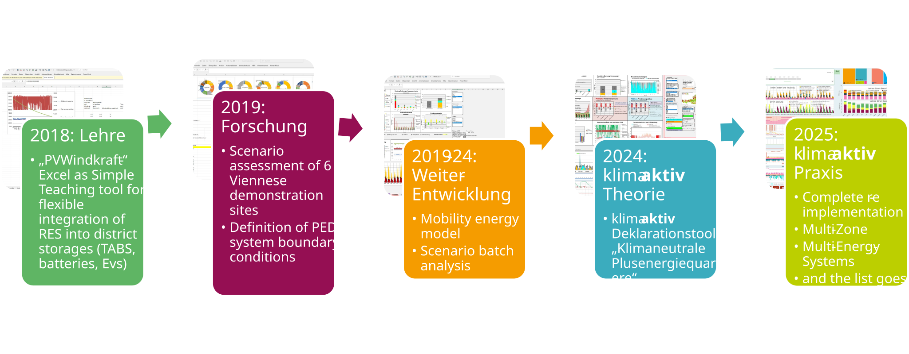

# Über diesen Bericht {.unnumbered #sec-about}
::: {.callout-note}
## Arbeitsfassung vom 14. Oktober 2026
:::

## Ziel des Hintergrundberichts

Dieser Bericht dokumentiert die von unserem Forschungsteam entwickelte Methodik des klimaaktiv Standards für Plus-Energie-Quartiere. Er führt die bereits in Schneider et al. publizierten Herleitungen und das Bewertungsmodell zu einer gemeinsamen Referenz für Planung, Verwaltung und Forschung zusammen [@schneider2023context; @schneider2025declaration; @schneider2026thesis].

Er ergänzt zwei weitere klimaaktiv-Publikationen: Die Broschüre *Plus-Energie-Quartiere* bietet einen Überblick über den Standard und seine Anwendungsmöglichkeiten. Das *Handbuch zum PEQ-Nachweistool* beschreibt die praktische Durchführung der Nachweisführung. 

Der vorliegende Hintergrundbericht konzentriert sich dagegen auf die Frage, **warum die Anforderungen in dieser Form definiert wurden und wie sie rechnerisch zustande kommen**.
Er verfolgt insbesondere vier Ziele:

1. Die Herleitung der quantitativen Anforderungen aus übergeordneten Energie- und Klimazielen nachvollziehbar darzustellen.
2. Die Systemgrenzen, Bilanzierungsverfahren und Kontextfaktoren des Standards zu erläutern.
3. Die Annahmen, Berechnungsverfahren und Grenzen des verwendeten Bewertungsmodells offenzulegen.
4. Die Grundlage für eine transparente Anwendung und dokumentierte Weiterentwicklung der Methodik zu schaffen.

### Zielgruppe
Der Bericht richtet sich insbesondere an Architekt:innen, Fachplaner:innen, Energieberater:innen, Projektentwickler:innen sowie Fachleute aus Verwaltung, Forschung und Qualitätssicherung, die sich mit der Bewertung klimaneutraler Gebäude, Quartiere und Städte beschäftigen.

## Entstehung und wissenschaftliche Grundlagen

Die Methodik wurde von der Forschungsgruppe *Climate-fit Buildings and Districts* der FH Technikum Wien im Rahmen von Forschungs- und Entwicklungsarbeiten zu klimaneutralen Plus-Energie-Quartieren erarbeitet.

Die Entwicklung der Bewertungsmethodik und des PEExcel-Nachweistools erfolgte über mehrere Forschungs- und Entwicklungsschritte. Ausgehend von frühen Energiemodellen wurde die Betrachtung schrittweise auf Mobilität, Lebenszyklusemissionen und die klimaaktiv-Nachweisführung erweitert.

{#fig-peq-entwicklung width="100%"}

Wesentliche wissenschaftliche Grundlagen bilden die Dissertation von Schneider (2026) sowie die zugehörigen Publikationen zur quantitativen Definition von Plus-Energie-Quartieren, zur nationalen Allokation von Energie- und Treibhausgasbudgets und zur integrierten Quartiersbewertung [@schneider2026thesis; @schneider2023context; @schneider2025declaration].

Der Bericht führt diese Arbeiten zusammen und dokumentiert ihre Operationalisierung im österreichischen klimaaktiv Standard.

## Methodenstand und Versionierung

Die dargestellten Anforderungen beruhen auf einem definierten Methodenstand und den zugrunde liegenden nationalen Energie- und Klimaszenarien.

Da sich Szenarien, wissenschaftliche Erkenntnisse und Rahmenbedingungen weiterentwickeln, ist eine regelmäßige Überprüfung und Fortschreibung der Methodik vorgesehen. Änderungen an Zielwerten, Kontextfaktoren und Bilanzierungsregeln sollen nachvollziehbar dokumentiert werden.

Zwischen dem **Methodenstand des Standards** und der **Softwareversion des PEQ-Nachweistools (PEExcel)** wird ausdrücklich unterschieden. Weiterentwicklungen der Software bedeuten nicht zwangsläufig eine Änderung der Bewertungsmethodik.

## Autor:innen und Mitwirkende

Der Bericht wird von der Forschungsgruppe *Climate-fit Buildings and Districts* der FH Technikum Wien erarbeitet.

**Wissenschaftliche Bearbeitung:** Thomas Zelger, Simon Schneider

**Institution:** FH Technikum Wien

[Autor:innenliste, weitere Mitwirkende, Auftraggeber und institutionelle Angaben vor Veröffentlichung ergänzen.]

## Zitierempfehlung

Für die wissenschaftliche Bezugnahme auf die Methodik wird empfohlen, die jeweils einschlägigen Originalpublikationen zu zitieren.

Für Verweise auf die zusammenfassende Darstellung dieses Hintergrundberichts ist folgende Zitierweise vorgesehen:

Schneider, S. et al. (2026): *Klimaneutrale Plus-Energie-Quartiere. Wissenschaftliche Grundlagen des klimaaktiv Standards für Plus-Energie-Quartiere.* FH Technikum Wien, Wien.

## Quellen und Geltungsbereich

Dieser Bericht dokumentiert die von unserem Forschungsteam entwickelte Methodik des klimaaktiv Standards für Plus-Energie-Quartiere. Er führt die in Schneider (2026) und den zugehörigen Publikationen beschriebenen Grundlagen zu einer zusammenhängenden Methodendarstellung zusammen [@schneider2026thesis; @schneider2023context; @schneider2025declaration]. Die klimaaktiv-Broschüre ergänzt diese Darstellung um einen kompakten Überblick zur Anwendung [@klimaaktiv2026peq].

Die hier dokumentierte Anwendung bezieht sich auf Österreich. Eine Übertragung auf andere Länder erfordert eine eigene Prüfung der Szenarien, Allokationen und Bewertungsfaktoren.

Der Bericht erläutert die wissenschaftlichen Grundlagen des Standards, ersetzt jedoch weder die jeweils gültigen offiziellen Anforderungen noch das Handbuch zur Nachweisführung. Für konkrete Deklarationsvorhaben sind die freigegebenen Dokumente und der jeweils maßgebliche Methoden- und Toolstand heranzuziehen.

